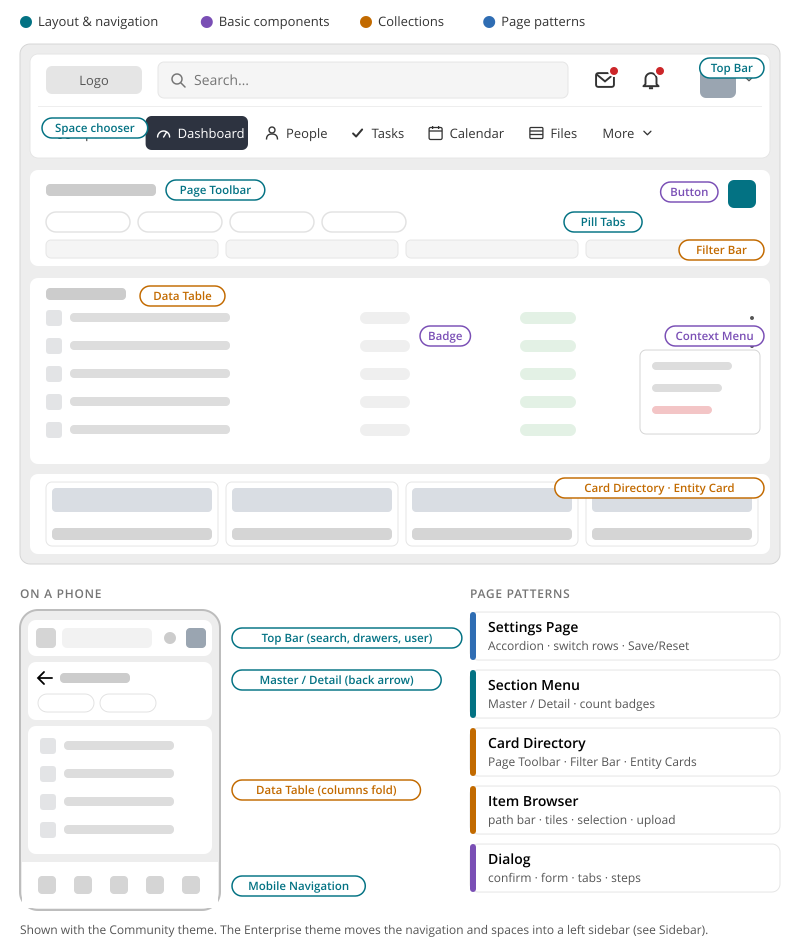

# HumHub UI Styleguide

This folder describes the UI components and mechanics of the upcoming HumHub design. It is the
shared reference from which core components are built, and which module developers rely on.

The visual reference is the designer's interactive prototype of the new design. The prototype's
CSS, icons and markup are **not** the implementation template. These pages describe what a
component looks like, how it behaves and how it maps to core. Each page has illustrations in
[`images/`](images/).

Since 1.20, parts of the design already exist in core as Vue components: `PageToolbar` (becomes
`PageHeader`), `FilterBar`, `ViewSwitch`, `EntityBrowser`, the item browser kit and others (see
[Vue.js Components](../develop/ui-js-vuejs-components.md)). For those, the *Implementation in core*
section of each page lists the gaps between the design and the current implementation.

## Themes

This styleguide describes the new design for the **Community theme**, the default theme in core
(`protected/humhub/themes/HumHub`). Every component page refers to it.

The designer's prototype is built on the **Enterprise theme** (module `enterprise-theme`). Most
of the design applies to both themes unchanged: page header, tabs, tables, forms, dialogs, cards,
feedback and the mobile navigation. The differences are in the page frame:

| | Community theme (core) | Enterprise theme |
|---|---|---|
| Main navigation | Horizontal, in the [Top Bar](top-bar.md) | Vertical, in the left [Sidebar](sidebar.md) |
| Spaces | Space chooser dropdown in the top bar | Space list in the sidebar, with filter |
| Space categories | — | Yes ("space types"), also as a directory filter |
| Phones | [Mobile Navigation](mobile-navigation.md) | [Mobile Navigation](mobile-navigation.md) |

Pages that only apply to the Enterprise theme say so in their header.

**Start here:** [Principles](principles.md). These are the rules every component follows: hide,
don't disable; one main action per header; what the colours mean; how things fold on mobile.

**Building a component:** [Styling with Bootstrap 5](bootstrap.md). The prototype is not built on
Bootstrap; core is. This page says how the design is translated: which Bootstrap component each
part builds on, how classes are named (`.page-header`, `.page-header-title`), and where values
come from (Sass variables, local CSS variables).

## Where things live

## Components by category

### Layout & navigation

How a page is framed and how people move between pages.

| Component | What it is | Status | Technology |
|---|---|---|---|
| [Page Header](page-header.md) | The card at the top of a page: title, actions, filters or tabs | in progress | Both |
| [Content Card](card.md) | The card below the page header that holds the content, with an optional header | in progress | Both |
| [Pill Tabs](tabs.md) | Switch between sibling pages or views | in progress | Both (PHP exists) |
| [Master / Detail & Section Menu](master-detail.md) | Side pane + main pane that folds on mobile; the administration menu | in review | Both (proposed) |
| [Top Bar](top-bar.md) | Search, drawers, user menu, space chooser and main navigation | in review | Both (proposed) |
| [Space & Profile Header](container-header.md) | Cover, picture, counters, relationship buttons, tabs | in review | PHP (proposed) |
| [Mobile Navigation](mobile-navigation.md) | Bottom bar, menu sheet and widget drawer on phones | in review | PHP (proposed) |

### Enterprise theme

Parts that only the Enterprise theme adds.

| Component | What it is | Status | Technology |
|---|---|---|---|
| [Sidebar](sidebar.md) | Main navigation and the user's spaces in categories, on the left | in review | PHP + Vue (exists in the theme) |

### Basic components

Small building blocks used everywhere.

| Component | What it is | Status | Technology |
|---|---|---|---|
| [Buttons](buttons.md) | Variants, icon buttons, full width, choice rows, header actions | in progress | Both |
| [Badges & Status](badges.md) | Chips, priority, tags, count badges, dots | in progress | Both |
| [Accordion](accordion.md) | Groups that open in place, with unsaved-changes tracking | in progress | Both (proposed) |
| [Dialog](dialog.md) | Confirm, form, tabbed and multi-step dialogs | in review | Both |
| [Context Menu](context-menu.md) | The ⋮ menu for one item or area | in review | Both |

### Forms

Entering and changing data.

| Component | What it is | Status | Technology |
|---|---|---|---|
| [Form Fields](form-fields.md) | Field anatomy, states, types, layout and validation | in review | Both |
| [Select & Pickers](select-pickers.md) | Choose from a list, or search people, spaces, topics | in progress | Both |
| [Date Picker](date-picker.md) | Dates, ranges and times | in review | Both |
| [Switch, Checkbox & Radio](choice-controls.md) | On/off settings, choices, radio cards, matrix | in review | Both |
| [File Upload](file-upload.md) | Dropzone, file rows with progress, image settings | in review | Both |

### Feedback

Telling people what happens.

| Component | What it is | Status | Technology |
|---|---|---|---|
| [Toast](toast.md) | Short message about the result of an action, grouped | in progress | Vue (exists) |
| [Tooltip](tooltip.md) | Names an icon control or shows cut-off text | in review | Both |
| [Hover Card](hover-card.md) | Preview of a person or space | in review | Both |
| [Loading, Empty & Error States](loading-empty-error.md) | Skeletons, empty messages with a first step, retry | in review | Both |

### Collections

Showing, filtering and acting on many items.

| Component | What it is | Status | Technology |
|---|---|---|---|
| [Filter Bar](filter-bar.md) | Search and filters that apply live | in progress | Vue (exists) |
| [Data Table](data-table.md) | Records to compare and act on, with bulk actions | in progress | Vue (exists) |
| [Entity Browser](entity-browser.md) | Browse people, spaces, modules as cards | in progress | Vue (exists) |
| [Entity Card](entity-card.md) | The card for a person, space or module | in progress | Vue (exists) |
| [Item Browser](item-browser.md) | Browse levels of items: folders and files | in progress | Vue (exists) |

### Page patterns

How components combine into a whole page.

| Pattern | What it is | Status | Technology |
|---|---|---|---|
| [Settings Page](settings-page.md) | Settings groups, controls with defaults, explicit Save/Reset | in review | Both (proposed) |

## Which one do I use?

| I want to… | Use |
|---|---|
| …switch between sibling pages of a section | [Pill Tabs](tabs.md) (primary) |
| …switch between sections of one dialog or card | [Pill Tabs](tabs.md) (secondary) |
| …show the same data differently (grid / list, board / list) | View switch (see [Item Browser](item-browser.md)) |
| …give an area with 5–12 sections a menu | [Section Menu](master-detail.md#section-menu) |
| …show records people compare and act on in bulk | [Data Table](data-table.md) |
| …let people browse and pick people, spaces or modules | [Entity Browser](entity-browser.md) |
| …let people browse levels (folders) | [Item Browser](item-browser.md) |
| …show a list next to the selected item | [Master / Detail](master-detail.md) |
| …ask for a decision or a short task | [Dialog](dialog.md) |
| …offer more actions for one item | [Context Menu](context-menu.md) |
| …structure a long settings page | [Settings Page](settings-page.md) with [Accordions](accordion.md) |
| …let people pick one of a short list | Select ([Select & Pickers](select-pickers.md)) |
| …let people find and pick records (people, spaces, topics) | Picker ([Select & Pickers](select-pickers.md)) |
| …offer a setting that is on or off | Switch ([Switch, Checkbox & Radio](choice-controls.md)) |
| …let people choose items or confirm something | Checkbox ([Switch, Checkbox & Radio](choice-controls.md)) |
| …report the result of an action | [Toast](toast.md) |
| …explain an icon button | [Tooltip](tooltip.md) |
| …show that there is nothing (yet) | Empty state ([Loading, Empty & Error](loading-empty-error.md)) |
| …mark a state or a fact | Chip ([Badges & Status](badges.md)) |
| …show that something waits | Count badge on the menu entry, dot on the page ([Badges & Status](badges.md)) |

## Not documented yet

These appear in the design but have no page yet. They follow when their implementation starts:

- **Stream:** wall entry, composer, comments, topic chips, embedded media
- **Module views:** tasks board, calendar, messages, notifications, marketplace dialogs

## Conventions

Technology is decided per component:

- **Vue:** a Vue component, for use inside Vue islands only.
- **PHP:** a PHP widget with server-rendered markup.
- **Both:** one design and one set of CSS classes, with a Vue component and a PHP widget that
  render identical markup.

Status values:

- **draft:** taken over from the prototype analysis, not discussed yet.
- **in review:** rewritten, open questions listed for discussion.
- **agreed:** ready for implementation.
- **in progress:** being built in core. The page's *Implementation in core* section says what
  exists and what is still open.

Every component page has the same sections:

- a header stating where the component was found in the design, what exists in core, and the
  technology
- illustrations, then anatomy, variants, behaviour, mobile and accessibility
- *Markup and styles* (the Bootstrap 5 base and the class names, see
  [Styling with Bootstrap 5](bootstrap.md)) where a component has its own markup
- *Implementation in core* (what exists, the gaps, an API sketch) and *Open questions*

New pages follow this structure.
