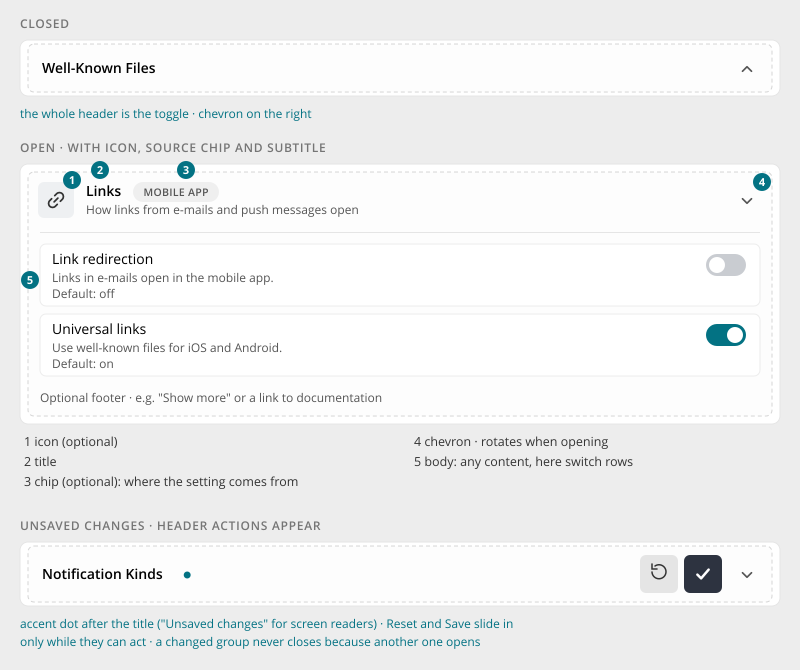
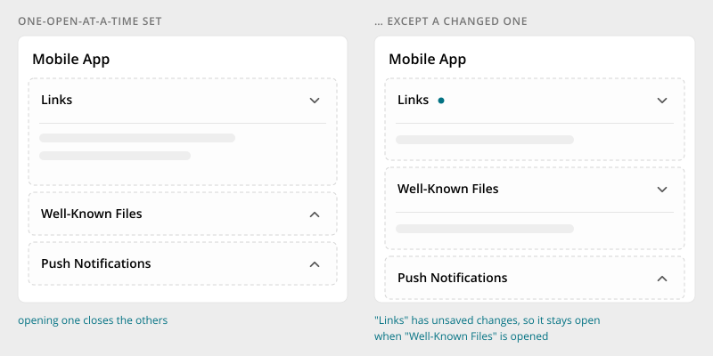

# Accordion

> Found in the design: Admin › Integrations (Mobile App), Admin › Communication (Notifications), Admin › Content, Files › Share dialog
> · Core: `ActiveForm::beginCollapsibleFields()` (older look)
> · Technology: **Both** (proposed). The PHP widget comes first, for server-rendered settings
> forms. The Vue component follows when an island needs it (e.g. notification settings).

A group that opens in place to reveal its content. It is mainly used to structure **settings
pages** into topics (Links, Well-Known Files, Notification Kinds, …). It is also used for
per-item details in dialogs, such as the people a file is shared with.

Don't use an accordion for:

- **Mutually exclusive views:** use [Pill Tabs](tabs.md).
- **Content that should always be visible:** use a plain card section.
- **A single optional block:** a switch that reveals its fields is clearer.



## Anatomy

| # | Part | Notes |
|---|---|---|
| 1 | Icon | Optional. 36px box with the topic's icon. |
| 2 | Title | Required. One line with ellipsis. |
| 3 | Chip | Optional. States where the content comes from: a module ("CALENDAR"), "CORE" or a source. |
| — | Subtitle | Optional. A short explanation under the title, which can be updated by script. |
| 4 | Chevron | On the right. It rotates when the group opens. |
| 5 | Body | Any content: switch rows, fields, tables. A thin divider separates it from the header. |
| — | Footer | Optional, e.g. "Show more" or a link to the documentation. |

The group is a softly bordered block (dashed light border, near-white fill) inside its card.
It is not a card of its own.

## Variants

| Variant | Use |
|---|---|
| **Default** | Settings group with title, optional icon, chip and subtitle |
| **Compact** | Dense lists (e.g. a dialog's shared-with list): smaller header, the icon without its box |
| **Set (one open at a time)** | Several groups where opening one closes the others. This is the default on settings pages. |
| **Independent** | Groups open and close independently, e.g. when users compare groups |

## Behaviour

- **The whole header is the toggle.** The chevron is the actual button, but its hit area covers the
  full header. Links and buttons inside the header (header actions) stay clickable on their own.
- **Open and close** animate the height (about 210ms) with a fade. A closed body is removed from
  the tab order.
- **Initially open:** the page decides. Settings pages open the first group, or the group that
  contains a validation error.



### Unsaved changes

This mechanic is new.

- When a field inside a group changes, the group shows an **accent dot** after its title. Screen
  readers announce "Unsaved changes", and the dot has a tooltip with the same text.
- **Header actions appear** in the header, sliding in: **Reset** (↺) restores the saved values,
  and **Save** (✓) saves only this group. They are hidden again once there is nothing to reset or
  save ("hide, don't disable").
- **A changed group never closes automatically.** In a one-open-at-a-time set, opening another
  group leaves the changed one open. Only its own chevron closes it.
- When the user leaves the page with unsaved changes, the browser's leave warning appears (as with
  `ActiveForm::$acknowledge` today).

## Mobile

- There are no breakpoints of its own. Title and subtitle truncate, and the body takes the full
  width.
- Content wider than the group (e.g. a settings matrix with Web / Email / Mobile columns) scrolls
  inside the body, not the page.
- Header actions keep their size. Title and chip get the remaining space.

## Accessibility

- The chevron is a `<button>` with `aria-expanded` and `aria-controls`, labelled by the title.
- The body is a `role="region"` labelled by the title.
- The changed state is announced as text, not shown by colour alone.
- Keyboard: Tab reaches the chevron, and Enter / Space toggle it. Header actions are their own
  tab stops.
- Reduced motion: no height animation; the group opens instantly.

## Implementation in core

**Today:** `humhub\widgets\form\ActiveForm::beginCollapsibleFields($title, $isClosed)` /
`endCollapsibleFields()` render a Bootstrap collapse with a +/− label. It is used in the admin
settings (`setting/basic.php`, `design.php`, `mobile_app.php`). `ActiveForm::$acknowledge` warns
on leaving with unsaved data. There is no group-level changed state and no group-level save.

**Proposal:**

1. **`Accordion` PHP widget** with the new markup. Settings forms use it directly.
2. Re-implement `beginCollapsibleFields()` on top of it, so existing callers get the new look
   without code changes.
3. A small JS module `humhub.ui.accordion`, bound by delegation, for opening and closing, sets and
   changed tracking.
4. A Vue `Accordion` component with the same markup, once a Vue island needs it.

```php
<?php Accordion::begin([
    'title' => Yii::t('AdminModule.settings', 'Links'),
    'icon' => 'link',
    'chip' => Yii::t('AdminModule.settings', 'Mobile App'),
    'subtitle' => Yii::t('AdminModule.settings', 'How links from e-mails and push messages open'),
    'open' => true,
    'set' => 'mobile-app',          // one open at a time within this set
    'trackChanges' => true,         // dot + Reset/Save header actions for the fields inside
]) ?>
    <?= $form->field($model, 'linkRedirection')->checkbox(['data-ui-switch' => true]) ?>
<?php Accordion::end() ?>

// existing callers keep working
<?= $form->beginCollapsibleFields(Yii::t('AdminModule.settings', 'Advanced'), true) ?>
```

## Open questions

1. **Chevron direction:** the prototype points it **up when closed** and down when open. That is
   the reverse of the usual convention (down = can open). The recommendation is the usual
   direction.
2. **Save per group or per page?** The prototype has both a group-level Save in the header and a
   page-level Save for the settings card. Which one is the rule, and can they coexist on one page?
3. **Changed tracking:** should it be a generic form feature (any form section, not only
   accordions), reusing `acknowledge`?
4. **Remember open groups** per user, or always start with the first group open?
