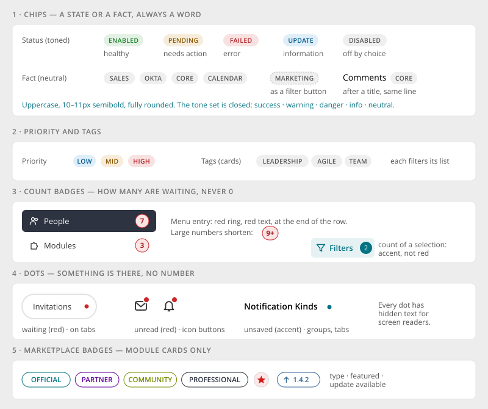
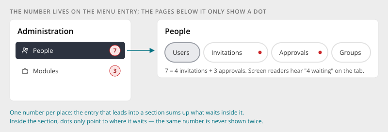

# Badges & Status

> Found in the design: Admin › People (status, group and source chips; menu counts; tab dots),
> Admin › Communication (CORE / CALENDAR chips), Admin › Modules, Tasks (priority), top bar
> (unread dots), directory cards (tags), Marketplace (module badges)
> · Core: `humhub\widgets\bootstrap\Badge`; card tags, filter count and marketplace badges in Vue
> · Technology: **Both**. The same small markers are needed in PHP views and in Vue islands.

Small, non-interactive markers that state something about an item. There are five families,
each with **one job**. Choosing the family by its job, not by its look, keeps colours
meaningful across 100 pages.



## Families

| Family | Job | Look | Examples |
|---|---|---|---|
| **1 Chip** | A **state** or a **fact** about the item, always as a word | Uppercase, small, semibold, fully rounded. Toned for states, neutral for facts. | ENABLED, PENDING, FAILED · SALES, OKTA, CORE |
| **2 Priority / Tag** | A rank (priority), or a keyword that groups items (tag) | Like chips. Priority uses three tones, tags are always neutral. | LOW, MID, HIGH · LEADERSHIP, TEAM |
| **3 Count badge** | **How many** items are waiting for action | Red ring with red number on a light red fill, fully rounded, at least 22px | People ⑦, Modules ③, 9+ |
| **4 Dot** | **That** something is there, without a number | 6–8px circle. Red = waiting / unread, accent = unsaved. | Invitations •, 🔔•, Notification Kinds • |
| **5 Marketplace badge** | A module's type, featured state or available update | Outlined pill in the type's brand colour, star, ↑ version | OFFICIAL, PARTNER, ★, ↑ 1.4.2 |

## Rules

### Chip tones are a closed set

| Tone | Means | Examples |
|---|---|---|
| **success** | healthy, active | Enabled, Active, Connected |
| **warning** | needs attention or action | Pending, Token missing, Expires soon |
| **danger** | an error or a failure | Failed, Rejected, Error |
| **info** | neutral information worth noticing | Update available, Beta |
| **neutral** | a fact, or a state that was **chosen** | Disabled, Archived, Inactive, SALES, CORE |

- **"Off" is not an error.** A disabled user or an archived space is a deliberate choice, so it
  gets the neutral tone, not danger.
- No other colours. A module that needs a new meaning maps it to one of these five.
- Chips are real text. The uppercase comes from CSS, so screen readers read normal case.

### A chip after a title

A chip that qualifies a title ("Comments CORE", "Links MOBILE APP") sits **on the title's line**,
directly after it. It wraps with the title and never gets a line of its own.

### Chips as filter buttons

In a [Data Table](data-table.md) or [Entity Browser](entity-browser.md), a category chip or tag can
be a button that filters the list by its value. It then gets a hover edge, a pointer cursor and the
tooltip "Filter by Marketing". Elsewhere chips are not interactive.

### Count badges: one number per place



- The **menu entry** that leads into a section shows the **sum** of what waits inside it
  (People ⑦ = 4 invitations + 3 approvals).
- **Inside** the section, the pages only show a **dot**. The same number is never shown twice.
- **Never 0:** without anything waiting, the badge is not rendered.
- Large numbers shorten to "9+" (or "99+" where there is room).
- A count of a **selection** (e.g. the filter toggle's "Filters 2") is not a waiting count. It
  uses the accent colour, not red.

### Dots

| Dot | Colour | Where |
|---|---|---|
| Waiting | red | Tabs and pages that contain something to handle |
| Unread | red, with a white ring | Icon buttons in the top bar (messages, notifications) |
| Unsaved | accent | Accordion groups, role tabs, any section with unsaved changes |

Every dot carries visually hidden text ("4 waiting", "unread messages", "unsaved changes").
Colour is never the only signal.

## Mobile

- No breakpoints. Chips truncate with an ellipsis inside narrow table columns.
- With larger text settings, filter chips grow to at least 24px height, so they stay easy to tap.

## Accessibility

- Chips and tags: plain text. As filter buttons: `<button>` with "Filter by …".
- Count badges: the number plus hidden context ("7 waiting"), or included in the link's
  accessible name ("People, 7 waiting").
- Dots: hidden text, as above. Dots that appear later (new unread) fade and scale in. Reduced
  motion shows them at once.
- Contrast: toned chips use a strong text colour on a light fill of the same tone.

## Markup and styles

All families are Bootstrap's **`.badge`**. A plain `.badge` is **neutral**; a tone is one
modifier `.badge-<tone>`, generated in a loop over `$badge-tones` from the theme's subtle colours,
so `accent` and custom brand colours work. The look never depends on utilities such as
`.text-bg-*`. Class names and SCSS follow [Styling with Bootstrap 5](bootstrap.md).

| Family | Classes | Notes |
|---|---|---|
| Status chip, fact chip | `.badge` (neutral) or `.badge.badge-<tone>` (`accent`, `success`, `info`, `warning`, `danger`) | Subtle fill and text from `--bs-<colour>-bg-subtle` / `--bs-<colour>-text-emphasis`; neutral from `--bs-secondary-bg` / `--bs-secondary-color` |
| Priority | `.badge.badge-<tone>` | low → info, mid → warning, high → danger |
| Tag | `.badge` (neutral) | Clickable tags are `<a>` or `<button>`: an edge in their colour on hover, the focus ring on focus |
| Count | `.badge.badge-count` (+ tone, default danger) | Pill (`rounded-pill` look built in), never rendered for 0 |
| Dot | `.badge-dot.badge-dot-waiting` (red) / `.badge-dot-unsaved` (accent) | Empty element with visually hidden text inside |

```html
<span class="badge badge-success">Enabled</span>
<span class="badge">Sales</span>
<span class="badge badge-count">7<span class="visually-hidden"> waiting</span></span>
<span class="badge-dot badge-dot-waiting"><span class="visually-hidden">3 waiting</span></span>
```

- **File:** `_badge.scss`, behind `$prev-badge`. Implemented so far: the dots (`.badge-dot`, red;
  `.badge-dot-unsaved`, accent; `$badge-dot-size`; first user: the unsaved groups of
  `ActiveForm::beginCollapsibleFields()`), the neutral plain `.badge`
  (`$badge-color` and the background), the tones `.badge-<tone>` for the colours in
  `$badge-tones` (`accent`, `success`, `info`, `warning`, `danger`) and clickable badges. There is
  no `.badge-light` / `-dark` / `-primary` / `-secondary`. A badge with only a background
  utility (`badge bg-success`) gets the theme's contrast colour as text. Users so far: the channel
  badges of the notification settings (`badge-accent` on, plain off), the tags and the stat pill
  of the entity cards, the space tags in the space chooser.
- **Sass variables:** Bootstrap's `$badge-font-size`, `$badge-font-weight`, `$badge-padding-x/y`,
  `$badge-border-radius` (HumHub's 2px stays until the open question is decided); plus
  `$badge-count-min-width`, `$badge-dot-size`.

## Implementation in core

**Today:** `humhub\widgets\bootstrap\Badge` (`Badge::danger('…')->icon('…')`, Bootstrap 5
colours) is used for four different jobs with the same look:

| Today | Job | Becomes |
|---|---|---|
| `AdminMenu`, `UserMenu`, `MemberMenu`, marketplace `Events`: `Badge::danger($count)` / `Badge::light($count)` in menu labels | Waiting count | **Count badge** on the menu entry, **dot** on tabs (see [Pill Tabs](tabs.md)) |
| `oauth/views/admin/clients.php`: `Badge::success('Active')` / `Badge::light('Inactive')` | Status in a list | **Status chip** (success / neutral) |
| `ContentActiveRecord` labels: `Badge::danger('Pinned')`, `Badge::warning('Archived')`, `Badge::info('Public')`, `Badge::light($contentName)` | Facts about content | **Chips**: Pinned and Public are neutral facts with icon, Archived is neutral (a chosen state). See Open questions. |
| `content\widgets\StateBadge`: `Badge::danger('Draft')`, `Badge::warning('Scheduled for …')`, `Badge::danger('Deleted')` | Content state | **Status chips**: Draft and Scheduled → warning, Deleted → danger |
| `admin/views/group/index.php`: `Badge::light('Default')`, `Badge::light('Protected')` | Fact | **Neutral chip** |
| `space/vue/components/SpaceChooserItem.vue`: plain `.badge` (done) | Tag | **Tag** |
| `topic\widgets\TopicBadge` | Topic | Stays a topic chip (own spec for the stream) |

In Vue the card tags (`.entity-card-tag`) and the stat pill are badges now; the filter count
(`.filter-bar-count`) and the marketplace badges (`.module-card-badge-*`) move onto
`.badge-count` and `.badge-<tone>`.

**Proposal:**

- One set of CSS classes for chips, counts and dots in the core SCSS, used by PHP and Vue alike
  (see [Markup and styles](#markup-and-styles)).
- **PHP:** keep `Badge` for backwards compatibility. Add purpose-named factories that render the
  new markup:

```php
Chip::status(Yii::t('UserModule.base', 'Enabled'))->success();   // ->warning() ->danger() ->info(); no tone = neutral
Chip::fact('Calendar');                                          // neutral
Chip::priority(Task::PRIORITY_HIGH);                             // low|mid|high → info|warning|danger
CountBadge::widget(['count' => 7, 'label' => Yii::t('base', '{n} waiting')]);  // renders nothing for 0
Dot::waiting(Yii::t('base', '{n} waiting', ['n' => 4]));
Dot::unsaved();
```

- **Menus:** `MenuLink` gets a `badge` (count) and an `indicator` (dot) instead of badge HTML
  concatenated into the label. See the open question in [Pill Tabs](tabs.md).
- **Vue:** small `Chip`, `CountBadge` and `Dot` components with the same classes. The entity card
  tags and the filter count move onto them.

## Open questions

1. **Content labels on wall entries:** Pinned, Archived, Public, content type and Draft are badges
   today. Do they become chips, icons only, or something else in the new stream design?
2. **"9+" or "99+":** where is the cutoff?
3. **Priority "none":** should tasks without a priority show nothing, or a neutral chip?
4. **Marketplace badges:** for now on the tones (official accent, PRO warning, partner success,
   update info, featured star danger, others neutral). Keep it so, or turn types into neutral
   chips with a brand-coloured edge?
5. **`$badge-border-radius`:** HumHub sets 2px today, while the design's chips and counts are
   rounder. Change the global value (affects every `.badge`) or only the new modifiers?
