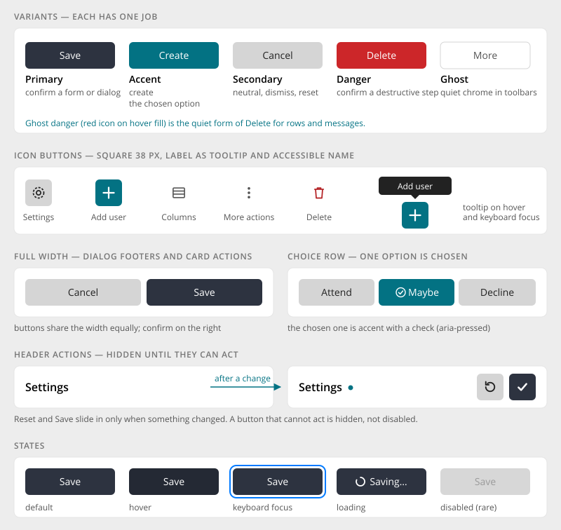

# Buttons

> Found in the design: every page; most visible in the administration (header icon buttons, table
> actions, dialog footers), space streams (Attend / Maybe / Decline) and the component demo page
> · Core: `humhub\widgets\bootstrap\Button` (Bootstrap 5 `.btn`); `.c-icon-button` in Vue (becomes `.btn-icon-only`)
> · Technology: **Both**

A button triggers an **action**. Use a link for navigation. The new design has few variants, and
each has **one job**. Most header actions are square **icon buttons** with a tooltip. Dialog
footers and card actions use **full-width** buttons.



## Variants

| Variant | Job | Examples |
|---|---|---|
| **Primary** (dark slate) | Confirm a form or dialog; the first step of a relationship | Save, Send, Join, Add friend |
| **Accent** (brand accent) | **Create** something new, or mark the **chosen** option | "+" Add user, Create space, Follow, Update; Maybe (chosen) |
| **Secondary** (grey) | Neutral: dismiss, reset, an established state | Cancel, Close, Reset, Member, Following |
| **Danger** (red) | Confirm a destructive step, mostly in a confirm dialog | Delete, Remove, Leave space |
| **Ghost** (no fill) | Quiet chrome: card header tools, row actions, pager, chevrons | Columns, ⋮, ‹ › |
| **Ghost danger** | The quiet form of delete, for rows and messages: red icon, red hover fill | Delete message |

**Rules of thumb:**

- **One accent button per header or card.** It is the main create action. Everything else is
  secondary, ghost, or goes into the ⋮ menu.
- **Primary confirms, accent creates.** In a dialog, the confirming button is primary ("Save"),
  and the accent colour is reserved for creating things and for the chosen option.
- **Danger only where it can't be taken back.** Destructive actions in menus are red *items*; the
  red *button* is the last confirmation in the dialog.

## Forms

| Form | Use | Notes |
|---|---|---|
| **Text** | Default | 38px high, optional leading icon |
| **Icon button** | Header actions, row actions | Square 38px. The label is the accessible name **and** the tooltip, so it is never missing. |
| **Full width** | Dialog footers, card footers, button rows | Buttons share the width equally. Confirm sits on the right (Cancel · Save). |
| **Choice row** | Pick one of a few options in place (RSVP) | Options are secondary, and the chosen one turns accent with a check. It is a row of buttons with `aria-pressed`, not a separate segmented control. |
| **Reveal action** | Save / Reset in a card or accordion header | Hidden until it can act, then slides in (see below) |

There is one size. Smaller controls (view switch, compact composer) keep their own height, but
there are no general `sm` / `lg` button sizes.

## Behaviour

- **Hide, don't disable.** A button that cannot act is **hidden**, not disabled: Save and Reset
  appear only after a change, and "Update all" appears only while updates exist. Disabled is
  reserved for short moments: while a request runs, or while the viewer's state is still loading.
- **Reveal actions appear in place.** Their slot grows, the button scales in, and a second action
  follows a moment later. They disappear the same way.
- **Loading.** A button that starts a request shows a spinner and a progress label ("Saving…"),
  and it can't be pressed again until the answer arrives. The design doesn't specify this state
  yet; this is a proposal based on `Button::loader()`.
- **Confirm.** Destructive actions open a confirm dialog with Cancel (secondary) and the action
  (danger).

## Mobile

- Same sizes. Icon buttons keep their 38px square, which is enough as a touch target.
- Full-width rows share the width. Choice rows wrap when the labels don't fit; labels are never
  cut.

## Accessibility

- Icon buttons always have `aria-label`. The tooltip shows the same text on hover **and** on
  keyboard focus.
- Toggle and choice buttons use `aria-pressed`.
- Menu buttons (⋮) use `aria-haspopup="menu"` and `aria-expanded`.
- Focus ring: visible on keyboard focus only, and never clipped (drawn inside rows that clip).
- Text colour is computed against the fill, so custom brand colours keep their contrast.

## Markup and styles

Every button is a Bootstrap **`.btn`** with one variant class. The new forms are modifiers on top
of it. Class names and SCSS follow [Styling with Bootstrap 5](bootstrap.md).

| Design | Classes | Built with |
|---|---|---|
| Primary, Accent, Danger | `.btn.btn-primary`, `.btn-accent`, `.btn-danger` | Bootstrap's `button-variant()` loop over `$theme-colors` (`accent` is in the map, see `maps.scss`) |
| Secondary (grey) | `.btn.btn-secondary` | `button-variant()` with `$btn-secondary-bg`, `$btn-secondary-color` (see Open questions: `$secondary`) |
| Ghost | `.btn.btn-ghost` | Like Bootstrap's `.btn-link`: the class sets its `--bs-btn-*` variables (transparent, hover fill `var(--bs-secondary-bg)`) |
| Ghost danger | `.btn.btn-ghost.btn-ghost-danger` | Ghost with `--bs-btn-color` / `--bs-btn-hover-*` from `var(--bs-danger)` and `var(--bs-danger-bg-subtle)` |
| Icon button | `.btn.btn-<variant>.btn-icon-only` | Square: `width` = `height` = `$btn-icon-only-size`, no horizontal padding, icon size `$btn-icon-only-icon-size` |
| Full width | `.btn.w-100` in a `.d-flex.gap-2` row | Bootstrap utilities; buttons of a row share the width |
| Choice row | `.btn-check` + `label.btn.btn-secondary` per option | Bootstrap's radio toggle buttons; the checked option renders accent with a check |
| Reveal action | `.btn` inside `.btn-reveal` | Own wrapper for the slot that grows and the scale-in |

```html
<a class="btn btn-accent btn-icon-only" href="…" aria-label="Add user"><i class="ti ti-plus" aria-hidden="true"></i></a>
<button class="btn btn-ghost btn-ghost-danger btn-icon-only" type="button" aria-label="Delete"><i class="ti ti-trash" aria-hidden="true"></i></button>

<div class="d-flex gap-2" role="radiogroup" aria-label="Attend?">
    <input type="radio" class="btn-check" name="rsvp" id="rsvp-attend" autocomplete="off">
    <label class="btn btn-secondary w-100" for="rsvp-attend">Attend</label>
    …
</div>
```

- **File:** `_button.scss`, behind `$prev-button`, with the icon button and the ghost variants.
- **Size:** the icon button is a square of the button's own height, computed from its
  `--bs-btn-*` variables, so it lines up with fields and works for `.btn-sm` too. A dropdown
  toggle keeps its padding for the caret.
- **Sass variables:** `$btn-icon-only-icon-size` (`$font-size-lg`, regular size only); the ghost
  colours are theme variables (`--hh-text-color-default`, `--bs-secondary-bg`). Bootstrap's
  `$btn-padding-*`, `$btn-border-radius` and `$btn-font-weight` stay the base.
- **HumHub's `.btn-icon-only`** (`Button::icon()` without text) is the square icon button; the
  Vue-only `.c-icon-button` of the 1.20 development line is gone.

## Implementation in core

**Today:** `humhub\widgets\bootstrap\Button` (Bootstrap 5, with `BootstrapVariationsTrait`).
Usage in core:

| Call | Uses | Becomes |
|---|---|---|
| `Button::primary()` | 45 | Primary |
| `Button::save()` | 33 | Primary ("Save") |
| `Button::light()` | 37 | **Secondary**: the grey neutral of the new design |
| `Button::danger()` | 25 | Danger |
| `Button::accent()` | 18 | Accent; review that each one creates something or marks a choice |
| `Button::secondary()` | 0 | Secondary |
| `Button::none()`, `back()` | few | Ghost / link |

`.btn-icon-only` and `.btn-ghost` are in `_button.scss`, used by `PageHeader`, `FilterBar`, the
item browser and the cards.

**Proposal:**

- **Variants:** add `ghost()` and `ghost()->danger()` (renders `.btn-ghost.btn-ghost-danger`).
  Make `light()` render as `.btn-secondary`, and keep it as an alias for backwards compatibility.
- **Icon buttons:** an `iconOnly($label)` modifier that renders `.btn-icon-only` and sets
  `aria-label` and the tooltip together. A label is mandatory, so icon buttons can't ship without
  an accessible name.
- **Full width:** a `full()` modifier (adds `.w-100`).
- **Reveal actions:** a `RevealAction` wrapper that renders the hidden slot and the reveal
  behaviour (shared with the [Accordion](accordion.md)).
- **Choice row:** a small `ChoiceButtons` widget on `.btn-check` (options, current value).
- **Page header actions** are rendered by `PageHeaderActions` from a menu, not by hand (see
  [Page Header](page-header.md#actions)).
- **Vue:** the same classes. A small `IconButton` component makes the label and tooltip mandatory
  there too; the header actions (`vue/header/HeaderActions.vue`) use it.

```php
Button::accent()->icon('plus')->iconOnly(Yii::t('AdminModule.user', 'Add user'))->link(['/admin/user/add']);
Button::ghost()->icon('trash')->danger()->iconOnly(Yii::t('base', 'Delete'))->confirm(...);
Button::light(Yii::t('base', 'Cancel'))->full();   // light() renders the grey secondary
Button::save()->full();
ChoiceButtons::widget(['options' => ['attend' => 'Attend', 'maybe' => 'Maybe', 'decline' => 'Decline'], 'value' => 'maybe']);
```

## Open questions

1. **`light()` vs. `secondary()`:** keep both (one as alias), or migrate modules to `secondary()`
   and deprecate `light()`?
2. **Sizes:** the design has one size. Are `sm()` / `lg()` (from `BootstrapVariationsTrait`)
   deprecated? Core doesn't use them, but modules might.
3. **Primary vs. accent:** confirm the rule "primary confirms, accent creates", so module authors
   choose consistently.
4. **Loading state:** spinner plus progress label as proposed, or only a spinner?
5. **`$secondary`:** HumHub's `$secondary` (#7a7a7a) is a grey *text* colour, while the design's
   secondary button is a light grey fill. Style `.btn-secondary` through button variables only, or
   change `$secondary` (which also changes `.text-secondary`, `.bg-secondary`, …)?
