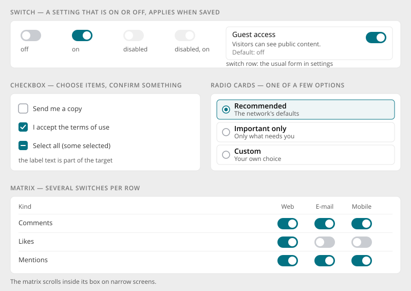

# Switch, Checkbox & Radio

> Found in the design: settings pages (switch rows), notification matrix, the Columns chooser,
> Reset to defaults (checkbox list), notification profiles (radio cards), table selection
> · Core: `ActiveField::checkbox()`, `radioList()` (PHP), `CheckboxField` (Vue); no switch yet
> (Bootstrap 5 supports `checkbox(['switch' => true])`)
> · Technology: **Both**

Controls for on/off and one-of-few choices. Each control has a clear job:

| Control | Job | Example |
|---|---|---|
| **Switch** | A **setting** that is on or off | Guest access, Link redirection |
| **Checkbox** | **Choose items** from a list, or **confirm** something | Reset these settings, Send me a copy, I accept the terms, row selection |
| **Radio cards** | Pick **one of a few** options that need a short explanation | Notification profile: Recommended / Important only / Custom |
| **Matrix** | Several switches per row, one per channel or target | Notification kinds × Web / E-mail / Mobile |

## Switch

- 40×22px, the knob slides from left (off) to right (on). On is accent-filled.
- **Switch row:** the usual form on settings pages. Title, description and "Default: …" on the
  left, the switch top right. See [Settings Page](settings-page.md).
- **A switch doesn't save by itself.** It marks its settings group as changed, and Save applies
  it. The exception is pages that save automatically (see
  [Settings Page](settings-page.md#explicit-save-or-autosave)).
- A switch whose "off" can't be undone (e.g. deleting data) asks for confirmation on save.
- **Off** must never look like on: the track stays light, and the knob and edge have enough
  contrast.

## Checkbox

- 20×20px, rounded 4px. Checked is accent-filled with a white check. **Mixed** (some selected) is
  used only for "select all" in tables.
- The label text is part of the target. Clicking "Send me a copy" toggles the box.
- Checkbox lists (e.g. Reset to defaults) start ticked when the dialog's purpose is to act on all
  of them.

## Radio cards

- For 2–4 options that each need a short explanation. Each card shows a title and a description,
  and the chosen card is accent-edged with a light fill.
- Plain radio buttons (no card) for short option labels in dense forms.
- If there are more options, or they need no explanation, use a [select](select-pickers.md).

## Matrix

- Rows are items (notification kinds), columns are targets (Web, E-mail, Mobile), and each cell
  holds a switch.
- Column headers stay readable. A row's name may carry a source chip ("CORE", "CALENDAR"), see
  [Badges & Status](badges.md).
- On narrow screens the matrix scrolls sideways **inside its own box**, never the page.

## Mobile

- The same sizes. Switch and checkbox targets are enlarged invisibly to at least 24px.
- Switch rows wrap their text, and the switch stays top right.

## Accessibility

- **Switch:** `role="switch"` with `aria-checked`, labelled by the row title, with the
  description linked via `aria-describedby`.
- **Checkbox and radio:** native inputs, so keyboard, forms and screen readers work without
  extra code. Radio cards are a `radiogroup` with arrow-key navigation.
- **Matrix:** each switch is labelled with row and column ("Comments, E-mail").
- Focus rings are drawn on the box or track, never clipped.
- Reduced motion: no knob or fill animation.

## Implementation in core

**Today:**

- **PHP:** `ActiveField::checkbox()` and `radioList()` render Bootstrap checks. Bootstrap 5's
  `checkbox(['switch' => true])` exists but is not used in core.
- **Vue:** `CheckboxField` (Bootstrap `form-check-input`). `NotificationSettings.vue` has its own
  radio cards (profiles) and channel checkboxes.
- **Tables:** the data table and the item browser bring their own row checkboxes.

**Proposal:**

- **Switch:** style Bootstrap's `form-switch` to the design. PHP uses
  `$form->field($model, 'x')->checkbox(['switch' => true])`, and Vue gets a `switch` prop on
  `CheckboxField` (or a `SwitchField`).
- **Switch row:** a `SettingsControl::switch()` (see [Settings Page](settings-page.md)) and a Vue
  `SwitchRow`.
- **Radio cards:** a `radioList(..., ['cards' => true])` option with descriptions, and a Vue
  `RadioCards`. `NotificationSettings.vue` moves onto it.
- **One checkbox style** for forms, tables and the item browser.

## Open questions

1. **Switch vs. checkbox in forms:** switches only for settings (proposal), checkboxes for
   choices and consent. Agree?
2. **Matrix:** a generic control, or keep it specific to notification settings?
