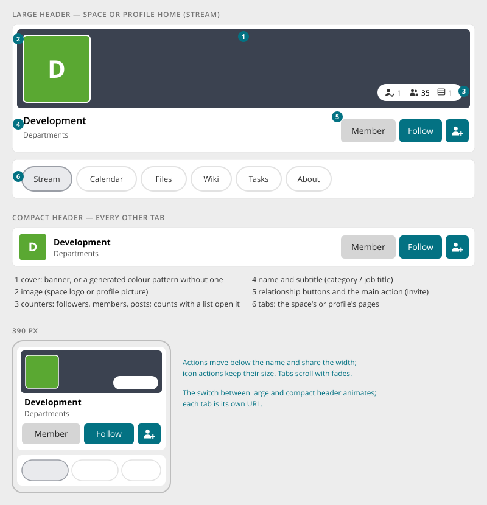

# Space & Profile Header

> Found in the design: every space page, every profile page
> · Core: `space\widgets\Header`, `HeaderControls`, `HeaderCounterSet`, `HeaderControlsMenu`;
> `user\widgets\ProfileHeader`, `ProfileHeaderControls`, `ProfileHeaderCounterSet`;
> `content\widgets\ContainerProfileHeader` (image upload and crop); `space\widgets\Menu`
> (`LeftNavigation`)
> · Technology: **PHP** (proposed). The relationship buttons are already Vue islands.

The top of every space and profile page. It shows **whose page this is** (cover, picture, name,
subtitle, counters) and the **relationship** to it (Member, Follow, Add friend, Invite). Below it,
the space's or profile's pages are [Pill Tabs](tabs.md).

## Anatomy

| # | Part | Notes |
|---|---|---|
| 1 | **Cover** | The banner image. Without one, a colour pattern generated from the space's or user's colour, always the same for that space. |
| 2 | **Picture** | Space logo or profile picture, on the cover. Without a logo, the space's initials in its colour. |
| 3 | **Counters** | Followers, members and posts (for profiles: friends, followers). Counts that have a list open it in a dialog. |
| 4 | **Name and subtitle** | Space name with its short description (Enterprise theme: its category), or the person's name with their job title |
| 5 | **Actions** | [Relationship buttons](entity-card.md#relationship-buttons) (Member, Follow, Add friend) plus the main action as an accent icon button (Invite). Further actions are in a ⋮ menu (space settings, leave, …). |
| 6 | **Tabs** | The space's or profile's pages (Stream, Calendar, Files, Wiki, Tasks, About). Modules add tabs. |

## Large and compact

- **Large header** on the space's or profile's **home** (usually the stream): with cover,
  picture and counters.
- **Compact header** on **every other tab**: a small picture, name, subtitle and actions, without
  cover. This gives modules like Calendar or Files more room.
- The switch between them animates the height. Each tab is **its own URL**.
- Pages like Calendar may use the full content width; the stream keeps its reading width.

## Editing

- Owners and admins can change cover and picture directly in the header. Hovering (or focus or a
  tap) shows **Upload / Edit / Delete**.
- Upload and Edit open the crop dialog: move and zoom the image under a fixed frame. Avatar
  output is square and the cover is wide.

## Mobile

- The cover keeps its proportions, and the picture stays on it. Counters stay on the cover.
- **Actions move below the name** and share the width. Icon actions keep their size.
- Tabs scroll horizontally with fades ([Pill Tabs](tabs.md)).

## Accessibility

- The name is the page's `h1`, in both large and compact form.
- Cover and picture are decorative, unless they are editable. Edit controls are labelled ("Change
  cover image").
- Counters that open a list are buttons with the full sentence ("35 members").
- Relationship buttons follow [Entity Card](entity-card.md#relationship-buttons).

## Markup and styles

The header is its own component; the parts inside it are Bootstrap: buttons, the ⋮ dropdown and
the tabs (`.nav.nav-pills`). Class names and SCSS follow [Styling with Bootstrap 5](bootstrap.md).

| Class | Element |
|---|---|
| `.container-header` | The card; `.container-header-compact` for all pages but the home |
| `.container-header-cover` | Banner image or generated pattern |
| `.container-header-image` | Space logo or profile picture |
| `.container-header-counters` | The counter pill on the cover; counters with a list are buttons |
| `.container-header-title`, `.container-header-subtitle` | Name and subtitle |
| `.container-header-actions` | Relationship buttons, accent `.btn-icon-only`, ⋮ `.dropdown` |
| `.container-header-nav` | Holds the primary `.nav.nav-pills` |

- **File:** `_container-header.scss` (new; replaces the header parts of `_space.scss` and
  `_profile.scss`), behind `$prev-container-header`.
- **Sass variables:** `$container-header-cover-height`, `$container-header-cover-height-compact`,
  `$container-header-image-size`, `$container-header-image-size-compact`; radius and shadow as
  for the [Page Header](page-header.md#markup-and-styles).

## Implementation in core

**Today:**

- **Header widgets:** `space\widgets\Header` and `user\widgets\ProfileHeader`, with controls
  (`HeaderControls`, `ProfileHeaderControls` as widget stacks), counters (`HeaderCounterSet`,
  `ProfileHeaderCounterSet`) and a controls menu (`HeaderControlsMenu`).
- **Image upload and crop:** `ContainerProfileHeader` (JS).
- **Relationship buttons:** already Vue islands (`MembershipButton`, `FollowButton`,
  `FriendshipButton`, `UserFollowButton`).
- **Navigation:** the space's pages are a **left menu** (`space\widgets\Menu` extends
  `LeftNavigation`), and the profile has the same.

**Changes:**

| Change | Note |
|---|---|
| Space and profile menus become tabs | `space\widgets\Menu` and the profile menu render as primary [Pill Tabs](tabs.md) below the header. Entries and events stay, so module tabs keep working. |
| Large / compact header | The header widget gets a compact mode for all pages but the home |
| Counters | `HeaderCounterSet` renders as the pill on the cover. Counters with a list become buttons opening the list dialog. |
| Actions | `HeaderControls` order: relationship buttons, then the main action (accent icon), then ⋮ |
| Generated cover | Optional fallback when no banner is set ([Entity Card](entity-card.md) uses the same) |

## Open questions

1. **Compact header on module pages:** always compact, or can a module ask for the large header?
2. **Generated cover:** colour pattern (design) or the current plain fallback?
3. **Profile tabs:** which profile pages become tabs (Stream, About, Friends, Spaces, …)?
4. **Left menu widgets:** some modules add widgets next to the space menu today. Where do they go
   with tabs (the aside column, or the mobile widget drawer)?
