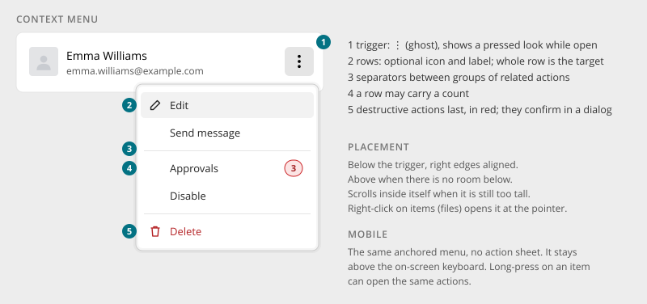

# Context Menu

> Found in the design: ⋮ on table rows, cards, wall entries, comments, messages, files; header
> overflow menus; right-click on files
> · Core: `humhub\widgets\menu\DropdownMenu` (PHP), `DropdownMenu.vue` (Vue, since 1.20)
> · Technology: **Both**

A short list of actions for **one item** or **one area**, opened from a ⋮ button (or by
right-clicking an item). It keeps rows, cards and headers calm: only the most important action
is visible, and everything else is in the menu.



## Anatomy

| # | Part | Notes |
|---|---|---|
| 1 | **Trigger** | ⋮ ghost [icon button](buttons.md) with the label "More actions for Emma Williams". It shows a pressed look while open. |
| 2 | **Rows** | Optional icon plus label. The whole row is the target. |
| 3 | **Separators** | Between groups of related actions (edit / state / delete) |
| 4 | **Count** | Optional count badge on a row (e.g. 3 approvals waiting) |
| 5 | **Destructive rows** | Last, in red. They always confirm in a [Dialog](dialog.md). |

## Rules

- **Order:** frequent actions first, then state changes (Disable, Archive), then destructive
  actions last.
- **Labels are verbs:** "Edit", "Move to…", "Delete". A trailing "…" means a dialog follows that
  asks for more input.
- **Only allowed actions appear.** An action the viewer can't take is left out, not shown
  disabled.
- **One item, one menu.** For actions on several selected items, the selection menu takes over
  (see [Data Table](data-table.md#selection-and-bulk-actions)).
- If an item has **exactly one** action, show it as an icon button instead of a menu with one row.

## Behaviour

- **Placement:** below the trigger with the right edges aligned. When there is no room below, it
  opens above. When it is still too tall, it scrolls inside itself.
- **At the pointer:** right-click, or the context-menu key, on an item that supports it (files,
  tiles) opens the same menu at the pointer.
- **Closing:** a click outside, Escape, choosing a row, scrolling the page, or a change of the
  window width.
- **Motion:** a short fade and rise (about 110ms). Reduced motion turns it off.
- **Extensible:** modules add rows to an item's menu without touching the item (menu entries,
  sort order).

## Mobile

- The same anchored menu, **no action sheet**. It stays above the on-screen keyboard.
- Rows are at least 40px high for touch.
- Long-press on an item can open the same actions (where long-press is supported).

## Accessibility

- Trigger: `aria-haspopup="menu"` and `aria-expanded`, with a label that includes the item's name.
- Menu: `role="menu"` with `menuitem` rows.
  - Arrow keys move between rows and Home/End jump.
  - Typing a letter jumps to the next row starting with it (proposal; Bootstrap doesn't do this).
  - Escape closes the menu and returns focus to the trigger.
- Destructive rows say so in text ("Delete"). Colour is not the only signal.
- A count on a row is part of its accessible name ("Approvals, 3 waiting").

## Markup and styles

Bootstrap's **`.dropdown-menu`** with its own JS (Popper placement, keyboard handling). The row
style is set through `$dropdown-*` variables. Class names and SCSS follow [Styling with Bootstrap 5](bootstrap.md).

```html
<div class="dropdown">
    <button class="btn btn-ghost btn-icon-only" type="button" data-bs-toggle="dropdown"
            aria-haspopup="menu" aria-expanded="false" aria-label="More actions for Emma Williams">
        <i class="ti ti-dots-vertical" aria-hidden="true"></i>
    </button>
    <ul class="dropdown-menu dropdown-menu-end">
        <li><a class="dropdown-item" href="…"><i class="dropdown-item-icon ti ti-pencil" aria-hidden="true"></i>Edit</a></li>
        <li><a class="dropdown-item" href="…"><i class="dropdown-item-icon ti ti-user-check" aria-hidden="true"></i>Approvals<span class="badge badge-count ms-auto">3</span></a></li>
        <li><hr class="dropdown-divider"></li>
        <li><button class="dropdown-item dropdown-item-danger" type="button"><i class="dropdown-item-icon ti ti-trash" aria-hidden="true"></i>Delete</button></li>
    </ul>
</div>
```

| Class | Element |
|---|---|
| `.dropdown-menu`, `.dropdown-item`, `.dropdown-divider`, `.dropdown-header` | Bootstrap |
| `.dropdown-item-icon` | The icon column (fixed width, so the labels line up). A menu's rows have an icon either all or none. |
| `.dropdown-item-danger` | A destructive row (red text and icon, red hover fill) |
| `.badge-count` | Count on a row ([Badges & Status](badges.md)) |

- The trigger has no `.dropdown-toggle`, so Bootstrap draws no caret. Its `.show` state is the
  pressed look.
- **Look:** at least 17rem wide, rows inset with rounded corners, a light accent fill on hover
  and while pressed (red for `.dropdown-item-danger`), a short colour transition.
- **One look everywhere:** the menu doesn't change with where it sits (panel, modal, tabs, page
  header). Only the top bar, Select2 and the rich text editor keep menus of their own.
- **Legacy markup:** a leading `<i>` in a row takes the icon column like `.dropdown-item-icon`,
  a plain `<a>` in `.dropdown-menu > li` gets the row style, and the ⋮ toggle of
  `.nav-pills.preferences` (wall entries, panels, comments) looks like the ghost icon button.
- **File:** `_dropdown.scss`, behind `$prev-dropdown`; the legacy ⋮ toggle in `_nav.scss`.
- **Sass variables:** Bootstrap's `$dropdown-padding-x/y`, `$dropdown-item-padding-x/y`,
  `$dropdown-border-radius`, `$dropdown-box-shadow`, `$dropdown-link-hover-bg`,
  `$dropdown-divider-margin-y`, `$dropdown-min-width`, `$dropdown-link-active-bg`; plus
  `$dropdown-item-icon-width`, `$dropdown-item-icon-gap`, `$dropdown-item-border-radius`,
  `$dropdown-item-transition`, `$preferences-toggle-size`, `$preferences-toggle-icon-size`.

## Implementation in core

**Today:**

- **Look (implemented):** one row style for all menus (icon column, neutral hover, red
  `.dropdown-item-danger`), no accent bar and no dark or context-specific variants. Destructive
  rows in core: content "Delete" (`DeleteLink`), comment "Delete", module "Uninstall", data
  table row actions with `destructive`.
- **PHP:** `humhub\widgets\menu\DropdownMenu` (Bootstrap dropdown with `MenuEntry` / `MenuLink`
  entries), used e.g. by `WallEntryControls` and `PanelMenu`. A destructive entry sets
  `'class' => 'dropdown-item-danger'` in its `htmlOptions`.
- **Vue:** `DropdownMenu.vue` with a free slot or data-driven entries (`menuId`, `entries`),
  extensible through `registerMenuEntry()` / `removeMenuEntry()`. It opens at the pointer via
  `open(event)` for right-click, and uses Bootstrap's dropdown JS for toggling and keyboard
  handling. An entry's `icon` renders as `.dropdown-item-icon`, a destructive one passes
  `htmlOptions: { class: 'dropdown-item-danger' }`.

**Gaps:**

| Gap | Proposal |
|---|---|
| No count on rows | `MenuLink` `badge` (shared with the [Badges & Status](badges.md) proposal) |
| No "destructive" flag | `MenuLink` `destructive` → `.dropdown-item-danger`, sorted last, confirm required (today the class is set by hand) |
| Placement | Flip above and scroll inside when there is no room. Check what Bootstrap/Popper already does, and fill the gaps. |
| Single action as icon button | A helper that renders an icon button instead of a menu when there is exactly one entry |

## Open questions

1. **Trigger icon:** ⋮ (vertical) everywhere, or ⋯ in some places? The design uses ⋮.
2. **Action sheets on phones:** stay with anchored menus (design), or switch to bottom sheets on
   touch devices?
3. **Disabled rows:** never shown (rule above), or shown with a reason in some cases (e.g. "Delete
   — only the owner can delete")?
