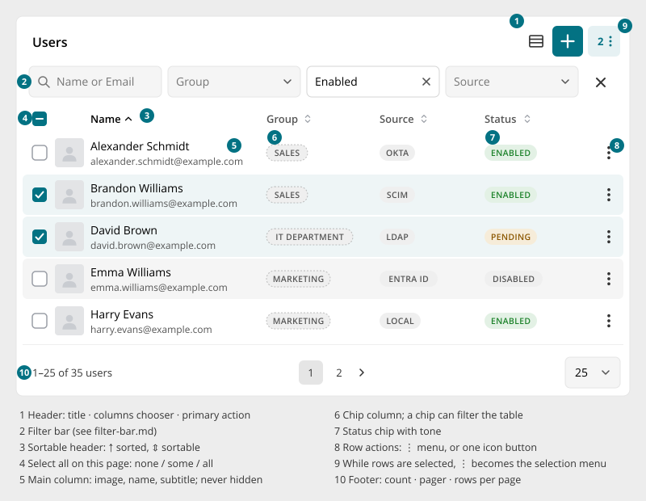
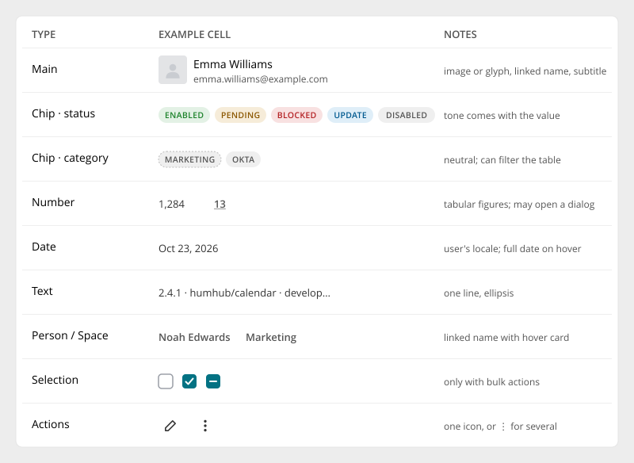
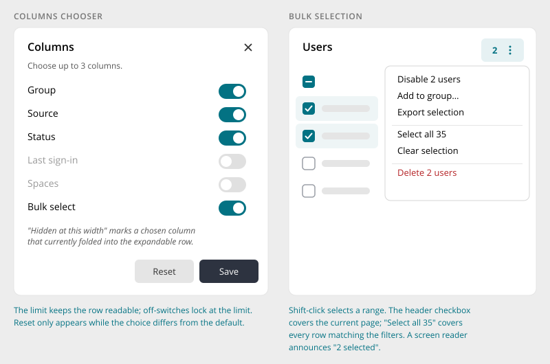
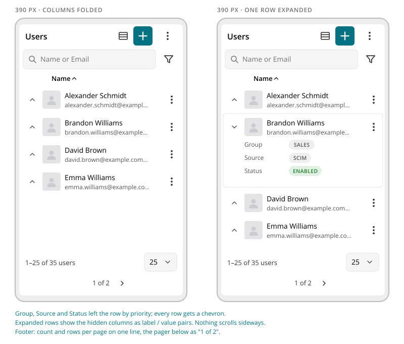

# Data Table

> Found in the design: Admin › People (Users), Admin › Spaces, Admin › Modules, component demo page (Users / Spaces / Invites)
> · Core: not yet available
> · Technology: **Vue only**. It is mounted from PHP through a `VueWidget`.

One component for every table of records: users, spaces, modules, invitations, groups, log
entries. Rows always have the same shape: a main column (image, name, subtitle), a few typed
columns and row actions. Search, filters, sorting and paging run on the server and update the
table in place without a page reload.

Use it for any paginated, sortable or filterable list of records that share the same fields.
Don't use it for:

- **Card directories** (People, Spaces, Marketplace): use `CardDirectory`.
- **Short lists without columns** (settings lists, a handful of entries): use plain list rows.
- **File and folder browsing:** use the item browser kit (`TileGrid`, `PathBar`).



## Anatomy

| # | Part | Notes |
|---|---|---|
| 1 | **Header** | Title and up to three icon buttons, in the order defined in [Page Toolbar](page-toolbar.md#header-actions): columns chooser, the one primary action (accent, e.g. "Add user"), overflow ⋮. When the table is the page's main content (admin), the host card can show the title, and the table then has no header of its own. |
| 2 | **Filter bar** | The core [Filter Bar](filter-bar.md), with search first. |
| 3 | **Column header** | Sticky. Sortable columns show ⇕, and the sorted column shows ↑ or ↓ in black. |
| 4 | **Select-all checkbox** | Only for tables with bulk actions. Covers the current page and has three states: none, some, all. |
| 5 | **Main column** | Image or glyph, name (link to the record) and a subtitle (e-mail, job title, description). Always visible. |
| 6–7 | **Typed columns** | See [Column types](#column-types). |
| 8 | **Row actions** | One icon button when a row has a single action, ⋮ when it has several, nothing when it has none. |
| 9 | **Selection menu** | While rows are selected, the overflow ⋮ becomes a button showing the count ("2 ⋮"). It opens the bulk actions. |
| 10 | **Footer** | Count ("1–25 of 35 users"), pager, rows per page. |

Rows have no dividers. A row is set apart by its hover fill, and selected rows get a light
accent fill. Nothing ever scrolls sideways (see [Mobile](#mobile)).

## Column types



| Type | Shows | Sortable | Filter | Typical mobile priority |
|---|---|---|---|---|
| **Main** | Image (avatar, space image) or glyph, linked name, subtitle | yes | search | always visible |
| **Chip · status** | Uppercase chip whose tone comes with the value: success (Enabled), warning (Pending), danger (Blocked), info (Update available), neutral (Disabled) | yes | select | 1 |
| **Chip · category** | Neutral chip (group, source, type). When its column has a select filter, the chip is a button that sets that filter, and pressing it again clears it. | yes | select | 2–3 |
| **Number** | Tabular figures. A number may open a dialog, e.g. a space's member count opens the member list. | yes | — | 1–3 |
| **Date** | Date in the user's locale and format setting, with the full date and time on hover | yes | date | 3 |
| **Text** | One line with ellipsis (version, publisher, branch) | yes | text | 3 |
| **Person / Space** | Linked name with hover card, no image (owner, inviter, space) | yes | picker | 2–3 |
| **Selection** | Checkbox. Only present when the table has bulk actions, and always first. | — | — | always |
| **Actions** | One icon button or ⋮ | — | — | always |

Each column declares a **priority** (1 = most important), which is used when space runs out. It
also declares whether it is **visible by default** or only on request via the columns chooser.

Not in the design yet: boolean (✓) columns, relative time ("3 days ago"), progress bars and
inline editing. See Open questions.

## Behaviour

### Sorting

- One column at a time. Clicking a sortable header cycles **ascending → descending → default
  order**.
- Empty values sort last in both directions.
- A sort change keeps the filters and returns to page 1.

### Search and filters

- Search and filters come from the [Filter Bar](filter-bar.md) and apply immediately. Any change
  returns to page 1, and the state is reflected in the URL.
- **Chips as filters:** a category chip whose column has a select filter sets that filter when
  pressed. The tooltip reads "Filter by Marketing".

### Columns chooser



- The ▦ button opens a dialog with one switch per optional column, plus "Bulk select" when the
  table has bulk actions.
- **Column limit:** "Choose up to N columns" keeps rows readable. At the limit, the switches that
  are off are locked.
- A chosen column that has currently folded away because of the width is marked "Hidden at this
  width".
- **Save** applies the choice. **Reset** appears only while the choice differs from the default.
- The choice is remembered per table and user.

### Selection and bulk actions

- The checkbox column appears only for tables with bulk actions.
- **Shift-click** selects a range.
- The header checkbox selects the current page. **"Select all 35"** in the selection menu selects
  every row that matches the current filters, across all pages.
- While rows are selected, the header's ⋮ becomes the **selection menu** with the count. It lists:
  - the bulk actions, with the number of rows each applies to ("Disable 2 users")
  - "Select all"
  - "Clear selection"
  - destructive actions last, in red
- A bulk action only applies to the selected rows that allow it.
- Rows that disappear because of a filter change are deselected.
- A screen reader announces the selection size.

### Row actions

- Each row only offers the actions allowed **for that row**. For example, "Disable" only on an
  enabled user, and no "Delete" on yourself.
- With exactly one action, the row shows it as an icon button. With several, it shows ⋮, and the
  menu groups related actions with separators and puts destructive actions last in red.
- **Action kinds:**
  - link: open the record or an edit page
  - modal: open a form in a dialog
  - request: POST, then update or remove the row in place
- **Destructive flow:**
  1. A confirm dialog opens.
  2. The row shows a red outline ring while the request runs.
  3. On success the row collapses and slides out.
  4. On failure the ring disappears, and the server's message is shown as a toast.
- **Long-running actions** (e.g. updating a module) show a travelling accent arc around the row
  until the request is done.
- **Hide, don't disable:** a primary action that can't act on any row (e.g. "Update all" with no
  updates) is hidden.

### Paging

- Rows per page is fixed to **25 / 50 / 100**. The viewer's choice is remembered.
- The pager shows at most 5 slots: `1 2 3 … 12`, `1 … 6 … 12` or `1 … 10 11 12`. Previous and
  next keep their place even when they can't act, so the numbers never jump. The pager is hidden
  when there is only one page.
- Count text: "1–25 of 35 users". When everything fits on one page it reads "8 users", and an
  empty table shows no count.
- A page change fades the rows (about 140ms) and scrolls the table's top into view.

### Empty, loading and error states

- **Loading:** skeleton rows (image square and text lines with a shimmer) are rendered on the
  server as the island's placeholder, so the page doesn't jump when the table mounts.
- **Empty:** one line: "No results found." When filters are set, it adds a "Clear filters" link.
- **Error:** a failed page load replaces the rows with a message and "Retry". A failed row action
  shows a toast and leaves the row unchanged.

### Motion

When search, filter or sort changes the rows, they change in place:

- leaving rows collapse and slide 8px to the side
- new rows drop in 4px
- rows that stay move to their new position

Reduced motion turns all of this into instant changes.

## Mobile



- **Columns fold by priority.** The table measures its **own width**, not the viewport. When the
  columns no longer fit, the column with the lowest priority (highest number) leaves first. The
  main column, the checkbox and the actions never leave. A column comes back only when there is
  clearly enough room, so columns don't flicker at the threshold.
- **Expandable rows.** As soon as a column has folded away, every row gets a chevron, and the
  whole row becomes the toggle. An expanded row shows the hidden columns as **label / value
  pairs**, rendered the same way as in the table (chips stay chips, links stay links).
- **Nothing scrolls sideways.**
- **Filter bar:** folds behind the filter button ([Filter Bar](filter-bar.md)).
- **Footer:** count and rows per page share the first line, and the pager moves to its own line
  below. On very narrow widths the page numbers are replaced by "1 of 2" between the arrows.
- **Header actions** stay visible.

## Accessibility

- Table semantics: `role="table"`, rows, column headers and cells. The main cell is a
  `rowheader`.
- Sortable header: a button inside the column header. `aria-sort` is set on the sorted column,
  and the label states the next action ("Name, sort descending").
- Visually hidden headers for the checkbox ("Select all on this page"), chevron ("Details") and
  actions ("Actions") columns.
- Chevron: `aria-expanded` and `aria-controls`, labelled "Details for Emma Williams". Collapsed
  details are removed from the tab order.
- Row controls include the record's name: "Select Emma Williams", "More actions for Emma
  Williams", "Disable Emma Williams".
- Pager: `<nav aria-label="Users pages">`, "Previous page", "Next page", "Page 2" with
  `aria-current="page"`.
- Live region for "2 selected" and for result counts after filtering.
- Focus rings are drawn inside the row so they are never clipped.

## Implementation in core

**Technology: Vue only.** A new core component `DataTable.vue` in `protected/humhub/vue/`. Pages
mount it through a `VueWidget` subclass, which also renders the skeleton placeholder. The
administration is the first consumer, starting with Users, Spaces and Modules.

**Reuses the existing core kit:**

| Need | Existing building block |
|---|---|
| Search and filters | `FilterBar`, `FilterSelect`, `FilterPicker`, user/space/topic filter types |
| Filter, sort and validation contract on the server | `humhub\components\listing\FilterableList` (`filters()`, `sorts()`), `FilterDefinition`, `ListContext` |
| Paged data | the API list envelope `{results, total, page, pageSize, pages}` (as used by `CardDirectory` and `UserList`) |
| Row and header menus | `DropdownMenu` (with `registerMenuEntry()`, so modules can add row actions) |
| Bulk actions | `SelectionMenu` |
| Confirm and form dialogs | `UiModal`, `HumHubForm` |
| Mounting from PHP | `VueWidget` |

**New pieces (proposal):**

- **Column definitions from the server.** Analogous to `FilterDefinition`, a `ColumnDefinition`
  (`key`, `type`, `label`, `priority`, `default` visible, `sortable`, `filter` key) is delivered as
  a prop. Modules can add columns to a list through the existing `FilterableList` events.
- **Row shape.** Each row in `results` carries:
  - `id` and `url`
  - a `cells` map keyed by column. Each cell holds what is shown (`text`, `subtitle`, `image`,
    `tone`, `url`) and, for chips, the value a filter uses.
  - an `actions` list: the ids of the actions allowed for this row, evaluated on the server.
- **Action definitions** are delivered once per table, not per row: `id`, `label`, `icon`,
  `kind` (link, modal, request), `url`, `bulk`, `destructive`, `confirm`. A request answer can
  update cells, remove the row or return a message, so the client stays generic.
- **Column sorting.** `FilterableList::sorts()` today offers named orders for a select. Columns
  need both directions per column. Proposal: `sort=name` / `sort=-name`, with sortable columns
  mapping to sort keys.
- **"Select all" across pages.** A bulk request sends either `ids` or `all: true` together with
  the current filter values. The server re-runs the list query instead of trusting a client id
  list.

**Sketch:**

```php
// PHP: the admin page mounts the island
echo UserTable::widget();   // extends VueWidget: props = endpoint, columns, filters, actions

class UserTable extends VueWidget
{
    protected string $component = 'DataTable';

    protected function getProps(): array
    {
        $list = new AdminUserList();   // FilterableList: filters(), sorts(), columns()
        return [
            'id' => 'admin-users',
            'label' => Yii::t('AdminModule.user', 'Users'),
            'noun' => ['one' => Yii::t('AdminModule.user', 'user'), 'other' => Yii::t('AdminModule.user', 'users')],
            'url' => Url::to(['/api/v2/admin/user']),
            'columns' => $list->columnDefinitions(),
            'filters' => $list->definitions(),
            'actions' => AdminUserActions::definitions(),
            'maxColumns' => 5,
        ];
    }
}
```

```html
<!-- Vue: inside another island -->
<DataTable id="space-members" :label="t('Members')" :url="membersUrl"
           :columns="columns" :filters="filters" :actions="actions" />
```

**Replaces:** `humhub\widgets\GridView` (with `ActionColumn`, `CheckboxColumn`, `ImageColumn`,
`DisplayNameColumn`, admin `UserActionColumn`, `Space*Column`) on the pages that move to the new
table. `GridView` stays for everything else until those pages are migrated.

## Open questions

1. **Column choice storage:** per user (setting, follows the user across devices) or per browser
   (as in the prototype)? The recommendation is per user.
2. **Rows per page:** fixed 25 / 50 / 100, or should the admin setting "Default pagination size"
   still apply?
3. **Number alignment:** the design aligns numbers to the start. The usual convention is to
   right-align them. Confirm.
4. **Missing column types:** do we need boolean, relative time or progress columns for the first
   tables? Relative time is used elsewhere in HumHub.
5. **Density:** the ▦ icon in the prototype is the columns chooser, not a density toggle. Do we
   want a compact density at all?
6. **Export:** "Download as CSV / Excel" goes into the ⋮ menu. Does export follow the current
   filters and the chosen columns?
7. **Row click:** should a click anywhere on a row open the record (on desktop), or only the name
   link? In the prototype only the name is a link, except on mobile, where the row toggles its
   details.
