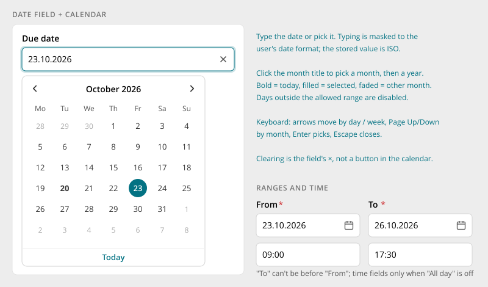

# Date Picker

> Found in the design: Tasks (due date, from / to), Calendar (event dates), filter bars (Last
> sign-in, From / To date), profile fields (birthday)
> · Core: PHP `humhub\widgets\form\DatePicker` (jQuery UI), `TimePicker`, `DurationPicker`; no
> Vue date field yet
> · Technology: **Both**

A field for a date, optionally with a time. People can **type** the date or **pick** it from a
calendar. It shares the [Form Fields](form-fields.md) anatomy and states.

## Behaviour

- **Typing:** the input is masked to the user's date format, so separators are inserted
  automatically. A complete, valid date applies at once and moves the calendar to it.
  - Impossible dates (31.02.) are rejected.
  - On leaving the field, unparseable text reverts to the last value.
  - The stored value is always ISO (`2026-10-23`), independent of the display format.
- **Calendar:** opens below the field, or above when there is no room. It is never clipped by
  dialogs.
  - **Days view** shows the month, with today in bold, the chosen day filled, and days of other
    months faded.
  - A click on the month title switches to months, and then to years, for fast jumps (e.g. a
    birthday).
  - One action at the bottom: **Today**. It can be hidden, e.g. for birthdays.
- **Clearing:** only through the field's × (shown once a date is set). There is no "Clear" button
  in the calendar.
- **Limits:** days outside the allowed range (minimum / maximum) are disabled, and typed values
  outside it are rejected with an error.
- **Week start and names** follow the user's language and locale.

## Ranges and time

- A **range** is two fields, "From" and "To". "To" can't be before "From". When "From" moves past
  "To", "To" follows.
- **Time** is its own field next to the date, shown only when needed (e.g. when "All day" is off).
- **Durations** ("45 min", "2 h") use a duration field, not two times.

## Mobile

- The same calendar below or above the field, kept inside the visible area above the keyboard.
- The calendar is at least 280px wide and never wider than the screen.
- Typing stays possible. Use `inputmode="numeric"` so the number keypad appears.

## Accessibility

- The input is a combobox (`aria-haspopup="dialog"`, `aria-expanded`) labelled by the field's
  label. The calendar is a dialog labelled by the field, with a `grid` of days.
- **Keyboard** (calendar open):
  - ←/→ move by day and ↑/↓ by week
  - Page Up / Page Down move by month
  - Enter picks the day, Escape closes the calendar, and Tab leaves the field
- Navigation buttons are labelled ("Previous month", "Next month"), and the month title is
  announced when it changes.
- The × is a button labelled "Clear due date".

## Markup and styles

The field is a Bootstrap **`.form-control`** (in an `.input-group` with the calendar button); the
calendar opens in a **`.dropdown-menu`**. Class names and SCSS follow [Styling with Bootstrap 5](bootstrap.md).

| Class | Element |
|---|---|
| `.input-group` > `.form-control` + `.btn.btn-ghost.btn-icon-only` | The field and its calendar button |
| `.dropdown-menu.datepicker` | The popup |
| `.datepicker-header` | Month and year, ‹ › as `.btn-ghost.btn-icon-only` |
| `.datepicker-grid`, `.datepicker-day` | The days; `.active` (chosen), `.is-today`, `.is-in-range`, `.disabled` |
| `.datepicker-time` | The time part (`.form-select` or `.form-control`) |

- On phones the calendar opens in an `.offcanvas.offcanvas-bottom` instead of the dropdown.
- **File:** `_datepicker.scss` (today the jQuery UI styles), rewritten for the new markup, behind
  `$prev-datepicker`.
- **Sass variables:** `$datepicker-day-size`, `$datepicker-gap`; colours from `$dropdown-*`
  and the accent.

## Implementation in core

**Today:**

- **PHP:** `humhub\widgets\form\DatePicker` extends `yii\jui\DatePicker` (jQuery UI, with
  HumHub patches for locale whitespace). There are also `TimePicker` and `DurationPicker`. The look
  is jQuery UI's.
- **Vue:** no date field. Filter bars have no date type ([Filter Bar](filter-bar.md)).

**Proposal:**

- A new **date field** used by both: a Vue component (`DateField`, part of the form suite with the
  `HumHubForm` error contract), mounted from PHP through a `VueWidget` behind the existing
  `DatePicker` API. Existing `$form->field($model, 'due')->widget(DatePicker::class)` calls keep
  working.
- It also adds the **`date` filter type** for the [Filter Bar](filter-bar.md).
- `TimePicker` and `DurationPicker` follow the same pattern.
- jQuery UI's date picker can be removed once all callers are moved.

## Open questions

1. **Own component or library:** build the calendar in core (the design is simple and fully
   specified), or wrap an accessible library?
2. **Ranges:** two fields (as designed) or one range field with two months?
3. **Time input:** typed `HH:MM` with a mask (proposal), or a list of times in 15-minute steps?
