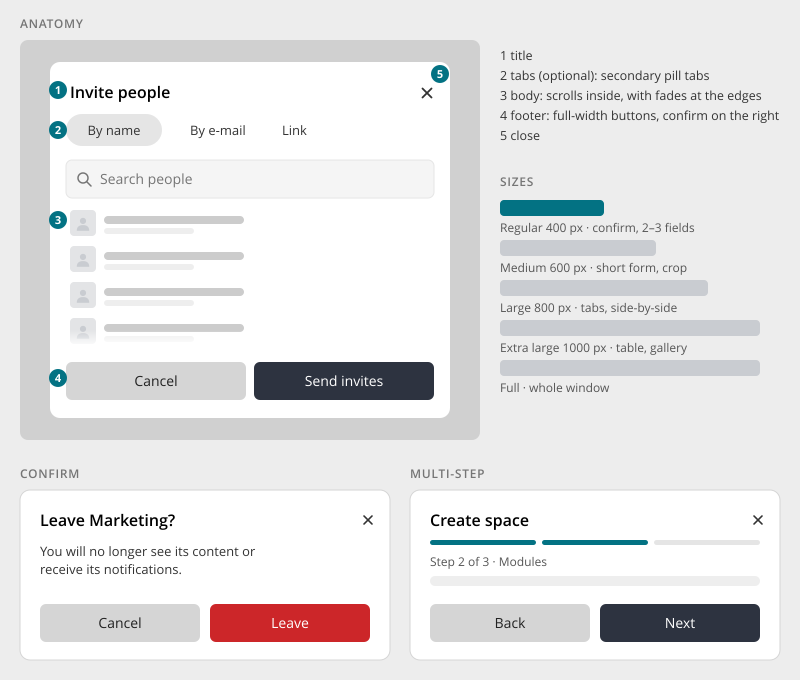

# Dialog

> Found in the design: confirmations everywhere (leave space, delete, cancel request), Invite
> people, Create space, Create task, Welcome wizard, Columns chooser, Reset to defaults, image crop
> · Core: `humhub\widgets\modal\Modal` (PHP, Bootstrap 5), `UiModal.vue` (Vue, since 1.20)
> · Technology: **Both**

A dialog asks for a **focused decision or a short task** without leaving the page: confirm,
fill in a few fields, pick something. It sits above a dimmed page, and only one dialog is open at
a time.

Don't use a dialog for:

- **Long or frequently used forms:** use a page (e.g. a [Settings Page](settings-page.md)).
- **Status messages:** use a toast.
- **A list of actions:** use the [Context Menu](context-menu.md).

## Anatomy

| # | Part | Notes |
|---|---|---|
| 1 | **Title** | Says what the dialog is for. For confirmations it is the question ("Leave Marketing?"). |
| 2 | **Tabs** | Optional. Secondary [Pill Tabs](tabs.md) for sections of one task ("By name / By e-mail / Link"). The height changes smoothly between tabs. |
| 3 | **Body** | Scrolls inside the dialog, with fades at the top and bottom edges while there is more. |
| 4 | **Footer** | Full-width [Buttons](buttons.md): dismiss on the left (secondary), confirm on the right (primary, or danger for destructive steps). |
| 5 | **Close** | × in the header. It is a real button with the label "Close". |

## Sizes

| Size | Width | Use |
|---|---|---|
| **Regular** | 400px | Confirmations, 2–3 fields. This is the default. |
| **Medium** | 600px | Short forms, image crop |
| **Large** | 800px | Forms with tabs or fields side by side |
| **Extra large** | 1000px | A table, a gallery, a comparison |
| **Full** | whole window | Media preview, editors |

Widths never exceed the window. On phones, every dialog takes the full width minus a small
margin.

## Variants

- **Confirm:** title as a question, one or two sentences on the consequences, Cancel plus the
  action.
  - The action button **names the action** ("Leave", "Delete", "Remove friend"), never "OK" or
    "Yes".
  - Destructive actions use the danger button.
- **Form:** fields in the body, Cancel plus Save (or a verb such as "Send invites"). Validation
  errors appear on the fields, and the dialog stays open.
- **Tabbed:** sections of one task in secondary pill tabs.
- **Multi-step (wizard):** a segmented progress bar under the title ("Step 2 of 3"), with Back and
  Next in the footer.
  - **Next** is blocked until the step is valid.
  - The last step's button names the result ("Create space").
  - Width and height animate between steps, and focus moves to each step's title.
  - Used by Create space, the Welcome wizard and Buy module.

## Behaviour

- **One at a time.** Opening a second dialog waits until the first is closed. A step can hand over
  to another dialog and continue afterwards (e.g. "Choose image" from the wizard).
- **Closing:** close button, Escape, the dismiss button, or (see Open questions) a click on the
  dimmed page.
- **Focus** is trapped in the dialog while it is open, and returns to the element that opened it.
- **On-screen keyboard:** the dialog stays within the visible area above the keyboard, and the
  body scrolls.
- **No bottom sheet.** On phones the dialog stays a centred dialog, with less padding around it.

## Mobile

- Full width minus 16px on each side. The body scrolls, and header and footer stay visible.
- Footer buttons share the width. Long labels wrap rather than being cut.

## Accessibility

- `role="dialog"` with `aria-modal="true"`. Labelled by the title and described by the confirm
  text.
- Focus moves into the dialog on open, to the first field or else the dialog title. Focus is
  trapped and restored on close.
- Escape closes the dialog, unless a nested popup (select, date picker) is open; then Escape
  closes that popup first.
- Reduced motion: no scale, slide or height animations.

## Markup and styles

Bootstrap's **`.modal`**. Radius and padding come from Bootstrap's `$modal-*` variables, and
internal scrolling is Bootstrap's `.modal-dialog-scrollable`. Class names and SCSS follow [Styling with Bootstrap 5](bootstrap.md).

**Sizes stay Bootstrap's for now.** The design's widths (400 / 600 / 800 / 1000) are an open
question (see below); until it is decided, the existing classes keep their widths:

| Design | Classes | Width today |
|---|---|---|
| Regular | `.modal-dialog.modal-sm` or default | 300px / 500px |
| Large | `.modal-dialog.modal-lg` | 800px |
| Extra large | `.modal-dialog.modal-xl` | 1140px |
| Full | `.modal-dialog.modal-fullscreen` | whole window |

| Class | Element |
|---|---|
| `.modal-header`, `.modal-title`, `.btn-close`, `.modal-body`, `.modal-footer` | Bootstrap |
| `.modal-dialog-scrollable` | The body scrolls inside the dialog |
| `.modal-body-fades` | Edge fades while the body has more content (`.has-start-fade`, `.has-end-fade`) |
| `.modal-footer-fill` | Footer buttons share the full width (Cancel · Save) |
| `.modal-steps` | The segmented progress of a multi-step dialog (Bootstrap's `.progress-stacked`) |
| `.nav.nav-pills.nav-pills-secondary` | Tabs in the header |

- **File:** `_modal.scss`, behind `$prev-modal`.
- **Sass variables:** Bootstrap's `$modal-sm`, `$modal-md`, `$modal-lg`, `$modal-xl`,
  `$modal-inner-padding`, `$modal-content-border-radius`, `$modal-content-box-shadow-*`,
  `$modal-footer-margin-between`. Adopting the design's widths later only changes these
  variables (plus one class for a medium size).

## Implementation in core

**Today:**

- **PHP:** `humhub\widgets\modal\Modal` (`Modal::beginDialog()`, `beginFormDialog()`,
  `ModalButton::cancel()`, `save()`), loaded through `humhub.ui.modal`. It extends the Yii
  Bootstrap 5 modal sizes (`modal-sm`, default, `modal-lg`, `modal-xl`, plus `SIZE_FULL_SCREEN`).
  `$backdrop` is `false`: a click outside doesn't close the dialog, so form data isn't lost by
  accident.
- **Vue:** `UiModal.vue` (`v-model:show`, `title`, `size`: small / normal / large, slots for
  header, body and footer, focus handling, `backdropClose` defaults to true). It reuses the same
  Bootstrap modal classes as the PHP dialogs.

**Gaps:**

| Gap | Proposal |
|---|---|
| Sizes differ (Bootstrap 300 / 500 / 800 / 1140, design 400 / 600 / 800 / 1000) | Keep Bootstrap's sizes for now, see Open questions. Vue `UiModal` and PHP `Modal` use the same size names. |
| Footer buttons are inline, not full width | Footer renders full-width buttons, with the confirm action on the right |
| No body edge fades | Add scroll fades to the dialog body (shared with other scroll areas) |
| No multi-step pattern | A `ModalSteps` helper (PHP view parts plus a JS module) and a `UiModalSteps` Vue component: progress bar, Back/Next, per-step validation |
| Confirm dialogs | Keep `Button::confirm()` / `data-action-confirm`, but render the new layout (question title, named action button) |

## Open questions

1. **Click outside:** close (design, `UiModal`) or not (PHP `Modal`, to protect form data)?
   Proposal: close only when the dialog has no unsaved input. Otherwise ask, or ignore the click.
2. **Sizes:** adopt 400 / 600 / 800 / 1000, and migrate existing `modal-sm` / `modal-lg` usages?
   This only changes `$modal-*` values; a medium size (600px) would need one extra class.
3. **Bottom sheets:** the design keeps dialogs centred on phones. Do we want a bottom-sheet variant
   for pickers or menus later?
