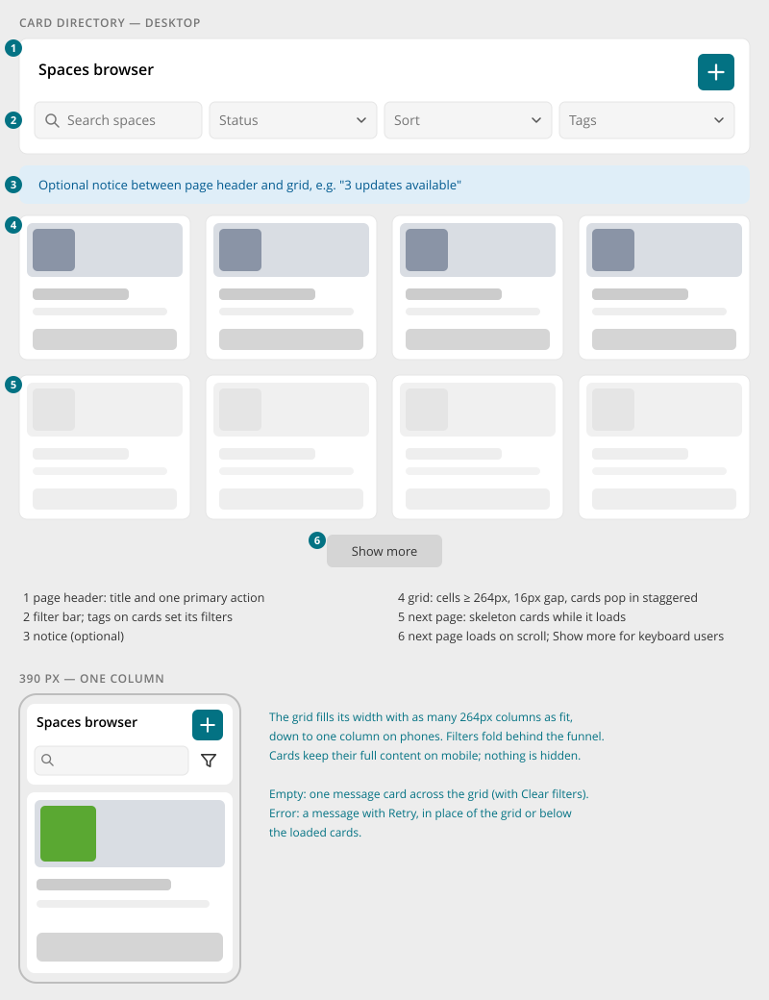

# Entity Browser

> Found in the design: People, Spaces, Marketplace
> · Core: `EntityBrowser.vue`, `EntityGrid.vue`, `CardSkeleton.vue` (since 1.20). Used by People,
> Spaces and Marketplace.
> · Technology: **Vue** (exists)

A page that lets people **browse** a collection of people, spaces or modules as cards. It always
has the same structure:

1. a [Page Header](page-header.md) with title and primary action
2. a [Filter Bar](filter-bar.md)
3. an optional notice
4. a responsive grid of [Entity Cards](entity-card.md) that loads page by page

Use it when people **discover and choose**, and every item is worth a picture and a short
description. For administrative lists where people **compare and act on many records**, use the
[Data Table](data-table.md).

## Anatomy

| # | Part | Notes |
|---|---|---|
| 1 | **Page header** | Title ("Spaces browser", "Marketplace") and its actions: one primary action (create space, invite people, update all) plus secondary tools (settings) |
| 2 | **Filter bar** | Search plus the list's filters. Tags and type badges on the cards set filters here. |
| 3 | **Notice** | Optional. Sits between page header and grid, e.g. update information in the marketplace. |
| 4 | **Card grid** | Cells at least 264px wide with a 16px gap, as many columns as fit. Cards in a row have equal height, and their footers line up. |
| 5 | **Loading** | Skeleton cards with the card's geometry: on the first load, and below the grid while the next page loads. |
| 6 | **Paging** | The next page loads automatically when the end of the grid scrolls into view. A "Show more" button stays for keyboard users and as a fallback. |

## Behaviour

- **Live filtering.** Every filter change reloads from page 1. A reload that takes longer than a
  moment dims the grid, while a fast answer doesn't flash. Filters are kept in the URL.
- **Cards as filters.** A card's tags ("MARKETING") and type badges ("OFFICIAL") are buttons that
  set the matching filter, with the tooltip "Filter by Marketing".
- **Entrance.** Cards pop in with a short rise, staggered by about 32ms per card. Reduced motion
  turns this off.
- **Per-viewer state.** The list itself is the same for everyone. Each viewer's state (membership,
  following, friendship) is loaded for every page right after it, and until it arrives the card's
  actions show a disabled placeholder. This keeps the list cacheable and fast.
- **Updates in place.** Joining a space or installing a module updates that one card, not the whole
  list.
- **Empty:** one message across the grid: "No results found!" with the hint "Try other keywords
  or remove filters."
- **Error:**
  - when nothing could be loaded, a message with "Try again" replaces the grid
  - when a later page fails, the message sits below the cards that are already loaded, and only
    that page is retried

## Mobile

- The grid fills the width with as many 264px columns as fit, down to **one column** on phones.
- Cards keep their full content; nothing is hidden on small screens.
- The filter bar folds behind the filter button, and the page header actions stay visible
  ([Page Header](page-header.md#mobile)).

## Accessibility

- The page title is the `h1`, and each card title is a link.
- Images inside the card are decorative (`aria-hidden`), because the title link names the item.
- "Show more" is a real button, so infinite scrolling never blocks keyboard users.
- Loading and error messages use `role="alert"` and `aria-busy` where they change.

## Markup and styles

The entity browser is a layout of other components: the [Page Header](page-header.md) with a
[Filter Bar](filter-bar.md), an optional notice, and the grid of [Entity Cards](entity-card.md).
Class names and SCSS follow [Styling with Bootstrap 5](bootstrap.md).

| Class | Element |
|---|---|
| `.entity-browser` | The whole page (page header, notice, grid, paging), capped at the page header's width and centred |
| `.entity-browser-notice` | Holds the notice, Bootstrap's `.alert` (`.alert-info` / `.alert-warning`) |
| `.entity-grid`, `.is-loading` | The grid; dimmed while a reload takes a moment |
| `.entity-grid-cells`, `.entity-grid-cell` | `repeat(auto-fill, minmax(264px, 1fr))` cells, each holding a card; `.entity-grid-cell-skeleton` for a skeleton card |
| `.entity-grid-message`, `-message-empty`, `-message-error`, `-message-text` | The empty state and the error of the first page |
| `.entity-grid-error`, `.entity-grid-more` | The error of a later page, and the "Show more" row (`.btn.btn-light.btn-sm`) |

- Skeleton cards are the entity card's markup with Bootstrap `.placeholder` blocks (see
  [Loading, Empty & Error](loading-empty-error.md)).
- **File:** `_entity-browser.scss`, behind `$prev-entity-browser`.
- **Sass variables:** `$entity-browser-max-width` (the page header's), `$entity-browser-gap`,
  `$entity-grid-gap` (both `$spacer`), `$entity-grid-cell-min-width` (264px, a layout width),
  `$entity-grid-box-shadow` / `-dark` (the cards' shadow, the page header's).

## Implementation in core

**Exists:** `EntityBrowser` (`protected/humhub/vue/EntityBrowser.vue`). It composes:

- `PageHeader` with `FilterBar`
- an optional `notice` slot
- `EntityGrid`, which feeds page by page from an endpoint answering the API list envelope

Further details:

- **Styles:** `resources/scss/_entity-browser.scss`.
- **Documentation:** [Vue.js Components](../develop/ui-js-vuejs-components.md).
- **Consumers:**
  - `user/vue/PeopleBrowser.vue` (`user\widgets\PeopleBrowser`)
  - `space/vue/SpacesBrowser.vue` (`space\widgets\SpacesBrowser`)
  - `marketplace/vue/MarketplaceBrowser.vue`, the reference consumer
- **Per-viewer states:** the `itemStates` prop is `(ids) => Promise<{ [id]: state }>`.
- **The card:** passed through the `card` slot.
- **Instance API:** `reload()`, `replaceItem()` and `replaceState()` for updates in place.

**Gaps compared to the design:**

| Gap | Note |
|---|---|
| Reduced motion | Only the OS setting (`prefers-reduced-motion`) is respected. A user setting needs a shared root attribute. |
| Notice | The slot exists, but there is no shared notice component. Define one (info / warning) for entity browsers. |

## Open questions

1. **Sort:** the People and Spaces designs offer "Sort" as a filter field. Is sorting a filter
   (select in the bar) or a separate control?
2. **Empty state with action:** should an empty entity browser offer its primary action (e.g. "Create
   the first space")?
3. **Other entity browsers:** which further lists become entity browsers (groups, topics, module
   pages such as wiki overviews)?
