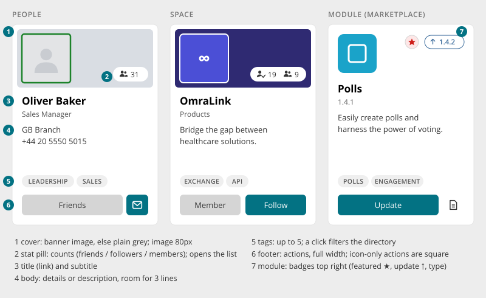
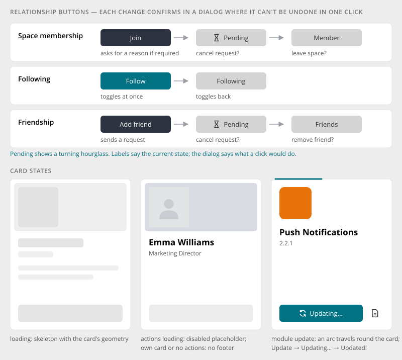

# Entity Card

> Found in the design: People browser (people card), Spaces browser (space card), Marketplace
> (module card), Welcome wizard (people suggestions)
> · Core: `PeopleCard.vue`, `SpaceCard.vue`, `ModuleCard.vue` on `.card.entity-card`, since 1.20
> · Technology: **Vue** (exists)

The card for one person, space or module in a [Entity Browser](entity-browser.md). It always has
the same five parts, so cards of different kinds look and line up the same. It shows enough to
decide (picture, name, short text, tags) and offers the next step (join, follow, add friend,
install) directly on the card.



## Anatomy

| # | Part | Notes |
|---|---|---|
| 1 | **Cover** | The banner image, or plain grey without one. The entity's image (80px) sits on top of it. A person's image shows the online state as a green ring. |
| 2 | **Stat pill** | Counts on the cover: friends or followers for people; followers and members for spaces. Each count opens the list in a dialog. |
| 3 | **Title and subtitle** | The name links to the profile, space or marketplace page. The subtitle is the job title, the module version, or for spaces what a module adds through the `space.card-subtitle` slot (the Enterprise theme shows the space category there). |
| 4 | **Body** | People: the profile fields chosen by the admin. Spaces and modules: the description. The body always keeps room for 3 lines, so cards in a row stay aligned. Descriptions are cut after 3 lines, and each profile field is one line with an ellipsis. |
| 5 | **Tags** | Up to 5 uppercase chips. Each one filters the directory by that tag. |
| 6 | **Footer** | The card's actions, sharing the full width. Icon-only actions (send message, changelog) are square and 38px high. |
| 7 | **Badges** | Modules only, top right of the cover: featured ★, update available (↑ 1.4.2) or the type (Official, Partner, Community, Professional). Featured and type filter the marketplace. |

## Variants

| Variant | Cover | Subtitle | Body | Footer |
|---|---|---|---|---|
| **People** | Profile banner, avatar with online ring, friends or followers pill | Job title | Admin-chosen profile fields, optional details template | Friendship (Add friend / Pending / Friends), Follow; modules add e.g. Send message |
| **Space** | Space banner, space image, followers and members pill | Via extension slot (Enterprise theme: category) | Description; "Archived" note for archived spaces | Membership (Join / Pending / Member), Follow |
| **Module** | No banner: module icon, badges | Version | Description, error message | Install / Buy / Update / Learn more, or a disabled "Installed" / "Not compatible"; ghost icon to the changelog or marketplace page |

## Relationship buttons



| Relationship | States | What a click does |
|---|---|---|
| **Space membership** | Join → Pending → Member | Join: sends a request (asks for a reason if the space requires approval). Pending: offers to cancel the request. Member: offers to leave the space. |
| **Following** | Follow ↔ Following | Toggles at once, with no dialog |
| **Friendship** | Add friend → Pending → Friends | Add friend: sends a request. Pending: offers to cancel it. Friends: offers to remove the friend. |

- The **label shows the current state** ("Member"), and the confirm dialog says what a click would
  do ("Leave Marketing?").
- Changes that are hard to undo always confirm.
- "Pending" shows a turning hourglass.
- The button colour follows the state:
  - a dark primary button for the first step (Join, Add friend)
  - accent for Follow
  - grey for an established state (Member, Following, Friends)

## States

| State | Look |
|---|---|
| **Loading** | Skeleton with the card's geometry: cover, image, title, lines, action bar |
| **Actions loading** | Card content is shown, but the footer is a disabled placeholder until the viewer's state arrives |
| **No actions** | No footer, e.g. on your own people card or for guests |
| **Archived space** | "Archived" note (warning colour, archive icon) in the body |
| **Module update** | Update → Updating… (an accent arc travels round the card) → Updated! → the card fades to the new version. "Update all" queues every card. |
| **Search match** | Marketplace: matching text in the name and description is highlighted |

## Mobile

- One card per row at phone width, with the same content as on desktop.
- Footer actions keep sharing the width. Icon-only actions stay square.

## Accessibility

- The title is the card's only link to the entity. The cover image is decorative, so it isn't a
  second tab stop.
- Stat pills: buttons labelled with the full sentence ("19 followers"). When the list can't be
  opened, they are plain text with visually hidden text.
- Tags and badges: buttons with "Filter by …" as label and tooltip.
- Placeholders while loading are `disabled` and `aria-hidden`.
- Error messages on a module card use `role="alert"`.

## Markup and styles

The entity card is a Bootstrap **`.card`** with the modifier **`.entity-card`**, which sets the
card's `--bs-card-*` variables (no border, `$border-radius-lg`, the directory's surface shadow,
the full height of its grid cell). A plain `.card` keeps Bootstrap's look. Class names and SCSS
follow [Styling with Bootstrap 5](bootstrap.md).

```html
<article class="card entity-card people-card">
    <div class="entity-card-cover">
        <a class="entity-card-avatar" href="…"></a>
        <span class="entity-card-pill"><a class="entity-card-stat entity-card-stat-followers" href="…">…</a></span>
    </div>
    <div class="entity-card-header">
        <a class="entity-card-title" href="…">Emma Williams</a>
        <p class="entity-card-subtitle">Marketing Manager</p>
    </div>
    <div class="entity-card-body"><p class="entity-card-text">…</p></div>
    <div class="entity-card-tags"><button class="entity-card-tag" type="button">Design</button></div>
    <div class="entity-card-footer"><button class="entity-card-action btn …">Follow</button></div>
</article>
```

| Class | Element |
|---|---|
| `.card.entity-card` | The card; body at least 3 lines high, footers aligned |
| `.entity-card-cover`, `-avatar`, `-pill`, `-stat` | The cover with the image and the stat pill |
| `.entity-card-cover-plain`, `.entity-card-image` | A cover without banner and an image that is no avatar (the module card) |
| `.entity-card-header`, `-title`, `-subtitle` | Name and subtitle |
| `.entity-card-body`, `-text` | Profile fields or description |
| `.entity-card-tags`, `-tag` | The tag chips |
| `.entity-card-footer`, `-action`, `-action-icon`, `-placeholder` | The actions (an icon-only one stays square), and the disabled placeholder while the viewer's state loads |
| `.people-card…`, `.space-card…` | What only the people or the space card has (`.people-card-details`, `.space-card-archived`) |
| `.module-card` | The module variant (`.card.entity-card.module-card`) on the entity card's parts, plus its own `.module-card-badges`, `-badge`, `-message`, `-mark`, `-secondary` |
| `.entity-card-skeleton` | The skeleton: an entity card of Bootstrap `.placeholder` blocks (`.placeholder-glow`) in the card's own parts; the blocks are sized by `.entity-card-skeleton-image`, `-avatar`, `-title`, `-subtitle`, `-line`, `-line-short`, `-tag`, `-action`, `-icon` |

- **File:** `_entity-card.scss`, behind `$prev-entity-card`, with `$entity-card-border-radius` and
  `$entity-card-padding`; the module card's parts in `_marketplace.scss`, the people and space
  card's own parts in `_people-browser.scss` and `_spaces-browser.scss`.
- The `.card-body` / `.card-title` parts of Bootstrap are not used: the entity card's parts have a
  geometry of their own (cover, a body of a fixed number of lines, a footer that fills the width).

## Implementation in core

**In core (1.20):**

- **People and Space cards** share the entity card: `PeopleCard.vue` with `PeopleCardSkeleton.vue`
  and `SpaceCard.vue` with `SpaceCardSkeleton.vue`.
- **Module card:** `ModuleCard.vue` is an entity card (`.card.entity-card.module-card`) on the
  entity card's parts, with a plain cover; only its badges, the search marks and the update
  states are its own. Like the other variants, its description is cut after three lines.
- **Skeletons:** `CardSkeleton.vue` (the module card's, `EntityGrid`'s default),
  `PeopleCardSkeleton.vue` and `SpaceCardSkeleton.vue`, and the placeholders the PHP widgets
  render, are entity cards of Bootstrap placeholders.
- **Extension slots**, so modules add their own lines and actions without touching the card:
  - `user.card-subtitle` and `user.card-actions` (core entries: `friendship` 100, `follow` 200)
  - `space.card-subtitle` and `space.card-actions` (core entries: `membership` 100, `follow` 200)

  A module registers an entry with
  `registerSlotComponent('user.card-actions', 'MailCardAction', { id: 'mail', sortOrder: 300 })`.
- **Relationship buttons:** `MembershipButton.vue`, `FollowButton.vue`, `FriendshipButton.vue`
  and `UserFollowButton.vue`. The same components work outside the cards.

**Open:**

| Gap | Proposal |
|---|---|
| Cover fallback is plain grey | The design generates a colour mesh from the space or user colour when there is no banner. Optional; decide if wanted. |
| Send message on people cards | Not in core. It belongs to the mail module through `user.card-actions`. |
| Tags vs. topics | Cards show profile and space tags. The design's chips look like topic chips. Keep tags, and confirm that topics are not meant. |

## Open questions

1. **One card base for modules too?** See the first gap. The recommendation is to unify.
2. **Generated covers:** do we want the generated colour mesh as cover fallback, or keep the plain
   grey?
3. **Body for people:** the admin chooses the profile fields shown. Is there a limit (e.g. 3
   lines), so cards stay the same height?
4. **Card click:** only the title is a link today. Should the whole card be clickable (with the
   buttons on top)?
