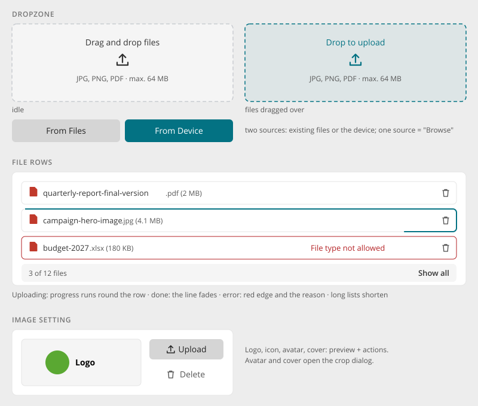

# File Upload

> Found in the design: attachments in dialogs (Create task, posts), the Files module, logo and
> icon settings (Appearance), avatar and cover
> · Core: PHP `file\widgets\UploadButton`, `UploadInput`, `UploadProgress`, `FilePreview`
> (`humhub.file.js`); Vue `UploadField` (form suite) and `DropZone` (item browser), since 1.20
> · Technology: **Both**

Adding files to a form or a place. Files can be dropped or chosen from the device, and optionally
picked from the existing Files. Files upload **as soon as they are added**, and the form only
submits references to them.

## Parts

| Part | Notes |
|---|---|
| **Dropzone** | A dashed area with "Drag and drop files", an icon and the allowed types and size ("JPG, PNG, PDF · max. 64 MB"). While files are dragged over it, it turns accent ("Drop to upload"). |
| **Sources** | One "Browse" button, or two: **From Files** (secondary, picks existing files) and **From Device** (accent) |
| **File rows** | Icon or thumbnail, name (shortened in the middle, keeping the extension and size), and remove (trash) or download as the trailing action |
| **Progress** | A line runs around the file row while it uploads, and fades when done. Once the file is sent, a segment runs around the row while the server processes it (with reduced motion the whole frame stands) |
| **Error** | Red edge and the reason in the row: the server's ("Only files with these extensions are allowed: pdf."), else one by the failure: "The file is too large. Maximum: 64 MB" (refused before uploading), "The file is too large." (413 from a limit in front of PHP), "The connection was interrupted." (no answer), "The server could not process the file." (5xx), "Too many uploads. Please try again in a moment." (429), "The upload failed." |
| **Long lists** | Show the first few rows, then "2 of 12 files · Show all". Never hide just one row. |
| **Image setting** | Preview plus Upload / Delete, for logo, icon, avatar and cover. Avatar and cover open the crop dialog. |

## Behaviour

- **Upload immediately.** Each file uploads when added, and the form's Save stays available.
  While uploads run, submitting waits for them, or says that files are still uploading.
- **Remove** deletes the uploaded file; its button shows a spinner while it does. The row collapses
  and slides out. Removing during the upload cancels it.
- **Single file** fields (logo, one attachment): a new file replaces the current one.
- **Limits** (types, size, count) are checked before uploading, where possible. A file larger than the
  server takes is refused at once, without a request (the core JS config's `file.upload.maxFileSize`: the
  file module's maximum, capped by PHP's `upload_max_filesize` and `post_max_size`). Refused files show
  their row with the reason, so nothing disappears silently. Of more files than the maximum count
  allows, the first ones up to it are taken, and one message names the maximum.
- **Drop anywhere it makes sense:** the Files module accepts drops on the whole browser, and on
  folders (see [Item Browser](item-browser.md)).
- **Image previews:** image rows show a thumbnail. With a mouse, hovering shows a larger preview.

## Mobile

- No dragging on phones: the dropzone becomes the buttons ("From Files", "From Device"), and the
  device's file or photo picker opens.
- Rows take the full width. Names shorten in the middle.

## Accessibility

- A real `<input type="file">` behind a real button, labelled "Choose files".
- Each row's remove button is labelled "Remove quarterly-report.pdf".
- Progress, completion and errors are announced (`aria-live`). The line is a `progressbar` ("Uploading
  report.pdf"); while the server processes the file it has no value, as an indeterminate one ("Processing
  report.pdf").
- "Show all" uses `aria-expanded`. Hidden rows are removed from the tab order.
- Dropping is never the only way: the buttons always work.
- An audio file's play button is labelled "Play song.mp3" / "Pause song.mp3" (the tooltip follows the label). While the
  file is the current track, the seek line is a range labelled "Position in song.mp3" with the text "1:12 of 3:24"
  (just the time when the length is unknown). Left/right and up/down step 5 seconds (left and right swap in
  right-to-left layouts); Page keys, Home and End are the range's own.
- When the player moves on to the next file of the list by itself, "Now playing next.mp3" is announced once the file
  plays. A file that can't be played is announced ("song.mp3 can't be played.") and the row shows the reason.
- The focus never lands on `<body>`: when the seek line (the track ended, a file failed, another one started) or the
  play button (the file failed) holds the focus and goes away, the focus moves to the row's play button, or to the
  name link when the file can't be played. See [Keyboard](keyboard.md), "Moving the focus".

## Markup and styles

File rows are a Bootstrap **`.list-group`**; errors use Bootstrap's `.is-invalid` /
`.invalid-feedback`. Class names and SCSS follow [Styling with Bootstrap 5](bootstrap.md).

| Class | Element |
|---|---|
| `.dropzone` | The dashed area; `.is-dragover` while files are dragged over it, `.is-refused` for a type that is not allowed |
| `.list-group` > `.list-group-item.file-row` | A file row |
| `.file-row-icon`, `.file-row-name`, `.file-row-meta` | Icon or thumbnail, name (shortened in the middle), size |
| `.file-list` > `.file-list-rows[role=list]` | The rows; in a long list `.file-list-more` (`.show` when open) holds the rows behind "Show all" |
| `.file-list-toggle` | The last row of a long list: "2 of 12 files" and the "Show all" button |
| `.file-row-progress` | The line running around the row while it uploads |
| `.file-row.is-uploading` | The file is uploading: the name is no link yet, the progress line runs |
| `.file-row.is-processing` | With `.is-uploading`: the file is sent, the server processes it; the line runs as a segment (`.progress-frame.is-indeterminate`) |
| `.file-row.is-invalid` + `.invalid-feedback` | The error state and its reason |
| `.file-row-play` | The play / pause button of an audio file, before the download |
| `.file-row.is-current` + `.file-row-seek` | The file is the current track of the shared player: the position as "1:12 / 3:24" and the seek line (a `.form-range`) below the name |
| `.file-row.is-failed` + `.file-row-reason` | The browser can't play the file: the reason replaces the play button, the download stays |
| `.file-row-enter-*` / `.file-row-leave-*` | The transition classes of `UploadList`: a row grows in and collapses out |
| `.image-setting` | Preview plus Upload / Delete |

- The trailing action is a `.btn.btn-ghost.btn-icon-only` (`.btn-ghost-danger` for remove).
- **File:** `_file.scss`, behind `$prev-file`.
- **Sass variables:** `$dropzone-border-style` (dashed), `$dropzone-padding`, `$dropzone-bg`,
  `$attached-images-row-height`, `$attached-images-single-height`, `$attached-images-comment-row-height`,
  `$attached-images-comment-single-height`, `$attached-images-gap`, `$attached-video-play-size`, `$file-list-gap`,
  `$file-list-transition`; rows from Bootstrap's `$list-group-*`. The progress line is the `ProgressFrame`
  (`.progress-frame` in `_item-browser.scss`).

## Implementation in core

**Today:**

- **PHP:** `UploadButton` + `UploadInput` + `FilePreview`, driven by `humhub.file.js`, plus `ActiveFileUpload` for
  model fields. `FilePreview` renders the upload rows as an `<upload-list>` island (`file.Preview` is its facade);
  `UploadProgress` is no longer used by core forms. `file.Upload` sends the files itself (XMLHttpRequest with
  FormData, no upload plugin): one request per file with upload rows (at most 3 at a time) or from an input without
  `multiple`, else one for the files added at once. It takes files dropped on the upload button or its `dropZone`, and pasted into its `pasteZone`.
- **Vue:** `UploadField` (form suite) uploads to `POST /api/v2/file` as soon as files are added, one request per
  file (at most 3 at a time), keeps the guid list and exposes `addFiles()`, `openPicker()` and `clear()`. See
  [Vue.js Form Suite](../develop/ui-js-vuejs-forms.md#file-uploads).
- **Upload rows:** both paths use `UploadList` and the core `FileRow`: progress around the row while it uploads
  (`ProgressFrame`), the error in the row, remove as the trailing action.
- **Item browser:** `DropZone` (desktop drop overlay) and `ProgressFrame` (progress along an
  outline).
- **Attached files:** `AttachedFiles.vue` shows images and videos as tiles (a video plays in the media viewer only)
  and lists the other files as read-only file rows (the core `FileRow.vue`): download as the trailing action, "Show
  all" from four files on. An audio file's row has play / pause before the download, the time and a seek line while it
  plays; one player serves the page and plays the next audio file of the list when one ends.
- **Subtitles:** video and audio files can have subtitles or captions per language (WebVTT variants of the file). Users
  who may edit the file manage them in the "Subtitles" dialog (Open file → Subtitles; in the media viewer through
  "Open"): add a language, edit the WebVTT text, load a .vtt or .srt file, download, delete. The media viewer's player
  offers them in its CC menu (the page language preselected); an audio row shows the current line below its seek line,
  with a toggle and, for several languages, a select. A module adds to the dialog, above its list, through the
  extension slot `file.subtitles` (e.g. creating subtitles).

**Gaps:**

| Gap | Proposal |
|---|---|
| Dropzone look | The dashed dropzone described above for the upload button (the upload rows exist) |
| "From Files" source | A files picker dialog (from the Files module) as an optional second source, offered when the module is active |
| Image setting | A shared image control (preview plus Upload / Delete, crop for avatar and cover) for admin settings and profiles |
| Two upload implementations | The rows have one implementation (`UploadList`); the PHP upload widgets still drive the upload itself. Render them as Vue islands over time, so `UploadField` is the single implementation |

## Open questions

1. **Upload immediately:** keep it (current behaviour), including for large files on slow
   connections?
2. **"From Files":** core feature, or provided by the Files module through an extension point?
3. **Limits shown:** always show allowed types and maximum size under the dropzone, or only on
   error?
