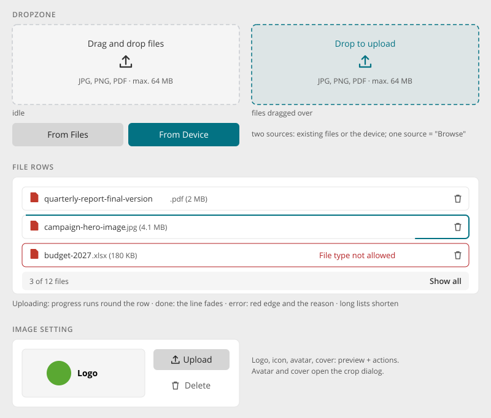

# File Upload

> Found in the design: attachments in dialogs (Create task, posts), the Files module, logo and
> icon settings (Appearance), avatar and cover
> · Core: PHP `file\widgets\UploadButton`, `UploadInput`, `UploadProgress`, `FilePreview`
> (`humhub.file.js`); Vue `UploadField` (form suite) and `DropZone` (item browser), since 1.20
> · Technology: **Both**

Adding files to a form or a place. Files can be dropped or chosen from the device, and optionally
picked from the existing Files. Files upload **as soon as they are added**, and the form only
submits references to them.

## Parts

| Part | Notes |
|---|---|
| **Dropzone** | A dashed area with "Drag and drop files", an icon and the allowed types and size ("JPG, PNG, PDF · max. 64 MB"). While files are dragged over it, it turns accent ("Drop to upload"). |
| **Sources** | One "Browse" button, or two: **From Files** (secondary, picks existing files) and **From Device** (accent) |
| **File rows** | Icon or thumbnail, name (shortened in the middle, keeping the extension and size), and remove (trash) or download as the trailing action |
| **Progress** | A line runs around the file row while it uploads, and fades when done |
| **Error** | Red edge and the reason in the row ("File type not allowed", "Too large") |
| **Long lists** | Show the first few rows, then "3 of 12 files · Show all". Never hide just one row. |
| **Image setting** | Preview plus Upload / Delete, for logo, icon, avatar and cover. Avatar and cover open the crop dialog. |

## Behaviour

- **Upload immediately.** Each file uploads when added, and the form's Save stays available.
  While uploads run, submitting waits for them, or says that files are still uploading.
- **Remove** deletes the uploaded file. The row collapses and slides out. Removing during the
  upload cancels it.
- **Single file** fields (logo, one attachment): a new file replaces the current one.
- **Limits** (types, size, count) are checked before uploading, where possible. Refused files show
  their row with the reason, so nothing disappears silently.
- **Drop anywhere it makes sense:** the Files module accepts drops on the whole browser, and on
  folders (see [Item Browser](item-browser.md)).
- **Image previews:** image rows show a thumbnail. With a mouse, hovering shows a larger preview.

## Mobile

- No dragging on phones: the dropzone becomes the buttons ("From Files", "From Device"), and the
  device's file or photo picker opens.
- Rows take the full width. Names shorten in the middle.

## Accessibility

- A real `<input type="file">` behind a real button, labelled "Choose files".
- Each row's remove button is labelled "Remove quarterly-report.pdf".
- Progress, completion and errors are announced (`aria-live`).
- "Show all" uses `aria-expanded`. Hidden rows are removed from the tab order.
- Dropping is never the only way: the buttons always work.

## Markup and styles

File rows are a Bootstrap **`.list-group`**; errors use Bootstrap's `.is-invalid` /
`.invalid-feedback`. Class names and SCSS follow [Styling with Bootstrap 5](bootstrap.md).

| Class | Element |
|---|---|
| `.dropzone` | The dashed area; `.is-dragover` while files are dragged over it, `.is-refused` for a type that is not allowed |
| `.list-group` > `.list-group-item.file-row` | A file row |
| `.file-row-icon`, `.file-row-name`, `.file-row-meta` | Icon or thumbnail, name (shortened in the middle), size |
| `.file-row-progress` | The line running around the row while it uploads |
| `.file-row.is-invalid` + `.invalid-feedback` | The error state and its reason |
| `.image-setting` | Preview plus Upload / Delete |

- The trailing action is a `.btn.btn-ghost.btn-icon-only` (`.btn-ghost-danger` for remove).
- **File:** `_file.scss`, behind `$prev-file`.
- **Sass variables:** `$dropzone-border-style` (dashed), `$dropzone-padding`, `$dropzone-bg`,
  `$file-row-progress-width`; rows from Bootstrap's `$list-group-*`.

## Implementation in core

**Today:**

- **PHP:** `UploadButton` + `UploadInput` + `UploadProgress` + `FilePreview`, driven by
  `humhub.file.js`, plus `ActiveFileUpload` for model fields.
- **Vue:** `UploadField` (form suite) uploads to `POST /api/v2/file` as soon as files are added,
  keeps the guid list and exposes `addFiles()`, `openPicker()` and `clear()`. See
  [Vue.js Form Suite](../develop/ui-js-vuejs-forms.md#file-uploads).
- **Item browser:** `DropZone` (desktop drop overlay) and `ProgressFrame` (progress along an
  outline).

**Gaps:**

| Gap | Proposal |
|---|---|
| Dropzone look and file rows | One file-row style for PHP and Vue: progress around the row, error in the row, "Show all" for long lists |
| "From Files" source | A files picker dialog (from the Files module) as an optional second source, offered when the module is active |
| Image setting | A shared image control (preview plus Upload / Delete, crop for avatar and cover) for admin settings and profiles |
| Two implementations | Render the PHP upload widgets as Vue islands over time, so `UploadField` is the single implementation |

## Open questions

1. **Upload immediately:** keep it (current behaviour), including for large files on slow
   connections?
2. **"From Files":** core feature, or provided by the Files module through an extension point?
3. **Limits shown:** always show allowed types and maximum size under the dropzone, or only on
   error?
