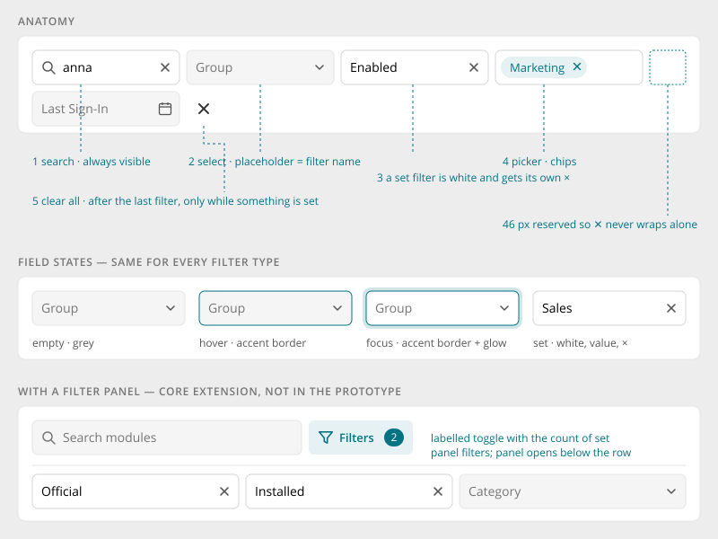
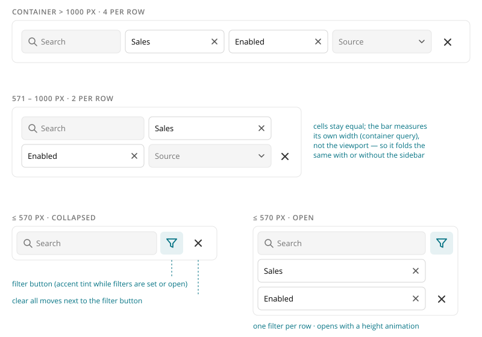

# Filter Bar

> Found in the design: Tasks, Files, People browser, Admin › People
> · Core: `FilterBar.vue` (since 1.20)
> · Technology: **Vue** (exists). A PHP variant is only needed if the [Data Table](data-table.md)
> gets a server-rendered mode.

A row of filter fields above a list, board, grid or table: a search field plus select, picker and
date filters. All fields have the same height and look, and they **apply immediately**: there is
no submit button. A clear-all button resets everything. On narrow widths the bar folds behind a
filter button.

Use it in a [Page Header](page-header.md) or in the header of a [Data Table](data-table.md).
Don't use it for forms that are submitted; use normal form fields there.



## Anatomy

1. **Search**: a text field with a magnifier and a clear ×. It is always the first field and
   always stays visible, also when folded.
2. **Filters**: select, picker, date and so on, in equal cells. The placeholder is the filter's
   name ("Group", "Status").
3. **Set filters** turn white and get their own × to clear only that one.
4. **Pickers** show the chosen records as chips.
5. **Clear all** (×): appears after the last filter as soon as a filter is set, and slides in and
   out. Room for it (a button and a gap) is always reserved at the end of the last row, so it never
   wraps onto a line of its own.

## Filter types

| Type | Control | Value | Examples |
|---|---|---|---|
| Text | Search field with clear × | string, applied after a short debounce | Name or Email, Search |
| Select | Single select. Its placeholder is the "all" state, and a set value gets a × | one option | Status, Group, Source, Sort |
| Picker | Searchable combobox with suggestions; chips | one or several record ids | User, Space, Topic, Group, Content type |
| Tags | Toggle chips | several values | Marketplace categories |
| Checkbox | Single checkbox | boolean | "Only installed" |
| Date | Date field with calendar | ISO date. Ranges are two fields ("From" / "To"). | Last Sign-In, From Date / To Date |

Pickers for user, space and topic each come from their module and are registered as their own
filter type.

## Behaviour

- **Live:** every change applies immediately. Text is debounced; all other types apply at once.
  The owner reloads the list.
- **URL sync:** applied values are mirrored into the page URL, so a filtered list can be bookmarked
  and shared and survives a reload.
- **Equal cells:** filters share the row in equal widths, with 4 → 2 → 1 per row depending on the
  bar's own width (see Mobile).
- **Clear all** resets every filter to its default and keeps fixed context such as the current
  space.
- **Selects** open their option list in an overlay that is never clipped by the card. On a phone
  it opens above the on-screen keyboard.
- **Optional filter panel** (core extension, not in the prototype): rarely used filters can sit in
  a panel below the row. A labelled "Filters" toggle with a count of set panel filters opens it.



## Mobile

The bar reacts to its **own width** (container query), not to the viewport. It therefore folds
the same way in a narrow content column as it does on a phone.

| Bar width | Filters per row | Folded |
|---|---|---|
| > 1000px | 4 | no |
| 571–1000px | 2 | no |
| ≤ 570px | 1 | yes: search + filter button |

- **Folded:** only the search field and the filter button (funnel) are visible. The button is
  accent-tinted while it is open or while filters are set. Clear all moves next to it.
- **Open:** the button expands the bar in place with a height animation (about 300ms), and each
  filter takes a full row.

## Accessibility

- The bar is a `<form role="search">` that is never submitted.
- Every field has an accessible name. The placeholder is not the only label: either a visually
  hidden label or `aria-label`.
- Filter button: `aria-expanded` and `aria-controls`, labelled "Show filters" / "Hide filters".
- Clear all is only in the tab order while it is visible. It is labelled "Clear filters".
- Pickers follow the WAI-ARIA combobox pattern.
- Reduced motion: no height or slide animations.

## Markup and styles

The filter bar is its own component; the fields inside it are Bootstrap form controls with the
look of [Form Fields](form-fields.md). Class names and SCSS follow [Styling with Bootstrap 5](bootstrap.md).

```html
<div class="filter-bar">
    <form class="filter-bar-body" role="search">
        <div class="filter-bar-item filter-bar-item-text" data-filter-bar-keep>
            <div class="search-field">
                <i class="search-field-icon ti ti-search" aria-hidden="true"></i>
                <input class="search-field-input" type="text" placeholder="Search" aria-label="Search">
            </div>
        </div>
        <div class="filter-bar-item">…</div>          <!-- select, picker, date -->
        <button class="filter-bar-toggle btn btn-ghost btn-icon-only" type="button" aria-expanded="false" aria-label="Filters">…</button>
        <button class="filter-bar-clear btn btn-ghost btn-icon-only" type="button" aria-label="Clear all filters">…</button>
    </form>
</div>
```

| Class | Element |
|---|---|
| `.filter-bar` | The component and the container for the container queries |
| `.filter-bar-body` | The row of items |
| `.filter-bar-item` | One cell, with the type as modifier (`.filter-bar-item-text`, `-select`, `-picker`, `-tags`, `-checkbox`); `.filter-bar-item-wide` takes a full row |
| `.filter-bar-toggle` | The filter button (funnel) when folded, `.filter-bar-toggle-labeled` with a panel; `.is-active` while filters are set |
| `.filter-bar-count` | The number of set panel filters on the toggle |
| `.filter-bar-panel` | Extra filters behind a labelled toggle |
| `.filter-bar-clear` | Clear all |
| `.search-field`, `-icon`, `-input` | The search field with the magnifier inside |
| `.select-menu`, `.picker` | Selects and pickers, see [Select & Pickers](select-pickers.md) |
| `.filter-tags`, `-label`, `-tag` | Tag filters |
| `.filter-check` | Checkbox filters |

- The fields are Bootstrap's **`.form-control`** (search input, the select's button, the picker's
  field), so they look like every other form field. The empty/filled fill from
  [Form Fields](form-fields.md) arrives with that step on `.form-control`; the bar needs no field
  styles of its own.
- **File:** `_filter-bar.scss`, behind `$prev-filter-bar`. It holds the filter bar, the search
  field, the select menu, the picker and the record filters.
- **Sass variables:** `$filter-bar-gap`, `$filter-bar-padding` (both `$spacer * .5`),
  `$filter-bar-item-width` (256px, the cell's flex basis), `$filter-bar-collapse-width` (570px),
  `$filter-bar-icon-size` (`$font-size-lg`). The row height (`$filter-bar-row-height`) is derived
  from `$input-*` and `$btn-*`, so the folded bar always fits one field or button.

## Implementation in core

Core has this component for Vue pages: **`FilterBar.vue`** with `FilterSelect`, `FilterPicker`,
`PickerFilterControl` and the module types `UserFilterControl`, `SpaceFilterControl` and
`TopicFilterControl`. Styles live in `resources/scss/_filter-bar.scss` (see
[Markup and styles](#markup-and-styles)), and the component is
documented in [Vue.js Components](../develop/ui-js-vuejs-components.md).

Filter definitions come from the server through `humhub\components\listing\FilterDefinition` and
`FilterableList` (`components/listing/`), so the PHP side already has a data contract for
filtering.

**Gaps compared to this spec:**

| Gap | Today | Proposal |
|---|---|---|
| No **date** filter type | Not available | Add a `date` type (single date; a range as two definitions or one `daterange`) on top of the upcoming date picker |
| Row layout | `flex: 1 1 256px`: the number of columns depends on content | Equal cells 4 / 2 / 1 per row via the container widths 1000px / 570px, as in the design |
| Clear-all threshold | Shown as soon as one filter is set | Keep this (the prototype uses 3, which hides a useful action). See Open questions. |
| Visible labels mode | Not available | Optional: labels above the fields, for accessibility settings. Placeholders then become generic ("Select"). |
| Legacy filters | `ui\filter\widgets\FilterPanel`, `FilterInput` subclasses and `humhub.ui.filter.js` (stream filter, older directories) | Migrate step by step; the stream filter gets its own spec |

## Open questions

1. **Clear-all threshold:** from the first set filter (current core) or from three (prototype)?
   The recommendation is the first.
2. **Date ranges:** two filters ("From" / "To", as in the prototype) or one range field?
3. **Filters for hidden columns:** in the prototype's data table, a filter whose column is hidden
   disappears and is cleared. Do we want that coupling, or are filters independent of columns?
4. **Stream filter:** move the stream's filter dropdown to this bar, or keep it as a separate
   component?
