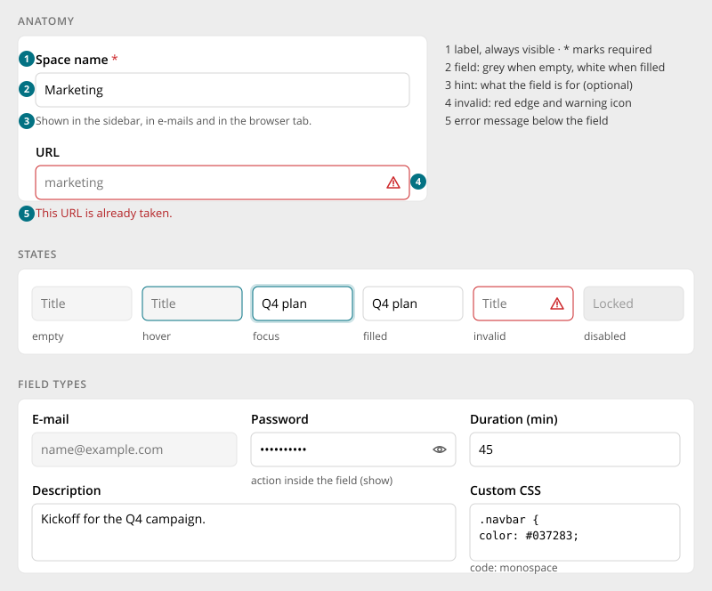
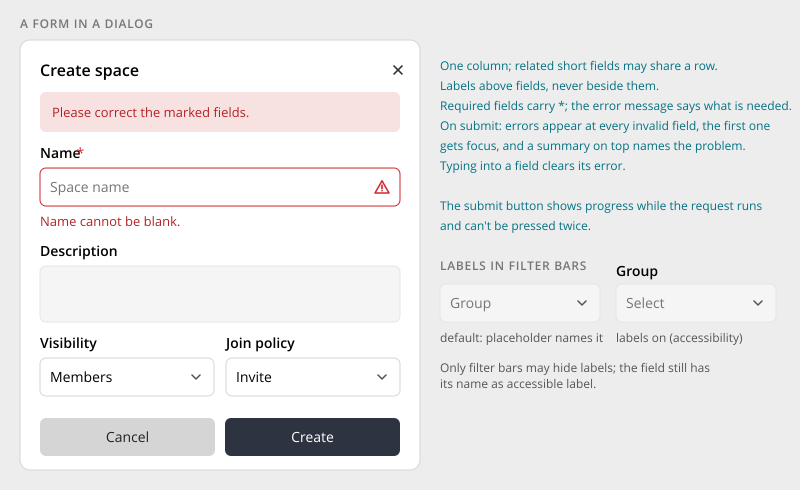

# Form Fields

> Found in the design: every dialog form (Create space, Create task, Invite, Edit file), every
> settings page, the component demo page (labels, required, validation)
> · Core: `humhub\widgets\form\ActiveForm` / `ActiveField` (PHP, Bootstrap 5); the Vue form suite
> `HumHubForm`, `TextField`, `TextareaField`, `SelectField`, `CheckboxField`, `SubmitButton`
> (since 1.20, same markup as `ActiveField`)
> · Technology: **Both**. PHP and Vue already render the same Bootstrap markup, so the new look is
> mostly CSS.

The basic building block of every form: a label, a control, an optional hint and an error
message. All control types share this anatomy and the same states, so a form looks and behaves
the same everywhere: in a dialog, on a settings page or in a filter bar.

The other form pages build on this one: [Select & Pickers](select-pickers.md),
[Date Picker](date-picker.md), [Switch, Checkbox & Radio](choice-controls.md),
[File Upload](file-upload.md).

## Anatomy

| # | Part | Notes |
|---|---|---|
| 1 | **Label** | Always visible, above the field. A red `*` marks required fields. |
| 2 | **Field** | 38px high and fully rounded corners (6px). **Grey when empty, white when filled.** |
| 3 | **Hint** | Optional. One line on what the field is for or what format it expects. |
| 4 | **Invalid** | Red edge (also on hover and focus) plus a warning icon inside the field |
| 5 | **Error message** | Below the field, in red. It says what is wrong and how to fix it ("This URL is already taken."). |

## States

| State | Look |
|---|---|
| Empty | Grey fill, placeholder text |
| Hover | Accent edge |
| Focus | White, accent edge with a soft glow. Keyboard focus shows the focus ring instead. |
| Filled | White with a neutral edge. The fill shows at a glance which fields have a value. |
| Invalid | Red edge and icon, error message below |
| Disabled | Muted. It stays reachable by keyboard and says why it can't be changed (hint or tooltip). |
| Read-only | Shown like disabled, with "Set in the configuration file." or a similar reason |

## Field types

| Type | Use | Notes |
|---|---|---|
| **Text, e-mail, URL, number** | Short values | Placeholder shows an example, never the label |
| **Password / secret** | Credentials, PINs | Show/hide eye inside the field. A stored secret is never displayed; the field says one is set. |
| **Textarea** | Longer text | Grows vertically. For rich text, the editor keeps its own toolbar, but uses this field's frame and states. |
| **Code** | CSS, snippets, lists ("one URL per line") | Monospace font |
| **With action** | A button inside the field (show, copy, generate) | The action is an icon button with a label |
| **Select, picker, date, colour, upload** | See the specific pages | They share the anatomy and states |

## Layout

- **One column.** Short related fields may share a row ("Visibility | Join policy") when each one
  gets at least 240px. Otherwise they stack.
- **Labels above, never beside.** This works at every width and with long translations.
- **Order follows the task:** required and important fields first, optional ones last or behind
  an [Accordion](accordion.md) ("Advanced").
- **Sections:** in dialogs, use secondary [Pill Tabs](tabs.md) for separate topics. On pages, use
  accordion groups ([Settings Page](settings-page.md)).
- **Buttons:** dialog footers use full-width buttons with the confirm action on the right. On pages,
  the save action is in the header ([Settings Page](settings-page.md)).

## Validation

- **When:** on submit, plus live for a field once it has shown an error (so the error clears while
  typing). There is no validation while someone types into a fresh field.
- **Where:** at the field (message plus red edge). On submit with errors:
  - the first invalid field gets focus and scrolls into view
  - a short summary on top names the problem ("Please correct the marked fields.")
  - the summary stays until the next submit
- **Server errors** use the same places. Errors that belong to no field (e.g. "You don't have
  permission") go into the summary.
- **Required:** the `*` marks the field, and the error text states it ("Name cannot be blank.").
  Don't mark optional fields, only required ones.
- **Second submit with the same errors:** the invalid fields shake briefly. Reduced motion turns
  this off.
- **Submit button:** shows progress while the request runs and can't be pressed twice.

## Labels in filter bars

[Filter bars](filter-bar.md) are the only place where labels may be hidden. There the placeholder
names the filter ("Group"). The field keeps the name as its accessible label. With the
accessibility setting "show labels", the labels appear and placeholders become generic
("Select").

## Mobile

- Fields take the full width, and pairs stack.
- Correct input types (`email`, `url`, `number`, `tel`) bring up the matching on-screen keyboard.
- With the on-screen keyboard open, the focused field stays visible. Dialogs scroll their body,
  not the page.

## Accessibility

- Every control has a `<label for>`, or an `aria-label` where the label is hidden.
- Hint and error are linked with `aria-describedby`.
- An invalid field has `aria-invalid="true"`. The error is announced when it appears.
- The required `*` is hidden from screen readers. The requirement is part of the label
  (`aria-required`) and the error text.
- Disabled uses `aria-disabled`, so the field stays reachable and its reason readable.
- Text and placeholder meet contrast requirements. The field edge meets 3:1 against the
  background.

## Implementation in core

**Today:**

- **PHP:** `ActiveForm` / `ActiveField` render Bootstrap 5 markup (`form-label`,
  `form-control`, `form-select`, `is-invalid`, `invalid-feedback`, `form-text`). Related pieces:
  `ActiveForm::$acknowledge` (leave warning) and `beginCollapsibleFields()`.
- **Vue:** the form suite (`HumHubForm`, `TextField`, `TextareaField`, `SelectField`,
  `CheckboxField`, `SubmitButton`, `UploadField`, `RichTextField`) mirrors that markup exactly. It
  shares one server-error contract (HTTP 422 `{errors: {attribute: [messages]}}`, `setErrors()`,
  `focusFirstError()`). See [Vue.js Form Suite](../develop/ui-js-vuejs-forms.md).

Because both render the same markup, **most of the new look is CSS on the Bootstrap form classes**,
and it reaches every existing form at once.

**Gaps:**

| Gap | Proposal |
|---|---|
| Empty/filled fill, accent focus, red invalid icon | Theme styles on `form-control` / `form-select` (`:placeholder-shown`, `:focus`, `.is-invalid`) |
| Error summary on top | `ActiveForm::errorSummary()` exists. Render it in the new style, and in Vue as a `HumHubForm` slot. |
| Focus first error on submit (PHP) | A small JS addition for `ActiveForm` (Vue already has `focusFirstError()`) |
| Field with action (show password, copy) | An `ActiveField::inputAction()` / Vue `action` slot |
| Paired fields | A form row helper that pairs two fields at ≥ 240px each |
| Shake on repeated submit | Optional, CSS only |

## Open questions

1. **Live validation:** only after the first error, as proposed, or also on blur for some fields
   (e-mail, URL)?
2. **Optional vs. required marking:** mark only required fields (proposal), or mark optional ones
   in forms where most fields are required?
3. **Rich text editor:** adopt the field frame and states for the editor, or keep its own look?
