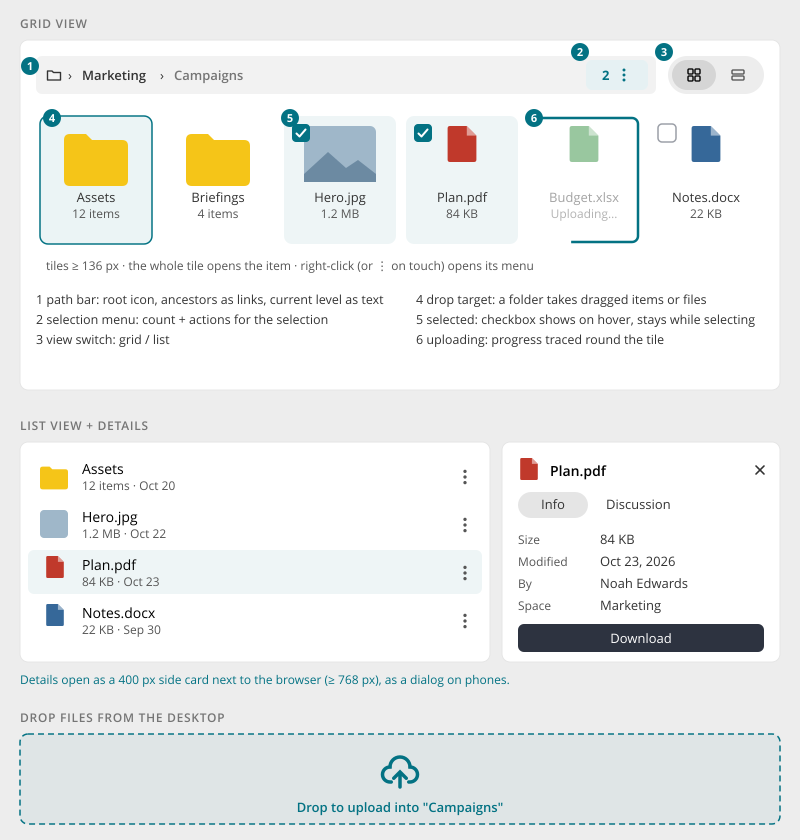
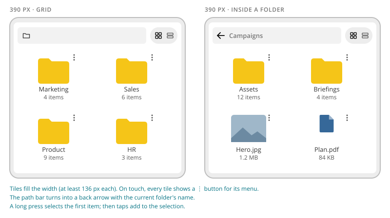

# Item Browser

> Found in the design: Files (global files and a space's files): folders and files, grid and list,
> details, upload, move, share
> · Core: the item browser kit `ViewSwitch`, `PathBar`, `TileGrid`, `SelectionMenu`, `DropZone`,
> `ProgressFrame` (Vue, since 1.20). The cfiles module is the reference consumer.
> · Technology: **Vue** (exists)

A view for browsing a collection **level by level**: folders and files, albums and pictures,
pages and sub-pages. People open items, select several, drag them into folders and drop files from
the desktop to upload them. It sits in the content card below a [Page Toolbar](page-toolbar.md)
with the [Filter Bar](filter-bar.md).

Use a [Card Directory](card-directory.md) for flat collections without levels, and a
[Data Table](data-table.md) for records with many fields to compare.

## Anatomy

| # | Part | Notes |
|---|---|---|
| 1 | **Path bar** | Root as an icon, ancestors as links, the current level as plain text. Every ancestor is a drop target. |
| 2 | **Selection menu** | Appears at the end of the path bar while items are selected: the count plus a menu (Download, Share, Move, Delete, Select all, Clear selection). |
| 3 | **View switch** | Grid or list, at the far right of the content card |
| 4 | **Tiles** | At least 136px wide. Thumbnail or type icon, name, meta line (item count, size). The **whole tile** opens the item. |
| 5 | **Selection** | The checkbox appears on hover or focus, and stays on every item while something is selected |
| 6 | **Upload progress** | Progress is drawn as a line around the tile. The tile is dimmed until the upload is done. |

## Behaviour

- **Open:** folder → next level; image → preview; other files → preview or download, depending on
  the type.
- **Levels:** going deeper slides the new level in from the right, going up from the left. Loading
  shows skeleton tiles.
- **Selection:**
  - click the checkbox, or Shift-click for a range
  - on touch, a **long press** selects the first item, and taps then add more
  - the selection menu acts on all selected items
- **Context menu per item:** right-click with a mouse; a ⋮ button on touch devices and at the end
  of every list row. See [Context Menu](context-menu.md).
- **Drag to move:** dragged items fade in place. A folder tile or a path-bar ancestor highlights as
  the target.
- **Drop to upload:** dragging files from the desktop over the browser shows the drop area with
  the target ("Drop to upload into Campaigns"). A refused drop says why.
- **Paging:** more items load when scrolling to the end, with "Show more" as a fallback.
- **Details:** a side card (400px) next to the browser on wide screens, a [Dialog](dialog.md) on
  phones. It has Info (facts, people, dates, topics) and Discussion (description, likes, comments)
  as secondary tabs, and Download as the main action.

## Mobile

- Tiles fill the width with at least 136px each, which is usually two columns on a phone.
- The path bar shows a **back arrow** with the current level's name instead of the full path.
- Every tile shows a ⋮ button, because there is no right-click on touch.
- Long press to start selecting.
- Details open as a dialog.

## Accessibility

- The whole tile is one link (its name). Checkbox and ⋮ are separate controls, labelled "Select
  Plan.pdf" and "More actions for Plan.pdf".
- The path bar is a `<nav>` with links, and the current level is marked `aria-current`. When the
  focused element disappears (e.g. after a delete), focus moves to the current level.
- Drag and drop always has a keyboard alternative: "Move to…" in the menu, "Upload" in the
  toolbar.
- Upload progress is announced when it finishes or fails.
- Reduced motion: no slides between levels.

## Implementation in core

**Exists:** the item browser kit in `protected/humhub/vue/`, styled by
`resources/scss/_item-browser.scss` and documented in
[Vue.js Components](../develop/ui-js-vuejs-components.md):

| Component | Does |
|---|---|
| `PathBar` | Root, ancestors, current level, back button at 768px and below, drop targets, an `end` slot for the selection menu |
| `TileGrid` | Tiles with slots (`thumb`, `name`, `meta`, `actions`), selection, right-click menu, dragging, upload state, skeletons, level slides, "Show more" paging |
| `SelectionMenu` | The count button plus menu while items are selected, extensible via `registerMenuEntry()` |
| `DropZone` | Desktop file drop overlay, refused state, flicker-free nested targets |
| `ProgressFrame` | Progress drawn along the container's outline |
| `ViewSwitch` | Grid / list icon buttons with `aria-pressed` |

None of them holds state of its own. The owning view (e.g. cfiles' file browser) keeps the
selection and the current level, so grid and list views stay in step.

**Gaps:**

| Gap | Proposal |
|---|---|
| No list view component | A `ItemList` with the same slots and events as `TileGrid` (rows with icon, name, meta, ⋮), so the view switch only swaps the component |
| Details pane | A generic `DetailsPane`: a side card at 768px and up, a dialog below; Info / Discussion tabs as slots |
| Media preview | A shared full-window preview (swipe between items, swipe down to close, details drawer). Today each module brings its own. |
| View switch placement | The design puts it in the content card next to the path bar. Align the `ViewSwitch` docs, which mention the page toolbar. |

## Open questions

1. **List view:** a separate core component, or a `layout="list"` mode of `TileGrid`?
2. **Media preview:** core component for every module (files, gallery, stream images), or per
   module?
3. **Other consumers:** gallery albums, wiki page trees: should they adopt the item browser too?
