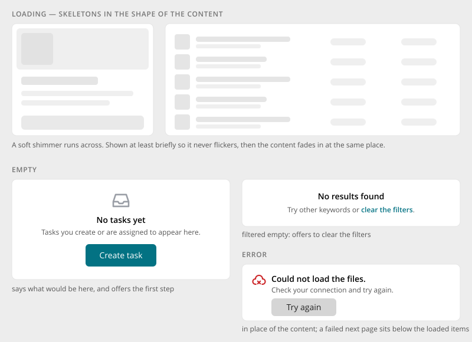

# Loading, Empty & Error States

> Found in the design: directories, tables, the stream, widgets, files, tasks, calendar
> · Core: `CardSkeleton.vue` and `EntityGrid` messages, `TileGrid` skeleton tiles, data table
> skeleton (planned); `humhub\widgets\LoaderWidget` (spinner)
> · Technology: **Both**

Every place that loads content needs three states besides "content": **loading**, **empty** and
**error**. They are designed together, so a page never jumps, never flickers and never leaves
people stuck.

## Loading

- **Skeletons, not spinners.** While content loads, grey blocks in the **shape of the final
  content** stand in: card skeletons for cards, row skeletons for tables and lists, entry
  skeletons for the stream.
- A soft shimmer runs across the blocks. Reduced motion shows them static.
- **Minimum time:** a skeleton stays for a short minimum (about 150–600ms), so a fast answer
  doesn't flash. It then cross-fades to the content in the same place.
- **Reloading** content that is already shown (a filter change): the content dims only when the
  answer takes longer than a moment (about 150–300ms). It is not replaced by skeletons.
- **More items** (infinite scroll): skeleton items appear below the loaded ones.
- **Server-rendered first paint:** where possible, the page is rendered with its skeleton, so
  nothing jumps when a Vue island mounts.
- **Spinners** are only for small, local waits: a button that is saving, or an upload starting.

## Empty

| Case | Content | Example |
|---|---|---|
| **Nothing yet** | What would be here, plus the first step as a button (if the user can take it) | "No tasks yet · Tasks you create or are assigned to appear here. [Create task]" |
| **Filtered to nothing** | That nothing matches, plus a way out | "No results found · Try other keywords or clear the filters." |
| **No access** | Why, without blame | "Only members can see the files of this space." |

- One message in place of the content, centred in its card.
- An icon is optional and neutral.
- Lists that may stay empty for long (e.g. "Upcoming events" in a widget) use one short line
  without a button.

## Error

- **In place of the content** when nothing could be loaded: what failed, what to do, and **"Try
  again"**.
- **Below the loaded items** when a later page fails. The loaded items stay, and only the failed
  part retries.
- **Action errors** (a save, a delete) are not content states. They show at the field or as a
  [Toast](toast.md), and the content stays as it was.
- The text says what failed in plain words ("Could not load the files."). Technical details are
  only for administrators, in an expandable part.

## Accessibility

- A loading region has `aria-busy="true"`, and skeletons are hidden from screen readers.
- When content arrives, it is not announced as a whole. Counts may be ("35 users").
- Empty and error messages are real text. Errors that appear after an action use `role="alert"`.
- "Try again" and the first-step button are real buttons.

## Markup and styles

Skeletons are Bootstrap's **`.placeholder`** blocks, spinners are **`.spinner-border`**. Empty and
error states are one own component. Class names and SCSS follow [Styling with Bootstrap 5](bootstrap.md).

| Class | Element |
|---|---|
| `.placeholder-glow` (or `-wave`) > `.placeholder` | Skeleton blocks inside a component's own markup (an `.entity-card`, a `.tile`, a table row), so the skeleton has the final geometry. The entity cards do so already (`.entity-card-skeleton`). |
| `.spinner-border.spinner-border-sm` | Spinner in a button while a request runs |
| `.is-reloading` | Content that reloads; dims after `$reloading-delay` |
| `.empty-state` | Empty state: `.empty-state-icon`, `.empty-state-title`, `.empty-state-text`, action `.btn` |
| `.empty-state.empty-state-error` | Error state with "Try again" |

- **File:** `_empty-state.scss` (new), behind `$prev-empty-state`. No shimmer of its own: the
  placeholder animation is Bootstrap's.
- **Sass variables:** Bootstrap's `$placeholder-opacity-max`, `$placeholder-opacity-min`; plus
  `$empty-state-icon-size`, `$reloading-delay`, `$reloading-opacity`.

## Implementation in core

**Today:**

- **Vue:** `CardSkeleton` (card directories), skeleton tiles in `TileGrid`, and the messages of
  `EntityGrid` ("No results found!" / "Try other keywords or remove filters." / "Try again").
  Directory pages render the skeleton on the server as the island's placeholder.
- **PHP:** `humhub\widgets\LoaderWidget` (spinner) for legacy loading. Empty texts are written per
  view.

**Proposal:**

- **Skeleton blocks** as shared CSS (one shimmer instead of a copy per component), with
  skeletons for card, row, entry and tile.
- **`EmptyState`:** a component and widget (icon, title, text, optional action). Use it for "nothing
  yet", "filtered" (with "Clear filters") and "no access".
- **`ErrorState`:** a component and widget (message plus "Try again").
- Move `LoaderWidget` usages to skeletons where content is loaded, and keep spinners for buttons.

## Open questions

1. **Illustrations:** neutral icons only (proposal), or illustrated empty states for some places
   (first space, first post)?
2. **Minimum skeleton time:** one value for all, or per place (shorter on the dashboard)?
