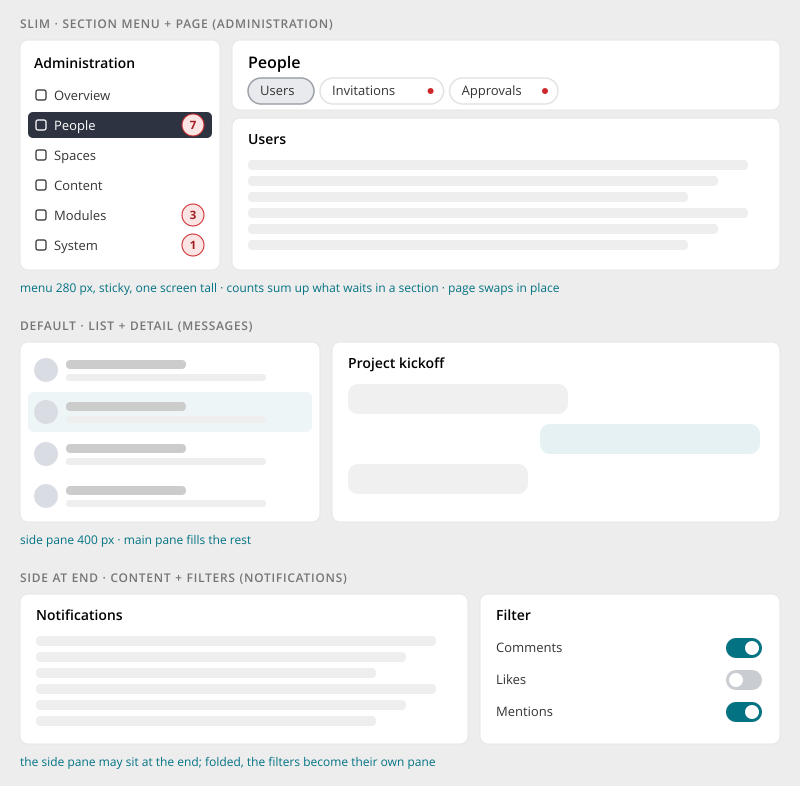
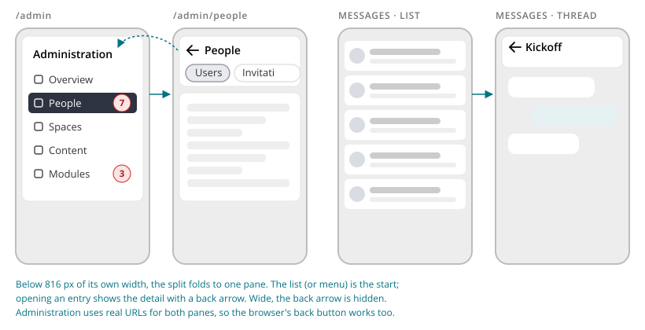

# Master / Detail & Section Menu

> Found in the design: Administration (section menu + page), Messages (conversations + thread),
> Notifications (list + filters)
> · Core: `admin\widgets\AdminMenu` (`LeftNavigation`); no master/detail layout yet
> · Technology: **Both** (proposed). It is a CSS layout with a small JS helper: PHP pages (the
> administration) and Vue islands (messages, notifications) use the same classes.

A two-pane layout: a fixed-width **side pane** next to a flexible **main pane**. When there isn't
enough room for both, it **folds into one pane** at a time, with a back arrow to return. This is
how the new design expresses **hierarchy on mobile**: menu → page, list → detail,
content → filters. There is no hamburger drawer.

The **section menu** is its most important use. The administration's menu sits in the side pane,
and the chosen section's page in the main pane.



## Variants

| Variant | Side pane | Use |
|---|---|---|
| **Slim** | 280px, at the start | A section menu next to its pages (Administration; later account and space settings) |
| **Default** | 400px, at the start | A list next to the selected item (Messages: conversations + thread) |
| **Side at end** | 400px, at the end | Main content with a supporting pane (Notifications: list + filters) |

## Section menu

- A card with the area's title ("Administration") and one entry per **section**: Overview,
  People, Spaces, Content, Communication, Security, Appearance, Integrations, Modules, System.
- **Sub-pages are not nested in the menu.** They are [Pill Tabs](tabs.md) in the section's
  [Page Header](page-header.md).
- The **active entry** is filled with the primary colour, in both colour modes. Hover is a tint
  of it.
- **Count badges** show what waits inside a section, as the **sum** of its sub-pages: People ⑦ =
  4 invitations + 3 approvals. The tabs inside show only dots
  ([Badges & Status](badges.md#count-badges-one-number-per-place)).
- The menu is **sticky** and one screen tall. It scrolls inside itself only when the window is
  shorter than its entries.
- Use a section menu for areas with about 5–12 sections. Fewer sections get tabs only.

## Behaviour

- **The fold depends on the layout's own width, not the viewport.** Below **816px** (two
  400px panes plus the gap) it shows one pane. This also happens on a narrow desktop window, or
  when other columns take room.
- **Folded:**
  - the side pane (menu, list) is the start
  - opening an entry shows the main pane, with a **back arrow** before its title
  - the arrow only exists while folded
- **Real URLs.** In the administration, `/admin` shows the menu and `/admin/people` shows the page,
  so the browser's back button and shared links work. Messages and notifications switch panes
  inside the page.
- **Page swaps in place** (administration): choosing a section or tab replaces only the page card.
  The old content dims only if the answer takes longer than 300ms. Every URL still works as a
  full page load.
- **Unsaved changes:** leaving a [Settings Page](settings-page.md) with unsaved changes asks
  first, also on in-place navigation.
- **Motion:** the arriving pane slides in 8px from the side it comes from. Reduced motion turns
  this off.
- **Full height:** both panes fill the window below the top bar and scroll inside themselves, so
  the list doesn't scroll away while reading a thread.



## Mobile

| Width of the layout | Shows |
|---|---|
| ≥ 816px | Both panes side by side. The back arrow is hidden. |
| < 816px | One pane. The side pane is the start, and the main pane comes with a back arrow. |

## Accessibility

- The section menu is a `<nav>` labelled by its title. The active entry has
  `aria-current="page"`.
- Counts carry hidden text ("7 waiting").
- Hidden panes are `display: none`, so they are removed from the tab order and from screen
  readers.
- The back arrow is a real link where a URL exists, labelled "Back to Administration" or "Back to
  conversations".
- After a pane change, focus moves to the arriving pane's title. After an in-place page swap,
  focus stays on the pressed element if it is still there.

## Markup and styles

The layout is its own component; the section menu is a Bootstrap **`.nav`**. Class names and SCSS follow [Styling with Bootstrap 5](bootstrap.md).

| Class | Element |
|---|---|
| `.pane-split` | The layout and the container for its container query |
| `.pane-split-slim` | Modifier: slim side pane (280px) |
| `.pane-split-end` | Modifier: side pane at the end |
| `.pane-split-side`, `.pane-split-main` | The panes |
| `.is-showing-main` | While folded: the main pane is shown instead of the side pane |
| `.card.section-menu` | The section menu: a card, padded like the page header, with the title and a vertical nav |
| `.section-menu-title` | The area's title (`h2`), with the page header title's size and weight |
| `.nav.flex-lg-column.nav-section` | The entries: a column next to the page, a row above it when the layout stacks |
| `.nav-section .nav-link` | An entry with icon and label; `.active` filled with the primary colour, hover a tint of it. Something waiting shows the dot (`.badge-dot.badge-dot-waiting`, as on tabs) until the count badge exists |

- **Files:** `_section-menu.scss` (new) behind `$prev-section-menu`; `_pane-split.scss` (new)
  behind `$prev-pane-split`.
- **Sass variables:** `$section-menu-padding` (`$spacer * .5`, as the page header),
  `$section-menu-title-font-size` (`$font-size-lg`), `$section-menu-title-font-weight`
  (`$font-weight-semibold`), `$section-menu-title-color` (`var(--bs-emphasis-color)`),
  `$nav-section-link-padding` (`$spacer * .5`), `$nav-section-link-font-weight`
  (`$font-weight-medium`), `$nav-section-link-hover-bg` (`var(--bs-primary-bg-subtle)`),
  `$nav-section-link-active-bg` (`var(--bs-primary)`), `$nav-section-link-active-color`
  (`var(--hh-primary-contrast)`), `$nav-section-icon-font-size` (`$font-size-lg`);
  `$pane-split-side-width` (400px), `$pane-split-side-width-slim` (280px),
  `$pane-split-fold-width` (816px), `$pane-split-gap`.

## Implementation in core

**Today:**

- **Section menu (1.20):** `humhub\widgets\menu\SectionMenu` (`extends Menu`, template
  `widgets/menu/views/section-menu.php`) renders the card above: `title`, then the entries as
  `.nav-link`s (`MenuLink::render(['class' => 'nav-link'])`, so `active`, `aria-current`,
  `data-menu-id` and a module's own classes stay). The `<nav>` is labelled by its title
  (`aria-labelledby`). `admin\widgets\AdminMenu` and `user\widgets\AccountMenu` extend it, with
  the plain titles "Administration" and "My Settings". Below `lg` the title is hidden and the
  entries are a horizontally scrolling strip, as the other left menus do today.
- **Counts:** an entry's `MenuLink::$count` shows the waiting dot with hidden "{count} waiting"
  text, as [Pill Tabs](tabs.md) do. The Modules entry uses it for pending marketplace updates, a
  stored setting the marketplace refreshes in the background, so rendering costs no request.
  `UserMenu` keeps its dot on the approvals tab.
- **Layout:** `modules/admin/views/layouts/main.php` and `modules/user/views/account/_layout.php`
  are Bootstrap columns (`col-lg-3` / `col-lg-9`) with the `gx-3` gutter, so the gap between the
  menu and the page is the `gap-3` between the page header and its content card. No fold yet,
  full page loads (pjax optional).
- **Other left menus:** the space and profile menus, and modules' own menus (hostinginfo), still
  render through `humhub\widgets\menu\LeftNavigation` (`widgets/menu/views/left-navigation.php`,
  a Bootstrap panel) until they become tabs ([Space & Profile Header](container-header.md)).
- **Lists with details:** `NotificationOverview.vue` uses two Bootstrap panels. The messages UI is
  in the mail module, with its own columns.

**Proposal:**

- **Layout:** a `PaneSplit` layout for PHP views and a `PaneSplit` Vue component, rendering the
  same classes. The fold is pure CSS (container query). A tiny JS helper answers "is it folded?"
  for code that must decide whether opening an entry also switches panes. That code must never
  check the window width.
- **Section menu:** `SectionMenu` gets `homeUrl` for the folded start page and renders `count`
  as a count badge once [Badges & Status](badges.md) has `.badge-count`. Entries keep the
  `MenuLink` API; modules add theirs through the menus' events as before.
- **Admin regrouping:** the design groups today's admin menu into the sections listed above.
  That is a separate change, but the section menu makes it possible.

```php
// admin layout
PaneSplit::begin(['variant' => PaneSplit::VARIANT_SLIM, 'showMain' => !$isAdminHome]);
    echo AdminMenu::widget();                       // side pane
PaneSplit::main();
    echo PageHeader::title($sectionTitle)->tabs($sectionTabMenu)->backUrl(['/admin']);
    echo $content;                                  // main pane
PaneSplit::end();
```

```html
<!-- Vue -->
<PaneSplit :show-main="openConversationId !== null">
    <template #side><ConversationList @open="open" /></template>
    <template #main><ConversationThread :id="openConversationId" @back="close" /></template>
</PaneSplit>
```

## Open questions

1. **In-place swap:** do we swap only the page card in the administration (fetch, or pjax), or
   keep full page loads? Full loads are simpler and already work with real URLs.
2. **History when folding:** should opening a conversation on a phone add a history entry, so the
   device's back button returns to the list? The administration does through its URLs, but
   messages doesn't.
3. **Admin regrouping:** adopt the new section grouping (People, Spaces, Content, Communication,
   Security, Appearance, Integrations, Modules, System) together with the new menu, or
   separately?
4. **Other areas:** account settings and space settings: section menu, or tabs only?
