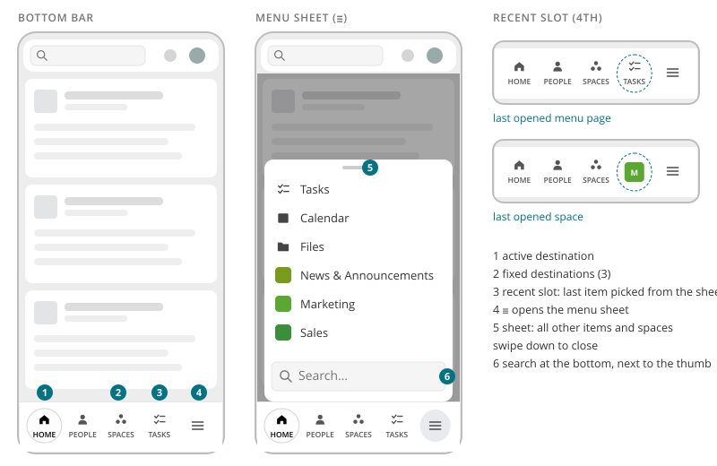
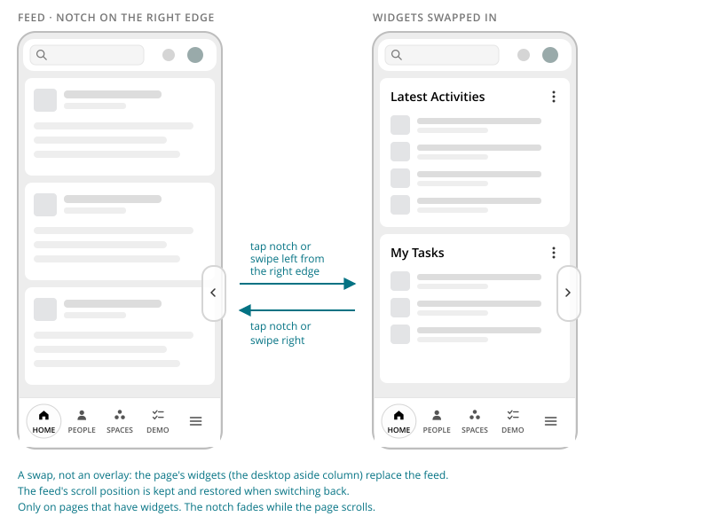

# Mobile Navigation

> Found in the design: any page at a width of 768px or less, e.g. the dashboard
> · Theme: **both** (Community and Enterprise)
> · Core: not yet available
> · Technology: **PHP** (proposed). The bar and sheet are rendered from the existing menus, with a
> small JS module for the sheet and the widget drawer.

On phones, the desktop navigation is replaced by three mechanics. In the Community theme that
is the navigation row of the [Top Bar](top-bar.md), and in the Enterprise theme the
[Sidebar](sidebar.md). The mechanics are:

1. a fixed **bottom bar** with the most important destinations
2. a **menu sheet** behind "≡" with everything else, including all spaces
3. the **widget drawer**, a notch on the right edge that swaps the page content for the page's
   widgets

There is no hamburger drawer. Hierarchy *within* a page (administration sections, conversation
list → conversation) is handled by a back arrow in the [Page Toolbar](page-toolbar.md), not by
this navigation.



## Bottom bar

| # | Part | Notes |
|---|---|---|
| 1 | **Active destination** | Pill-shaped highlight |
| 2 | **Fixed destinations** | Three entries, e.g. Home, People, Spaces. Filled icon over a short uppercase label. |
| 3 | **Recent slot** | The 4th slot shows the item last picked from the sheet. For a menu page it shows icon and label (e.g. Tasks); for a space, only the space image. |
| 4 | **≡** | Opens the menu sheet |

- The bar is fixed at the bottom, above the safe area (iPhone home indicator). The page content
  gets matching bottom padding, so the last card is never covered.
- **On-screen keyboard:** while typing, the bar fades out and leaves the tab order. The exception
  is while the sheet is open, because its search field raised the keyboard.
- The bar has no badges. Unread messages and notifications stay in the top bar (see Open
  questions).

## Menu sheet

| # | Part | Notes |
|---|---|---|
| 5 | **Sheet** | Slides up from the bottom bar over a dimmed page. It lists all remaining main-menu items and all spaces, without repeating what is already in the bar. |
| 6 | **Search** | Sits *below* the list, next to the thumb. It filters as you type, ignores accents, and highlights the matches. |

- **Opening:** "≡" (`aria-expanded`). The page behind it stops scrolling.
- **Closing:** any of the following closes the sheet, and closing also resets the search:
  - tapping the dimmed area
  - Escape (the first Escape clears a non-empty search)
  - "≡" again
  - picking an item
  - **swiping down** on the sheet (it follows the finger and closes after about 72px)
  - growing the window above 768px
- **Size:** the sheet is at most 360px wide and at most 70% of the screen height, and the list
  scrolls inside it.
- **Empty states:** "No more menu items." / "No matching items."

## Widget drawer



On desktop, many pages have a widget column (aside): latest activities, tasks, upcoming events.
On phones, that column is reached through the widget drawer:

- A **notch** sits at the right edge, at about three quarters of the screen height. It is
  translucent with a left-pointing caret, and fades while the page scrolls.
- **Open:** tap the notch, or swipe left from the right edge.
- **Close:** tap the notch again, or swipe right.
- **It is a swap, not an overlay.** The widgets replace the page content in the same scroll area,
  with a short slide. The page's scroll position is kept and restored when switching back, while
  the widgets always start at their top.
- It only appears on pages that have widgets. In a space or profile, the widgets of the current tab
  are used.

## Breakpoints

| Width | Navigation |
|---|---|
| ≤ 768px | Bottom bar, menu sheet, widget drawer. The top bar keeps only search, drawers and user menu, and the Enterprise sidebar is hidden. |
| > 768px | Top bar navigation row (Community) or sidebar (Enterprise), and the aside column. Bottom bar, sheet and notch are hidden. |

## Accessibility

- The bottom bar is a `<nav>` with its own label (e.g. "Main"). The top bar's navigation needs a
  different label.
- "≡": `aria-expanded` and `aria-controls`, labelled "Open menu" / "Close menu".
- Sheet:
  - `inert` and hidden while closed
  - focus is trapped inside while open
  - focus returns to "≡" on close
  - Escape closes it
- Recent slot: labelled "Last opened: Marketing", because the space image alone has no text.
- Notch: a button labelled "Show widgets" / "Show content", with `aria-expanded`.
- Swipe gestures are always optional. Every action also works with a tap or the keyboard.
- Reduced motion: the sheet and the swap appear instantly.

## Implementation in core

**Today:** there is no mobile navigation of its own.

- On small screens, `humhub\widgets\TopMenu` collapses into a "More" dropdown
  (`humhub.ui.topNavigation.js`).
- Spaces are reached through the space chooser.
- Page sidebars (`BaseSidebar`) stack below the content.

**Proposal: Technology PHP**, because the navigation is part of the main layout and must work on
every page, also on pages without a Vue island:

- **`MobileNav` widget**, rendered once in the main layout of both themes. Its entries come from the existing
  menus, so modules that add entries via `TopMenu` events appear automatically:
  - the bar's fixed destinations from `TopMenu`
  - the sheet from `TopMenu` plus the user's spaces
- **`humhub.ui.mobileNav`** JS module for the sheet: open and close, swipe-down, focus trap,
  search and the recent slot.
- **Widget drawer:** the same module works on the existing widget column markup. A page opts in
  by marking its widget column (`data-mobile-widgets`), and `BaseSidebar` can set this by default.

```php
// main layout
<?= MobileNav::widget([
    'fixed' => ['dashboard', 'directory-people', 'directory-spaces'],  // TopMenu entry ids
    'recent' => true,                                                  // 4th slot
]) ?>
```

## Open questions

1. **Fixed destinations:** configurable by the admin (which three) or fixed? Modules could also
   suggest themselves (e.g. Tasks).
2. **Space groups in the sheet:** the sheet lists spaces flat (Community). Should a theme be able
   to group them (Enterprise space categories)?
3. **Recent slot:** remembered per browser (prototype) or server-side as "last visited"?
4. **Badges:** should the bottom bar show unread counts (e.g. on "≡" when a sheet item has news),
   or does the top bar cover this?
5. **HumHub mobile app:** the native app has its own navigation. Is the bottom bar hidden inside
   the app, or does the app rely on it?
6. **Widgets on tablets:** between 769px and 1200px the prototype hides the aside column but shows
   no notch, so the widgets can't be reached. Should the drawer also apply there, or should the
   aside move below the content?
