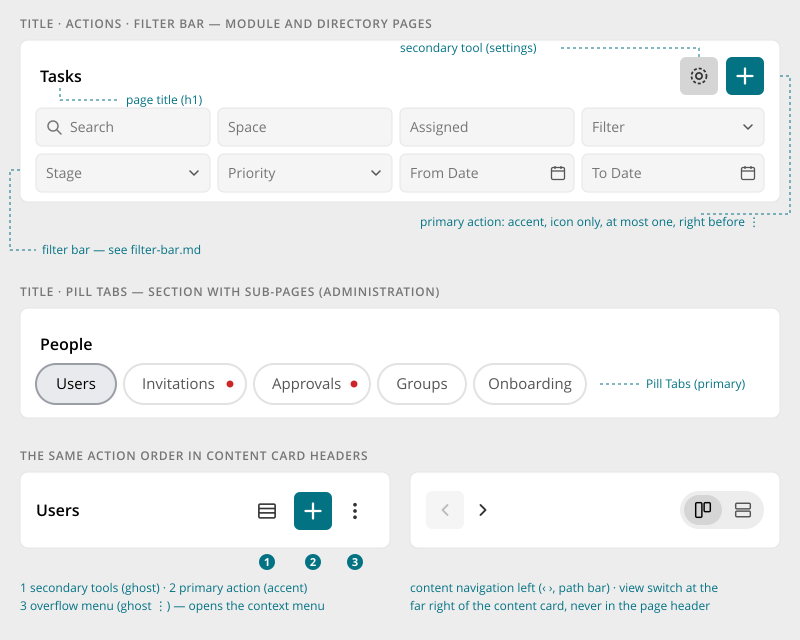
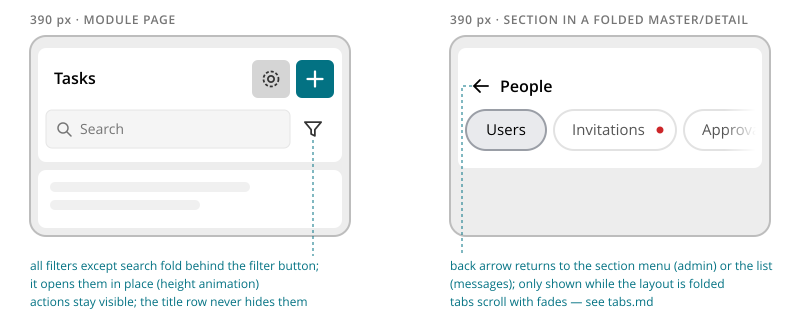

# Page Header

> Found in the design: Tasks, Files, People browser, Admin › Overview, Admin › People
> · Core: `PageToolbar.vue` (since 1.20, becomes `PageHeader.vue`)
> · Technology: **Both** (proposed). A PHP widget and a Vue component render identical markup.

The card at the top of every page that is not a space or profile page: module pages (Tasks,
Calendar, Files, Messages, Notifications), directories (People, Spaces, Marketplace) and
administration sections. It names the page, holds the page's actions and, optionally, the page's
filters or its tabs.

Everything below it (board, grid, table, list, form) is *not* part of the page header. It sits in
one or more [cards](card.md).

Space and profile pages use the [Space & Profile Header](container-header.md) instead.



## Anatomy

The page header is one card with two zones:

```
┌──────────────────────────────────────────────────┐
│ [‹]  Title (h1)                    [⚙] [+] [⋮]   │  ← bar (always)
│ ──────────────────────────────────────────────── │
│ Filter Bar   or   Pill Tabs                      │  ← body (optional, one of the two)
└──────────────────────────────────────────────────┘
```

| # | Part | Notes |
|---|---|---|
| 1 | **Back arrow** | Optional. Only while a surrounding master/detail layout is folded (phones). |
| 2 | **Title** | The page's `h1`. Required. |
| 3 | **Actions** | Icon buttons in a fixed order, see [Actions](#actions). |
| 4 | **Body** | Either a [Filter Bar](filter-bar.md) or primary [Pill Tabs](tabs.md). |

## Variants

There is one component. The variants only differ in what the body holds:

| Body | Example | Used for |
|---|---|---|
| none | Admin › Overview, Messages | Pages without filters or sub-pages |
| **Filter Bar** | Tasks, Calendar, Files, People, Spaces | Module and directory pages |
| **Pill Tabs** | Admin › People (Users, Invitations •, Approvals •, Groups, …) | Sections with sub-pages |

The bar is the same in all three: title, plus actions if the page has any.

**Filters and tabs are never combined.** A page with tabs puts its filters into the content card
below. Admin › People › Users does this: the page header has the tabs, and the "Users" card has
its own header with title, actions and filters (see [Data Table](data-table.md)).

**Not a variant: the dashboard.** The dashboard has no title, and its Feed / Spaces / People
switch is a full-width segmented control with its own filter toggle. It is a special case of the
stream and gets its own spec with the stream; it does not use the page header.

## Actions

All actions are **icon-only square buttons** ([Buttons](buttons.md#forms)) with a tooltip and an
accessible label. They always appear in this order, whatever the sort order of their menu:

```
[tools …]        [+ primary]     [⋮ menu]
secondary        accent          ghost, opens the context menu
any number       at most one     only when it has entries
```

| Part | Look | Examples | Comes from |
|---|---|---|---|
| **Tools** | Secondary icon button | Settings, column chooser, export | The actions menu |
| **Primary action** | Accent icon button | "+" create, add, invite, upload | The entry of the actions menu marked as primary |
| **⋮ menu** | Entries with icon and text in the [Context Menu](context-menu.md) | Everything that doesn't need to be visible | A dropdown menu of its own |

- **Primary** is a neutral property of a menu entry, "the main action of its menu", not a page
  header concept. Among the tools, the menu's sort order applies, so a module that adds a tool
  through a menu event never ends up to the right of "+".
- **At most one primary.** If a menu has more than one, the first is shown as primary and the
  others as tools. Nothing disappears.
- **The ⋮ menu** is an ordinary dropdown menu, the same kind as the ⋮ of a stream entry. It
  appears only when it has entries.
- Nothing moves into ⋮ automatically when there are many tools.

**Content navigation is not an action.** ‹ › period navigation, the path bar and the view switch
belong to the [card](card.md) below: navigation on the left, the view switch at the far right.

A [card](card.md#header-actions) header uses the same action order, but with ghost tools and an
`h2`.

## Behaviour

- **Static layout.** The page header loads nothing and has no state of its own. Filters and tabs
  bring their own behaviour.
- **Width.** At most 1440px wide and centred, aligned with the content below it.
- **Wrapping.** The bar wraps: when the title is long, the actions move to a new line rather than
  truncating the title.
- **Full-height module pages** (board, calendar, files): the content card below fills the
  remaining window height. While the filter bar opens or closes, that card resizes with it.

## Mobile



- **Actions** stay in the bar and stay visible. There is no extra overflow just because the
  screen is narrow.
- **Filter Bar:** below about 570px of its own width, everything except the search field folds
  behind a **filter button** (funnel). Details are in [Filter Bar](filter-bar.md).
- **Tabs** scroll horizontally with fades ([Pill Tabs](tabs.md)).
- **Back arrow:** in a folded master/detail layout (admin section menu → section page,
  conversation list → conversation), a back arrow before the title leads back to the list. It
  appears only while the layout is folded.

## Accessibility

- The page header is a `<section>` labelled by its title (`aria-labelledby`). The title is the
  page's `h1`.
- Icon buttons have `aria-label` and a tooltip with the same text. The ⋮ button has
  `aria-haspopup="menu"` and `aria-expanded`.
- The back arrow is a link labelled "Back".
- Link tabs in the body are a `<nav>` with its own label ([Pill Tabs](tabs.md#accessibility)).

## Markup and styles

The page header is its own component; Bootstrap 5 has none for this job. It is laid out like a
`.card`, and everything inside it is Bootstrap: buttons, the dropdown, the nav. Class names and
SCSS follow [Styling with Bootstrap 5](bootstrap.md).

```html
<section class="page-header" aria-labelledby="page-header-title-1">
    <div class="page-header-bar">
        <a class="page-header-back btn btn-ghost btn-icon-only" href="/admin" aria-label="Back">
            <i class="ti ti-arrow-left" aria-hidden="true"></i>
        </a>
        <h1 id="page-header-title-1" class="page-header-title">People</h1>
        <div class="page-header-actions">
            <a class="btn btn-secondary btn-icon-only" href="…" aria-label="Settings"><i class="ti ti-settings" aria-hidden="true"></i></a>
            <a class="btn btn-accent btn-icon-only" href="…" aria-label="Invite new people"><i class="ti ti-plus" aria-hidden="true"></i></a>
            <div class="dropdown">
                <button class="btn btn-ghost btn-icon-only" type="button" data-bs-toggle="dropdown"
                        aria-haspopup="menu" aria-expanded="false" aria-label="More actions">
                    <i class="ti ti-dots-vertical" aria-hidden="true"></i>
                </button>
                <ul class="dropdown-menu dropdown-menu-end">…</ul>
            </div>
        </div>
    </div>
    <div class="page-header-body">
        <nav aria-label="People"><ul class="nav nav-pills">…</ul></nav>   <!-- or a .filter-bar -->
    </div>
</section>
```

| Class | Element |
|---|---|
| `.page-header` | The card: background, radius, shadow, max width, centred |
| `.page-header-bar` | The first row: back arrow, title, actions; wraps |
| `.page-header-back` | The back arrow (a `.btn.btn-ghost.btn-icon-only`); hidden unless folded |
| `.page-header-title` | The `h1` |
| `.page-header-actions` | The actions, right-aligned |
| `.page-header-body` | The second row with the filter bar or the tabs |

- The ⋮ toggle uses `data-bs-toggle="dropdown"` without `.dropdown-toggle`, so Bootstrap draws no
  caret.
- **File:** `resources/scss/_page-header.scss`, behind `$prev-page-header`.
- **Sass variables** at the head of `_page-header.scss`, taken from existing Bootstrap values;
  radius and shadow are those of the 1.20 card kit (see
  [rule 3](bootstrap.md#3-values-come-from-sass-variables)):

```scss
$page-header-max-width: 1440px !default;
$page-header-padding: $spacer * .5 !default;
$page-header-gap: $spacer * .5 !default;
$page-header-bg: var(--hh-background-color-main) !default;
$page-header-border-radius: $border-radius-lg !default;
$page-header-box-shadow: 0 0 4px 1px rgba(150, 150, 150, .16) !default;
$page-header-box-shadow-dark: 0 0 4px 1px rgba(0, 0, 0, .48) !default;
$page-header-title-font-size: $font-size-lg !default;
$page-header-title-font-weight: $font-weight-semibold !default;
$page-header-title-color: var(--hh-text-color-highlight) !default;
```

- **CSS variables** on `.page-header`: `--hh-page-header-max-width`, `-padding`, `-gap`, `-bg`,
  `-border-radius`, `-box-shadow`, `-title-font-size`, `-title-font-weight`, `-title-color`.

## Implementation in core

**In core (1.20):**

- **Vue:** `PageHeader.vue` (`protected/humhub/vue/`, with the internal
  `header/HeaderActions.vue`), used by `EntityBrowser` (People, Spaces, Marketplace) and the
  cfiles browser. It replaces `PageToolbar.vue` of the 1.20 development line.
- **PHP:** the widget `humhub\widgets\PageHeader` and the menu base
  `humhub\widgets\menu\PageHeaderActions`, with `MenuLink::$isPrimary`. The placeholders of the
  People, Spaces and Marketplace islands render `PageHeader`, and so do the administration's
  section layouts (Users, Spaces, Settings, Information), with their [Pill Tabs](tabs.md) in the
  body and the section's content in a panel below.
- **Every core page that is not a space or profile page has one:** Administration › Modules
  (`ModulesHeaderActions`, "Add more modules" as primary), the account section (Profile, General
  incl. Topics, Security & Privacy, Modules, Notifications, E-Mail Summaries, Friends; the
  title is the entry of the account menu, the section's tabs sit in the body), the notification
  overview (`NotificationOverview.vue`), search and the licence page. Not converted: the
  dashboard (special case, see above), login/registration/installer boxes and error pages.
- **Account section:** the layouts `@user/views/account/_userProfileLayout.php`,
  `_userSettingsLayout.php` and `@user/views/security/_layout.php` render the page header and a
  panel around `$content`; a module view rendered into one of them needs no change. A page
  rendered directly into the account layout brings its own `PageHeader` and sets
  `$this->params['accountPanel'] = false`.
- **Action menus:** `PeopleHeaderActions` and `SpacesHeaderActions` (formerly
  `PeopleHeadingButtons` and `SpaceDirectoryHeadingButtons`).
- **Styles:** `_page-header.scss`; the icon button and ghost are in `_button.scss`, the filter bar
  styles in `_filter-bar.scss` (see [Filter Bar](filter-bar.md)).

**Open:**

| Gap | Next step |
|---|---|
| Back arrow is always shown when a `backUrl` is set | Show it only while a surrounding [Master / Detail](master-detail.md) layout is folded, once that layout exists |
| Tooltips are the native `title` | Switch to the shared [Tooltip](tooltip.md) |

### Class structure

The page header follows the menu pattern of `humhub\widgets\menu`: the base class of a menu
decides how it is shown (`DropdownMenu`, `LeftNavigation`, …). Entries, sorting, visibility and
the events modules use to add entries stay in `Menu`.

```
humhub\widgets\menu\Menu
 ├─ DropdownMenu                ← also the ⋮ menu of a header
 ├─ PillTabs                    ← link tabs
 └─ HeaderActions               ← tools and the primary action
     ├─ PageHeaderActions       ← secondary tools
     │   ├─ user\widgets\PeopleHeaderActions
     │   └─ space\widgets\SpacesHeaderActions
     └─ CardHeaderActions       ← ghost tools, see Content Card
```

**Naming:** an action menu of a page header is named after the page, as people know it from its
title, plus `HeaderActions`: `PeopleHeaderActions`, `SpacesHeaderActions` (plural, so it can't be
mistaken for a space's own header), `AdminUserHeaderActions`. The name says where the menu
appears. Tab menus keep their `…Menu` names (`UserMenu`, `SpaceMenu`).

- **`PageHeader`** (widget): `title`, `actions`, `menu`, `tabs` and `backUrl`. It renders the
  card and delegates actions, ⋮ menu and tabs to their menus. Like `Button`, it has a fluent API;
  the classic `PageHeader::widget(['title' => …, 'actions' => …, 'tabs' => …])` works as well.
- **No filter option in PHP:** a filter bar only makes sense when the content below reacts to it
  without a reload, which means the content is a Vue island. Such a page renders
  `PageHeader.vue` with its [Filter Bar](filter-bar.md) inside the island.
- **`PageHeaderActions`** (`extends HeaderActions`): renders the secondary tools, then the
  primary entry. For Vue, `getEntriesData()` returns each entry's `primary` flag.
- **`MenuLink::$isPrimary`**: the main action of its menu. Neutral, so a card header or any other
  action menu can use it too.
- **⋮ menu:** a `humhub\widgets\menu\DropdownMenu`, handed over with `->menu()`. The page header
  renders it as a ghost ⋮ button (`widgets/menu/views/header-menu.php`); its entries, events
  and visibility are the dropdown menu's own.

```php
<?= PageHeader::title(Yii::t('AdminModule.user', 'People'))
    ->actions(AdminUserHeaderActions::class)
    ->menu(AdminUserHeaderMenu::class)
    ->tabs(UserMenu::class) ?>

<?= PageHeader::title(Yii::t('AdminModule.base', 'Overview')) ?>
```

In the administration this sits once in the layout of a section (e.g. `layouts/user.php`), not in
every view.

```php
class PeopleHeaderActions extends PageHeaderActions
{
    public function init()
    {
        $this->addEntry(new MenuLink([
            'label' => Yii::t('UserModule.base', 'Invite new people'),
            'icon' => 'invite',
            'url' => ['/user/invite'],
            'isPrimary' => true,
        ]));

        parent::init();
    }
}
```

```html
<!-- Vue -->
<PageHeader :title="t('Files')" :actions="actions">
    <FilterBar … />
</PageHeader>
```

- **`PageHeader.vue`:** props `title`, `titleTag` (default `h1`), `actions`, `menu`, `backUrl`;
  slots `actions` (stateful tools, always before "+") and default (the body).
- The actions are rendered by the internal `vue/header/HeaderActions.vue`, shared with
  `ContentCard.vue`; it renders the ⋮ through `DropdownMenu.vue`.

### Migration notes

- `PageToolbar.vue`, `Menu::ENTRY_VARIANTS`, `Menu::ENTRY_VARIANT_DEFAULT` and the
  `c-page-toolbar` classes are new in 1.20 and not released: renamed or removed directly.
- `PeopleHeadingButtons` and `SpaceDirectoryHeadingButtons` are renamed directly, without a
  compatibility class; their menu ids follow (`people-header-actions`,
  `spaces-header-actions`). Modules that add entries through the `EVENT_INIT` of
  `PeopleHeadingButtons` move to `PeopleHeaderActions`: custom-pages, matchmaking and
  members-map (module search). `module-migrate-1.20.md` lists the rename with the People and
  Spaces directories.
- The entries for the tab menus are listed with [Pill Tabs](tabs.md#migration).

## Open questions

1. **Primary action with text?** The prototype is icon-only everywhere. Do we allow a labelled
   primary button (e.g. "Invite") on wide screens?
2. **Overflow rules:** should there be a limit of visible tools (e.g. two) with the rest moving to
   ⋮, or does the page always decide explicitly, as now?
3. **View switch placement:** the prototype puts it in the content card. `ViewSwitch.vue` is
   currently documented "for a `PageToolbar`'s `actions` slot". Align the docs with the design.
