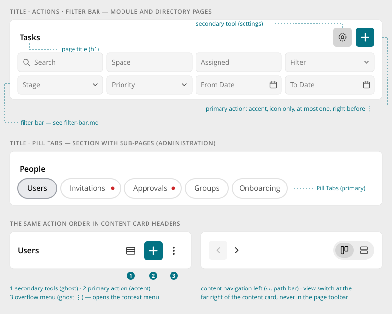
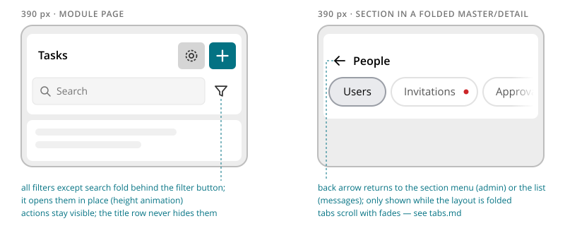

# Page Toolbar

> Found in the design: Tasks, Files, People directory, Admin › People
> · Core: `PageToolbar.vue` (since 1.20)
> · Technology: **Both** (proposed). Vue exists; a PHP widget with identical markup is needed for
> server-rendered pages such as the administration.

The card at the top of every page that is not a space or profile page, such as module pages
(Tasks, Calendar, Files, Messages, Notifications), directories (People, Spaces, Marketplace) and
administration sections. It carries:

- the page title
- the page actions
- optionally a filter bar or pill tabs

Everything below it (board, grid, table, list) is *not* part of the toolbar. It sits in its own
content card.

Space and profile pages use the container header (cover, image, membership buttons) instead.



## Variants

| Variant | Rows | Example |
|---|---|---|
| Title only | title | Admin › Overview |
| Title + actions | title | Messages (`+`), People (invite) |
| Title + actions + filter bar | title, filters | Tasks, Calendar, Files, Spaces, People |
| Title + pill tabs | title, tabs | Admin sections with sub-pages (People, Integrations, …) |
| With back arrow | title | Any of the above inside a folded master/detail layout, on phones |

Filters and tabs are not combined in one toolbar. A section page with tabs puts its filters into the
content card below (e.g. the Users table has its own filter bar, see [Data Table](data-table.md)).

## Header actions

All header actions are **icon-only square buttons** (38px, same height as a field). Each has a
tooltip and an accessible label. They always appear in this order, from left to right:

1. **Secondary tools**: settings, column chooser, export, … (secondary or ghost style).
2. **The primary action**: "+" for create, add, invite or upload. It uses the accent colour, and
   there is **at most one** per header.
3. **Overflow menu**: ⋮ (ghost). It opens the context menu with everything else.

The same order applies to the header of every content card (e.g. the Users table:
columns · + · ⋮). It is a general rule, not one specific to the toolbar.

Content navigation does **not** go into the page toolbar. This covers ‹ › period navigation, the
path bar and the view switch. They belong to the content card below: navigation
on the left, the view switch at the far right.

## Behaviour

- **Static layout.** The toolbar loads nothing and has no state of its own. Filters and tabs bring
  their own behaviour.
- **Width.** The toolbar is at most 1440px wide and centred, aligned with the content below it.
- **Wrapping.** The title row wraps: when the title is long, the actions move to a new line rather
  than truncating the title.
- **Full-height module pages** (board, calendar, files): the content card below fills the remaining
  window height. While the filter bar opens or closes, that card resizes with it.

## Mobile



- **Actions** stay in the title row and stay visible. There is no extra overflow just because the
  screen is narrow.
- **Filter bar:** below about 570px of toolbar width, everything except the search field folds
  behind a **filter button** (funnel). The button opens the filters in place with a height
  animation; details are in [Filter Bar](filter-bar.md). The fold depends on the toolbar's own
  width, not on the viewport.
- **Tabs** scroll horizontally with fades ([Pill Tabs](tabs.md)).
- **Back arrow:** in a folded master/detail layout (admin section menu → section page, conversation
  list → conversation), a back arrow before the title leads back to the list. It appears only while
  the layout is folded.

## Accessibility

- The toolbar is a `<section>` labelled by its title. The title is the page's `h1`.
- Icon buttons have `aria-label` and a tooltip with the same text. The overflow button has
  `aria-haspopup="menu"` and `aria-expanded`.
- The back arrow is a link with a label such as "Back to Administration".

## Implementation in core

Core already has this component for Vue pages: **`PageToolbar.vue`**
(`protected/humhub/vue/PageToolbar.vue`, styles in `resources/scss/_page-toolbar.scss`). It is
documented in [Vue.js Components](../develop/ui-js-vuejs-components.md) and used by `CardDirectory`
(People, Spaces, Marketplace) and the cfiles browser.

- **Props:** `title`, `titleTag` (default `h1`) and `actions`
  (`[{ id, icon, label, url, modal?, variant? }]`, typically from
  `humhub\widgets\menu\Menu::getEntriesData()`).
- **Slots:** an `actions` slot for stateful buttons, and the default slot for the filter bar.
- **Icon buttons:** `.btn.btn-<variant>.c-icon-button`, 38px.

**Gaps compared to this spec:**

| Gap | Proposal |
|---|---|
| No overflow menu (⋮) | Optional `menu` prop or slot that renders a `DropdownMenu`, always last |
| No action order enforced | Sort actions by role: `secondary`/`ghost` first, then the `accent` action, then the overflow menu. Allow at most one `accent` action. |
| No tabs row | `tabs` slot (or prop for link tabs from a `TabMenu`), rendered as primary [Pill Tabs](tabs.md) |
| No back arrow | `back` prop (`{ url, label }`), shown only while the surrounding master/detail layout is folded |
| Tooltip is the native `title` | Switch to the shared tooltip once that exists |
| Only for Vue pages | The admin and other server-rendered pages need the same markup. Options: a small PHP `PageToolbar` widget that renders the same `c-page-toolbar` markup, or a `VueWidget` wrapper. |

**Proposal: PHP counterpart** for server-rendered pages, mirroring the Vue props:

```php
PageToolbar::widget([
    'title' => Yii::t('AdminModule.user', 'People'),
    'actions' => AdminUserActionsMenu::class,   // Menu: secondary entries, one accent entry, overflow
    'tabs' => UserMenu::class,                  // TabMenu → primary pill tabs
    'back' => ['url' => ['/admin'], 'label' => Yii::t('AdminModule.base', 'Administration')],
]);
```

## Open questions

1. **Primary action with text?** The prototype is icon-only everywhere. Do we allow a labelled
   primary button (e.g. "Invite") on wide screens?
2. **Overflow rules:** what goes into ⋮ and what stays a visible icon? Proposal: at most two
   secondary tools visible, the rest in ⋮.
3. **View switch placement:** the prototype puts it in the content card. `ViewSwitch.vue` is
   currently documented "for a `PageToolbar`'s `actions` slot". Align the docs with the design.
