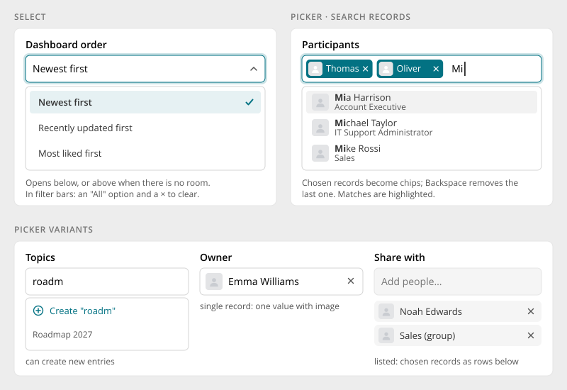

# Select & Pickers

> Found in the design: settings (selects), filter bars, Create task (assignees, space, topics),
> Share (people), the component demo page (user, space, topic, group and content type pickers)
> · Core: `PickerInput`/`PickerField` (Vue) on PHP `BasePicker` (`UserPickerField`,
> `SpacePickerField`, `ContentTagPicker`, `MultiSelect`) and on `Html::dropDownList()`; Vue
> `SelectField` (native `<select>`), `FilterSelect`, `FilterPicker`, `PickerFilterControl`
> (filters)
> · Technology: **Both**

Two controls for choosing:

- a **select** picks one value from a **short, fixed list** (sort order, visibility, page size)
- a **picker** **searches records** (people, spaces, topics, groups, content types) and picks one or
  several of them

Both share the [Form Fields](form-fields.md) anatomy and states.

## Select

- **Closed:** value plus chevron. Empty selects show a placeholder ("Select…").
- **Open:** the list opens below the field, or **above** when there is no room. It is never clipped
  by a dialog or card. The chosen option is highlighted with a check.
- **In filter bars:** the first option is "All" (no filter), and a set value gets a × to clear it.
  In forms, a select that always has a value has no ×.
- **Long lists** (more than about 10 options, or options that come from the server) become a
  picker with search.

## Picker

- **Search:** results appear after typing (usually from 2–3 characters). Some pickers show
  suggestions before typing (e.g. people of the current space). Matches are highlighted.
- **Results** are list rows: image or icon, name, a subtitle (job title, space description, "Content
  type"). Already chosen records are hidden from the results.
- **Chosen records** become chips in the field (filled in the accent colour, with image and ⊗). Backspace in the empty
  input removes the last chip.
- **Feedback** in the result list: "Type at least 3 characters", "No matches found", "Maximum
  reached".
- **Keyboard:** ↑/↓ move through results, Enter adds, Escape closes.

## Picker variants

| Variant | Use | Notes |
|---|---|---|
| **Multiple** | Participants, assignees, recipients | Chips in the field, optional maximum |
| **Single record** | Owner, space for a task | Shows the one record with its image, × to clear |
| **Listed** (`listed`) | Share with, members of a long list | Chosen records appear as rows below the field instead of chips |
| **Can create** | Topics, tags | A "Create "roadm"" row adds a new entry from the typed text |
| **Types** | User, space, topic, user group, content type, tag | Each type has its own result row and data source. Modules can register more. |

## Mobile

- The same list below or above the field. No bottom sheet.
- With the on-screen keyboard open, the list flips above the field when the keyboard covers the
  space below, and it is limited to the visible area.
- Chips wrap onto further lines inside the field.

## Accessibility

- **Select:** the trigger is a button (or native `<select>`) labelled by the field's label, with
  `aria-expanded`. Options are `role="option"` with `aria-selected`.
  - **Arrow keys** move through the options, and typing jumps to a matching option.
- **Picker:** WAI-ARIA combobox pattern: input with `role="combobox"`, `aria-expanded` and
  `aria-activedescendant`, results as `listbox`.
- Feedback messages are announced (`aria-live="polite"`).
- Each chip's × is a button labelled "Remove Thomas Bennett".
- The accessible name is always the field's name, never "Select".

## Markup and styles

A native select is Bootstrap's **`.form-select`**. Where native isn't enough (filters, rich
options), the custom listbox **`.select-menu`** is used; a picker is a `.select-menu` whose
button is a field with chips and an input. Class names and SCSS follow
[Styling with Bootstrap 5](bootstrap.md).

| Class | Element |
|---|---|
| `select.form-select` | Native select |
| `.select-menu` | Custom listbox (`FilterSelect`); `.is-open`, `.has-selection`, `.is-loading` |
| `.form-control.select-menu-button`, `.select-menu-value`, `-chevron`, `-clear`, `-spinner` | The button with the chosen value, the chevron, the × that clears it, the spinner |
| `.dropdown-menu.select-menu-drawer` | The listbox, open with `.show`, placed below the field with `data-bs-popper="static"` |
| `.dropdown-item.select-menu-option` | An option: `.active` when chosen (`aria-selected`), `.is-focused` for the option the keyboard is on (`aria-activedescendant`, drawn like hover) |
| `.dropdown-item-text.select-menu-feedback` | "No results", "Loading…" |
| `.picker` | A searchable picker (`FilterPicker`, `PickerFilterControl`) on `.select-menu`; `.is-disabled`, `.is-multiple` |
| `.form-control.picker-field`, `.picker-input` | The field holding chips and the combobox input |
| `.picker-chip`, `-label`, `-remove` | A chosen value |
| `.picker-option-label`, `-count` | An option with a count |
| `.picker-host` | The mount point of `PickerInput` after the native `<select>` |
| `.picker-option-image`, `-text`, `-subtext` | A result row: image, label, sub text |
| `.picker-value-image`, `.picker-chip-image` | The image of the chosen item in the closed field, in a chip (chips carry `data-value`) |
| `.picker-list`, `.picker-list-item`, `-image`, `-text` (`-label`, `-subtext`), `-remove` | The chosen records of a `listed` picker |
| `.picker-color` | A colour dot |
| `.picker-filter`, `-icon`, `-avatar`, `-chip`, `-name`, `-detail` | A record filter (`PickerFilterControl`) |
| `.user-filter`, `.space-filter`, `.topic-filter` | The module types; a type's own parts are `<block>-icon`, `-chip`, `-avatar`, `-option`, `-name`, `-detail` (e.g. `.topic-filter-dot`) |

- **File:** `_picker.scss`, behind `$prev-picker` (the rules moved there from `_filter-bar.scss`).
- The custom select's button is a `.form-control`, not a `.form-select`: it is no native
  `<select>`, and it brings its own chevron and clear ×. So filter fields and form fields share
  one look.
- **Sass variables:** `$select-menu-field-height`, `$select-menu-icon-size`,
  `$select-menu-icon-color`, `$select-menu-icon-space`, `$select-menu-max-height` (the listbox's
  height before it scrolls), `$picker-chip-height`, `$picker-chip-image-size`, `$picker-chip-bg`,
  `$picker-chip-color`, `$picker-chip-font-size`,
  `$picker-color-size`, `$picker-list-item-bg`; the rest is `$input-*` and `$dropdown-*`.

## Implementation in core

| Where | What |
|---|---|
| PHP forms | `humhub\widgets\form\BasePicker` (`UserPickerField`, `SpacePickerField`, `ContentTagPicker`, `MultiSelect`, …) and `Html::dropDownList()` render a native `<select>` with `data-picker-*`; the UI addition `ui.picker` mounts `PickerInput` on it. The `<select>` stays the value carrier, so forms, validation and `form.reset()` work as before. |
| Vue forms | `PickerField` (the `HumHubForm` field around `PickerInput`) for pickers and enhanced selects; `SelectField` stays a native `<select>`. |
| Vue filters | `FilterSelect`, `FilterPicker` and `PickerFilterControl` (plus `UserFilterControl`, `SpaceFilterControl`, `TopicFilterControl`) keep their components and share the combobox (`picker/comboboxMixin.js`) with `PickerInput`. |

The specification is [Vue.js Picker](../develop/ui-js-vuejs-picker.md). The minimum number of
characters is set per widget (`minInput`).

## Open questions

None.
