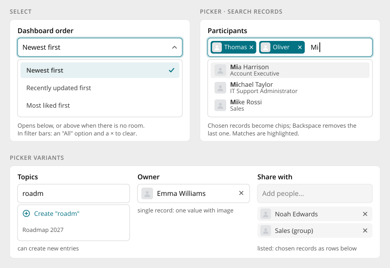

# Select & Pickers

> Found in the design: settings (selects), filter bars, Create task (assignees, space, topics),
> Share (people), the component demo page (user, space, topic, group and content type pickers)
> · Core: PHP `BasePicker` (select2) with `UserPickerField`, `SpacePickerField`,
> `ContentTagPicker`, `MultiSelect`; Vue `SelectField` (native `<select>`), `FilterSelect`,
> `FilterPicker`, `PickerFilterControl` (filters only)
> · Technology: **Both**

Two controls for choosing:

- a **select** picks one value from a **short, fixed list** (sort order, visibility, page size)
- a **picker** **searches records** (people, spaces, topics, groups, content types) and picks one or
  several of them

Both share the [Form Fields](form-fields.md) anatomy and states.

## Select

- **Closed:** value plus chevron. Empty selects show a placeholder ("Select…").
- **Open:** the list opens below the field, or **above** when there is no room. It is never clipped
  by a dialog or card. The chosen option is highlighted with a check.
- **In filter bars:** the first option is "All" (no filter), and a set value gets a × to clear it.
  In forms, a select that always has a value has no ×.
- **Long lists** (more than about 10 options, or options that come from the server) become a
  picker with search.

## Picker

- **Search:** results appear after typing (usually from 2–3 characters). Some pickers show
  suggestions before typing (e.g. people of the current space). Matches are highlighted.
- **Results** are list rows: image or icon, name, a subtitle (job title, space category, "Content
  type"). Already chosen records are hidden from the results.
- **Chosen records** become chips in the field (accent, with image and ×). Backspace in the empty
  input removes the last chip.
- **Feedback** in the result list: "Type at least 3 characters", "No matches found", "Maximum
  reached".
- **Keyboard:** ↑/↓ move through results, Enter adds, Escape closes.

## Picker variants

| Variant | Use | Notes |
|---|---|---|
| **Multiple** | Participants, assignees, recipients | Chips in the field, optional maximum |
| **Single record** | Owner, space for a task | Shows the one record with its image, × to clear |
| **Listed** | Share with, members of a long list | Chosen records appear as rows below the field instead of chips |
| **Can create** | Topics, tags | A "Create "roadm"" row adds a new entry from the typed text |
| **Types** | User, space, topic, user group, content type, tag | Each type has its own result row and data source. Modules can register more. |

## Mobile

- The same list below or above the field. No bottom sheet.
- With the on-screen keyboard open, the list flips above the field when the keyboard covers the
  space below, and it is limited to the visible area.
- Chips wrap onto further lines inside the field.

## Accessibility

- **Select:** the trigger is a button (or native `<select>`) labelled by the field's label, with
  `aria-expanded`. Options are `role="option"` with `aria-selected`.
  - **Arrow keys** move through the options, and typing jumps to a matching option.
- **Picker:** WAI-ARIA combobox pattern: input with `role="combobox"`, `aria-expanded` and
  `aria-activedescendant`, results as `listbox`.
- Feedback messages are announced (`aria-live="polite"`).
- Each chip's × is a button labelled "Remove Thomas Bennett".
- The accessible name is always the field's name, never "Select".

## Implementation in core

**Today:**

| Where | What |
|---|---|
| PHP forms | `humhub\widgets\form\BasePicker` (select2) with `UserPickerField`, `SpacePickerField`, `ContentTagPicker`, `MultiSelect`. Native `dropDownList` for selects. |
| Vue forms | `SelectField` renders a native `<select>` (Bootstrap `form-select`). There is no picker for forms yet. |
| Vue filters | `FilterSelect` (listbox with "all" state and ×), `FilterPicker` and `PickerFilterControl` (combobox with search, chips), plus the module types `UserFilterControl`, `SpaceFilterControl` and `TopicFilterControl`. These already follow the design. |

**Gaps:**

| Gap | Proposal |
|---|---|
| No picker for Vue forms | Promote `PickerFilterControl` into a form field (`PickerField`, with `attribute`, errors, the `HumHubForm` contract), with types user, space, topic, group |
| PHP pickers use select2 | Restyle select2 to the new look as a first step. Later, render PHP pickers as Vue islands (`VueWidget`) on the same component, so there is one implementation. |
| Native `<select>` look | Style `form-select` (fill, chevron, states). Use the custom listbox only where native isn't enough (filters, rich options). |
| Can-create and listed modes | Options on the shared picker |

## Open questions

1. **One picker implementation:** move PHP pickers to the Vue picker via `VueWidget`, or keep
   select2 restyled for PHP forms?
2. **Native or custom select in forms:** native `<select>` (best on mobile, simplest), or the
   custom listbox everywhere for a consistent look?
3. **Minimum characters:** one value for all pickers (e.g. 2), or per type?
