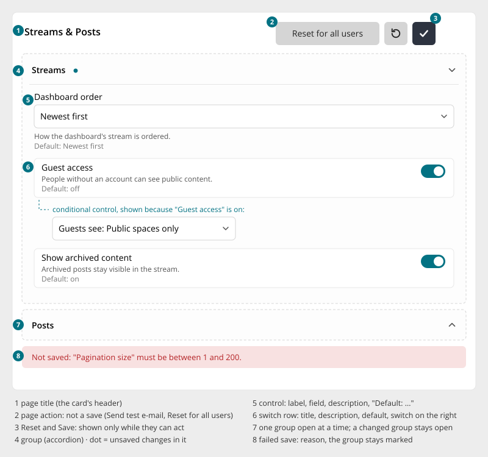
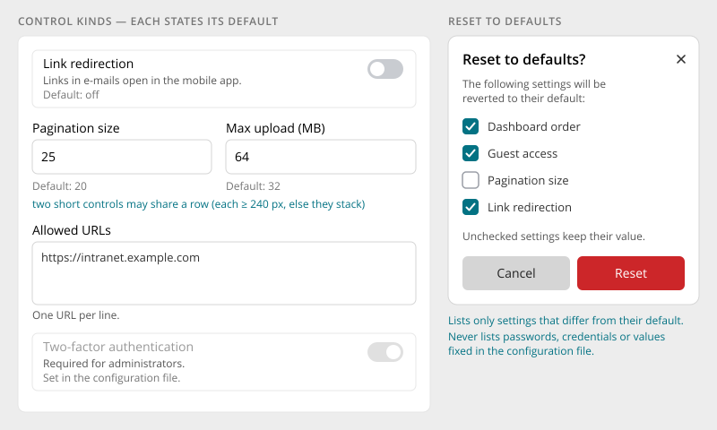

# Settings Page

> Found in the design: every Administration settings page (Appearance, Security, Content,
> Communication, Integrations, System), permission pages per role
> · Core: hand-written `ActiveForm` views in `admin/views/setting/*`; `NotificationSettings.vue`
> (account and admin notification settings, autosave)
> · Technology: **Both** (proposed). A PHP widget for the existing form models, and the same
> pattern for Vue islands.

The pattern for any page of settings: Administration, and later space, profile and module
settings. A card with the page title and the **Save / Reset icon buttons, which appear only when
they can act**. Its body holds the controls, optionally grouped into
[Accordions](accordion.md). **Every control says what it does and what its default is.**



## Anatomy

| # | Part | Notes |
|---|---|---|
| 1 | **Title** | The card header. Section tabs sit above it in the [Page Toolbar](page-toolbar.md). |
| 2 | **Page action** | Optional. A secondary text button for actions that are not saves ("Send test e-mail", "Reset for all users"). If the action depends on unsaved settings, it warns first. |
| 3 | **Reset and Save** | Icon buttons in the header. **Save** (primary) appears once something changed. **Reset** (secondary) appears while any value differs from its default. |
| 4 | **Groups** | [Accordions](accordion.md), one open at a time. A group with unsaved changes shows the accent dot and stays open. Pages with few settings have no groups. |
| 5 | **Control** | Label, field, a description line and "Default: …" |
| 6 | **Switch row** | Title, description and default on the left, the switch on the right. The most common control. |
| 7 | **Closed group** | Opens on click. The first group, or the one with an error, starts open. |
| 8 | **Save error** | The reason, under the groups. The affected group stays marked, and fields show their own errors. |

## Control kinds



| Kind | Notes |
|---|---|
| **Switch row** | On/off settings. A switch whose "off" can't be undone (e.g. deleting data) asks before saving. |
| **Select** | One of a few options |
| **Number / text** | Short values. Two short controls may share a row when each gets at least 240px; otherwise they stack. |
| **Textarea / code** | Lists ("one URL per line"), code snippets in a monospace font |
| **Picker** | Spaces, groups, users ([Filter Bar](filter-bar.md) pickers, as form fields) |
| **Colour, image** | Brand colour, logo, icon |
| **Password / secret** | Never shown again. The field says that one is saved, and typing replaces it. |
| **Read-only** | A value fixed in the configuration file: shown, disabled, with the reason "Set in the configuration file." |
| **Matrix** | Several switches per row, e.g. notification kinds × Web / E-mail / Mobile. It scrolls inside itself on narrow screens. |

**Conditional controls** appear in place, with a height animation, when the setting they depend
on is set. For example, "Guests see" only appears while "Guest access" is on. A control that
depends on another one *and must stay visible* is disabled instead, and its help line says why.

## Behaviour

- **Change tracking per group.** Values are compared with the saved state. Changing a value back
  removes the mark again.
- **Save** sends the changed values and shows a short confirmation (toast). On failure, the
  values stay as edited, the reason shows under the groups, and fields show their own messages.
- **Reset to defaults** opens a dialog listing **every setting that differs from its default**,
  each with a ticked checkbox. Only the ticked ones are reset, and other unsaved edits stay. The
  dialog never lists passwords, credentials or values fixed in the configuration file.
- **Leave guard.** Leaving the page, or switching tabs, with unsaved changes asks first.
- **Permission pages:** one tab per role (pill tabs, secondary), with a dot on roles that have
  unsaved changes. The groups are permissions by module, and each group saves and resets on its
  own via header actions in the accordion.

### Explicit save or autosave?

The design uses an **explicit Save**. Core's new notification settings (`NotificationSettings.vue`)
**save automatically** on every change and show the state next to the title ("Saving…",
"Saved", "Not saved").

**Proposal:**

- **Explicit Save** is the default for settings pages. Settings often depend on each other, need
  validation, or affect everyone.
- **Autosave** is allowed for pages that consist only of independent switches with immediate
  effect for the current user (personal notification settings). It must show its save state
  next to the title.
- A page never mixes the two.

## Mobile

- Controls always take the full width. Pairs stack.
- Matrices scroll inside their group, not the page.
- Header actions stay in the header, because they are icon buttons.
- The administration menu and the settings page fold into list → page with a back arrow (see
  [Page Toolbar](page-toolbar.md#mobile)).

## Accessibility

- Every control has a visible label. Description and default are linked via
  `aria-describedby`.
- The accordion and dot rules apply (see [Accordion](accordion.md)).
- Save and Reset: icon buttons with label and tooltip. When a pressed button hides itself, focus
  moves to the group header or the page title, never to nowhere.
- The save error is announced (`role="alert"`). Field errors are linked to their fields.
- Reduced motion: conditional controls and header actions appear without animation.

## Implementation in core

**Today:**

- **Admin settings views:** each one is a hand-written `ActiveForm` with a submit button
  (`modules/admin/views/setting/*.php`, models `modules/admin/models/forms/*Form.php`).
- **Groups:** some views use `ActiveForm::beginCollapsibleFields()`.
- **Storage:** values live in `$module->settings`.
- **Missing:** defaults are not shown, there is no change tracking and no reset to defaults.
- **Permissions:** `user\widgets\PermissionGridEditor`.
- **Vue:** `NotificationSettings.vue` is the first page in the new look (autosave, profile radio
  group, category rows with channel badges, reset).

**Proposal: Both.** A declarative `SettingsPage` PHP widget for the admin forms, with a small JS
module for change tracking, header actions, reset and the leave guard. Vue settings pages use the
same classes and rules.

```php
echo SettingsPage::widget([
    'title' => Yii::t('AdminModule.settings', 'Streams & Posts'),
    'model' => $form,                                   // existing *Form model
    'groups' => [
        'streams' => [
            'label' => Yii::t('AdminModule.settings', 'Streams'),
            'controls' => [
                SettingsControl::select('defaultStreamSort', $options)
                    ->hint(Yii::t('AdminModule.settings', "How the dashboard's stream is ordered.")),
                SettingsControl::switch('enableGuestAccess'),
                SettingsControl::select('guestVisibility', $guestOptions)->showIf('enableGuestAccess', true),
            ],
        ],
    ],
    'pageActions' => [
        Button::light(Yii::t('AdminModule.settings', 'Reset for all users'))->action('...'),
    ],
]);
```

- **Defaults** come from the form model (`getDefault($attribute)`), falling back to the module's
  default settings. A model can mark an attribute as fixed by configuration.
- **Save** posts the changed attributes and returns per-field errors (HTTP 422), which the page
  maps onto the fields.
- **Reset** posts the chosen attributes and returns the new values.
- `beginCollapsibleFields()` groups map to `SettingsPage` groups, so older views can migrate step
  by step.

## Open questions

1. **Explicit save vs. autosave:** agree on the rule above (explicit by default, autosave only for
   personal toggle pages)?
2. **Partial save and validation:** save only changed groups, or always validate the whole model?
   A per-group save needs validation per group.
3. **Defaults for module settings:** where do they come from: module config, the form model, or a
   new declaration?
4. **Space, profile and module settings:** do they all adopt this pattern, or only the
   administration?
5. **Matrix:** a generic control, or specific to notifications?
