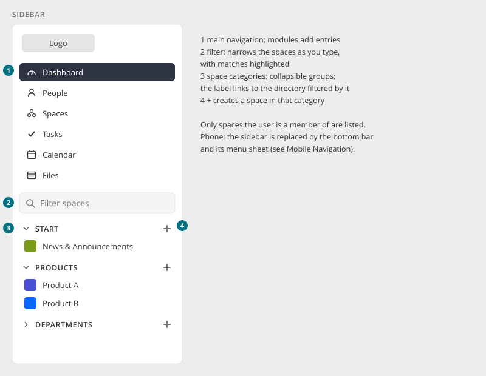

# Sidebar (Enterprise Theme)

> Found in the design: every page on desktop and tablet. The prototype is built on the Enterprise
> theme.
> · Theme: **Enterprise theme only** (module `enterprise-theme`). The Community theme keeps the
> horizontal navigation in the [Top Bar](top-bar.md).
> · Code: `enterpriseTheme\widgets\Chooser`, `EnterpriseSpaceChooser.vue`, space types
> (`models/SpaceType.php`), layout `themes/enterprise/views/layouts/main.php`
> · Technology: **PHP** layout with a Vue island for the space list (exists in the Enterprise theme)

The fixed column on the left of every page **in the Enterprise theme**. It holds the **main
navigation** and the user's **spaces**, grouped into **space categories**. The top bar then only
carries search, messages, notifications and the user menu.

This page describes the new look for the Enterprise theme's sidebar. All other components (page
toolbar, tabs, tables, forms, …) are the same in both themes.

## Anatomy

| # | Part | Notes |
|---|---|---|
| — | **Logo** | Links to the dashboard |
| 1 | **Main navigation** | Dashboard, People, Spaces, plus module entries (Tasks, Calendar, Files, …). The active entry is filled dark. |
| 2 | **Filter** | Narrows the spaces below as you type, with matches highlighted |
| 3 | **Space categories** | Collapsible groups (START, PRODUCTS, DEPARTMENTS). The label links to the [Card Directory](card-directory.md) of spaces filtered by that category. |
| 4 | **+ per category** | Creates a space in that category (only for users who may create spaces) |

Each space row shows the space image and name. New content in a space may be marked with a dot
([Badges & Status](badges.md)).

## Behaviour

- **Width:** 280px, sticky, full height. It scrolls inside itself when the list is long.
- **Collapsing categories:** the chevron toggles a category with a short height animation. The
  state is remembered per user.
- **Filter:**
  - it searches name and description, ignoring accents
  - groups without hits fold away, and groups with hits open
  - "No spaces found" appears when nothing matches
  - emptying the field restores the previous open/closed state
- **Only spaces the user is a member of** are listed. All spaces are in the directory.
- **Order:** categories in the admin-defined order; spaces inside by the user's order (or
  alphabetically).

## Space categories

Space categories are an **Enterprise theme feature** ("space types"). They are not part of core.

- A space belongs to **one** category. Categories are defined by administrators, ordered, and have
  a label.
- Spaces without a category are listed in a default group.
- Categories also appear as a **"Category" filter in the Spaces directory**, and as the subtitle on
  space cards (through the `space.card-subtitle` extension slot).

## Mobile

- At 768px and below, the sidebar is hidden. Its entries move into the
  [Mobile Navigation](mobile-navigation.md): the bottom bar plus the menu sheet with search.
- There is no hamburger drawer.

## Accessibility

- `<nav aria-label="Main">` for the main navigation, and a separate labelled list for spaces. The
  active entry has `aria-current="page"`.
- Category toggles are buttons with `aria-expanded`. The label link and the "+" are separate
  controls with their own names ("Create space in Products").
- The filter is a labelled search field. Its result count is announced.

## Implementation

**Today (Enterprise theme, `enterprise-theme` module, since its 1.18 release for HumHub 1.20):**

- **Layout:** `themes/enterprise/views/layouts/main.php` renders `#sidebar-wrapper` with the logo,
  `TopMenu` (vertical, view override of `widgets/topNavigation.php`) and the theme's
  `widgets\Chooser`. There is a hide/show toggle for the sidebar.
- **Space list:** the Vue island `EnterpriseSpaceChooser`. The spaces come with the page, and
  new-content counters load through the core HTTP API. The filter searches via
  `GET /api/v2/space`, and the list follows follow, unfollow and archive without a reload
  (`GET /api/v2/enterprise-theme/navigation`).
- **Space types:** `models/SpaceType.php` with an admin list. The "Category" filter is added to
  core's `SpaceList` (`EVENT_INIT`), and category restrictions apply on `SpaceList::EVENT_BUILD`.

**Changes for the new design:**

| Change | Note |
|---|---|
| Look | Entries with icons, the active entry filled dark, categories as collapsible groups with "+" |
| Filter | Folds groups without hits, highlights matches, and restores the open/closed state when cleared |
| Remember collapsed categories | Per user |
| "+" per category | Opens "Create space" with the category preselected |
| Mobile | The sidebar is hidden at 768px and below. Its entries and spaces appear in the core [Mobile Navigation](mobile-navigation.md) (bottom bar plus menu sheet). |

**Core requirements:** the theme builds on core's `TopMenu`, `SpaceList`, the space API and the
mobile navigation. Core needs no space categories of its own. The mobile menu sheet should let a
theme group the spaces (see [Mobile Navigation](mobile-navigation.md)).

## Open questions

1. **Space order:** user-defined (drag to sort), membership date, or alphabetical?
2. **Collapsed sidebar:** keep the hide/show toggle, or collapse to an icon rail on desktop?
3. **Categories on mobile:** show the space categories as groups in the mobile menu sheet?
