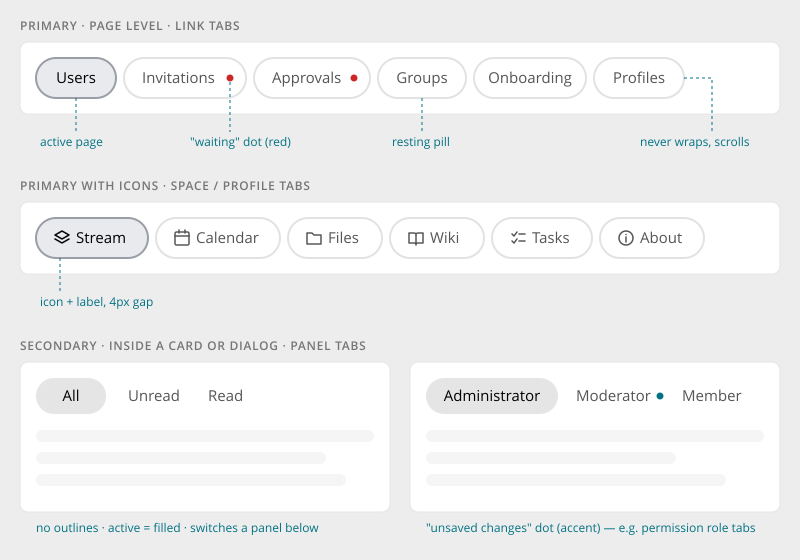
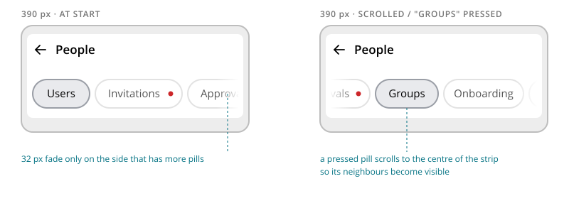

# Pill Tabs

> Found in the design: Admin › People (section tabs), space pages (tab strip), Notifications (All / Unread / Read), component demo page
> · Core: `humhub\widgets\menu\TabMenu` / `SubTabMenu` (become `PillTabs`), `humhub\widgets\bootstrap\Tabs`
> · Technology: **Both** (proposed). Link tabs come from PHP menus (`PillTabs`). Panel tabs are also
> needed inside Vue islands (e.g. Notifications All / Unread / Read).

A single horizontal strip of pill-shaped tabs. It switches between sibling pages or sibling views
of the same surface, for example:

- a space's Stream, Calendar, Files and Wiki
- the sub-pages of an admin section (Users, Invitations, Approvals, …)
- the sections of a dialog
- a list's All / Unread / Read

Pill Tabs replace every tab style in use today: Bootstrap `nav-tabs`, the `TabMenu` look and
`SettingsTabs`.

Don't use Pill Tabs for:

- **Different representations of the same data** (board/list, month/week): use the view switch.
- **A vertical section menu** (the admin's left menu): use the secondary navigation.



## Variants

| Variant | Where | Look |
|---|---|---|
| **Primary** | Directly on the page: space and profile tabs, admin section tabs. Usually sits in the page header card. | Outlined pills. The active pill is filled and has a darker outline. |
| **Secondary** | Inside a card, panel or dialog. This is the default inside dialogs. | No outlines. The active pill is filled; hover gives a light fill. |

Both variants share the same pill types, behaviour and markup. Only the styling differs.

## Pill types

| Type | Example | Notes |
|---|---|---|
| Text | Users, Groups | |
| Icon + text | Stream, Calendar, Files | Leading icon with a 4px gap. Use icons on all pills of a strip or on none. |
| With **waiting dot** (red) | Invitations •, Approvals • | Something on that page needs action. The **count** belongs to the menu entry that leads to the section (e.g. "People ⑦"). A tab only shows the dot. Screen readers get hidden text such as "3 waiting". |
| With **unsaved dot** (accent) | Moderator • | That tab has unsaved changes (permission role tabs). |
| Collapsible | Create Task › Schedule | A pill that appears or disappears with an animation when a related option is switched on or off. A collapsed pill is removed from the tab order. |

The two dot colours always mean the same thing: **red = waiting/unread, accent = unsaved**.

## Behaviour

- **Never wraps.** When the pills don't fit, the strip scrolls horizontally with a hidden scrollbar.
  A 32px fade marks each edge that has more pills behind it. The fade only appears on that edge,
  and is recalculated on scroll and on resize.
- **A pressed pill scrolls to the centre**, so its neighbours become visible. The scroll is smooth
  and stops at the ends of the strip. When nothing overflows, nothing moves.
- **Two kinds of tabs:**
  - **Link tabs** navigate to a URL. They are used for admin sub-pages and space/profile pages, and
    the active pill reflects the current route. In the administration the prototype swaps only the
    page card and keeps the strip in place. The old content is dimmed only if the response takes
    longer than 300ms.
  - **Panel tabs** switch content on the same page without a request. They are used in dialogs and
    for filters like All / Unread / Read. The panel fades in with a 4px rise, and the container
    height animates (about 140ms).
- **Pill size:** 40px high and fully rounded, with 16px horizontal padding. Pills keep their
  natural width and are never squeezed.

## Mobile



- No breakpoint of its own: on narrow screens the strip simply scrolls, with fades and the
  centring behaviour described above.
- When the page header is part of a folded master/detail layout (admin, messages), a **back arrow**
  appears before the title. The tabs stay below it.
- Pills never shrink to icon-only.

## Accessibility

- **Link tabs:** `<nav aria-label="…">` containing links. The active link has `aria-current="page"`.
- **Panel tabs:** a group of buttons with `aria-pressed`. Alternatively use the WAI-ARIA tabs
  pattern (`role="tablist"`/`tab`/`tabpanel` with arrow-key navigation); see Open questions.
- Dots carry visually hidden text such as "3 waiting" or "unsaved changes".
- Focus ring: visible on keyboard focus and never clipped by the scroller.
- Reduced motion: no panel fade, and the centring scroll is instant.

## Markup and styles

Pill Tabs are Bootstrap's **`.nav.nav-pills`**. The design's look is set through Bootstrap's
`$nav-pills-*` and `$nav-link-*` variables plus the outline of the primary variant. Class names
and SCSS follow [Styling with Bootstrap 5](bootstrap.md).

```html
<!-- link tabs, primary -->
<nav class="nav-scroller" aria-label="People">
    <ul class="nav nav-pills">
        <li class="nav-item"><a class="active nav-link" aria-current="page" href="…">Users</a></li>
        <li class="nav-item">
            <a class="nav-link" href="…">Approvals
                <span class="badge-dot badge-dot-waiting"><span class="visually-hidden">3 waiting</span></span>
            </a>
        </li>
    </ul>
</nav>

<!-- panel tabs, secondary -->
<div class="nav nav-pills nav-pills-secondary" role="group" aria-label="Show">
    <button class="nav-link active" type="button" aria-pressed="true">All</button>
    <button class="nav-link" type="button" aria-pressed="false">Unread</button>
</div>
```

| Class | Element |
|---|---|
| `.nav.nav-pills` | The strip; primary look (outlined pills) |
| `.nav-pills-secondary` | Modifier: secondary look (no outlines, light hover fill) |
| `.nav-link` | A pill; `.active` for the current one; a leading `.ti` icon is spaced by the pill |
| `.nav-scroller` | The `<nav>`: scrolls the strip horizontally instead of wrapping; later also the edge fades (`.has-start-fade`, `.has-end-fade`) |
| `.badge-dot` | The dot on a pill (see [Badges & Status](badges.md)): `-waiting` red, `-unsaved` accent |

- **File:** `_nav.scss` (pill variants on top of Bootstrap's nav), behind `$prev-nav`.
- **Sass variables:** Bootstrap's `$nav-pills-border-radius` (pill, in `variables.scss`),
  `$nav-link-padding-x/y` (height and padding stay Bootstrap's: 2.5rem); plus, in `_nav.scss`,
  `$nav-pills-gap`, `$nav-pills-font-weight` (`$font-weight-medium`), `$nav-pills-color`,
  `$nav-pills-hover-color`, `$nav-pills-hover-bg` (`--bs-tertiary-bg`), `$nav-pills-active-color`,
  `$nav-pills-active-bg` (`--bs-secondary-bg`), `$nav-pills-border-width`,
  `$nav-pills-border-color` (`--bs-border-color`), `$nav-pills-active-border-color` (the
  emphasis colour at 64 %), `$nav-pills-secondary-hover-bg` and `$nav-scroller-fade-width`.
- **Scope:** the outline and colours apply to the pill tabs (`.nav-scroller > .nav-pills`), not
  to every `.nav-pills` (the ⋮ of a stream entry is a legacy `.nav-pills.preferences`). The
  outline is an inset shadow, since the scrolling strip cuts off anything outside the pill;
  the focus ring is added to it.

## Implementation in core

**In core (1.20):** link tabs are `humhub\widgets\menu\PillTabs`. The 15 core tab menus extend it
(`admin\widgets\UserMenu`, `SpaceMenu`, `InformationMenu`, `SettingsMenu`, `AuthenticationMenu`,
`user\widgets\AccountSettingsMenu`, `space\modules\manage\widgets\DefaultMenu`, …), the former
`SubTabMenu`s with the secondary variant. The administration sections show their tabs in a
[Page Header](page-header.md).

**Open:**

| Today | Becomes |
|---|---|
| `humhub\widgets\bootstrap\Tabs`, `FormTabs`, `SettingsTabs` (Bootstrap `nav-tabs`) | Panel tabs (secondary by default) on `.nav-pills` |
| Counts as `Badge::danger()` concatenated into the label (`admin\widgets\UserMenu`, `AdminMenu`) | A dot indicator set on the menu entry. The number moves to the parent menu entry. |
| The strip scrolls, without edge fades and centring | The `humhub.ui.tabs` JS module below |
| Bootstrap's pill look (filled active pill, no outlines) | The primary variant's outlines, once the design is aligned globally (see [rule 3](bootstrap.md#3-values-come-from-sass-variables)) |

### Class structure

Link tabs follow the menu pattern of `humhub\widgets\menu`: the base class of a menu decides how
it is shown. Entries, sorting, visibility and the events modules use to add entries stay in
`Menu`. This matches how Yii 2 builds its own `Nav` and `Tabs` widgets: items and rendering in
one widget.

```
humhub\widgets\menu\Menu
 ├─ DropdownMenu
 ├─ LeftNavigation
 ├─ PillTabs                    ← variant primary | secondary
 │   └─ admin\widgets\UserMenu, SpaceMenu, InformationMenu, …
 └─ PageHeaderActions           ← see Page Header
```

- **`PillTabs`** (`extends Menu`): `$variant` (`VARIANT_PRIMARY` default, `VARIANT_SECONDARY`),
  `$renderSingleTab` (a strip with one tab is not rendered) and the dot of an entry: a
  `MenuLink` with a `count` above 0 (`'count' => $pendingApprovals`) shows the waiting dot
  (`.badge-dot.badge-dot-waiting`, "3 waiting" for screen readers) after its label. Users ›
  Pending approvals and a space's Members › Pending invites / approvals use it.
- **Panel tabs** are not a menu: they switch content on the page. They stay their own widget,
  `humhub\widgets\bootstrap\Tabs` (as Yii 2 keeps `Nav` and `Tabs` apart), with the same markup.

```php
// a link tab menu
class UserMenu extends PillTabs
{
    public function init()
    {
        $this->addEntry(new MenuLink([
            'label' => Yii::t('AdminModule.user', 'Approvals'),
            'url' => ['/admin/approval'],
            'indicator' => MenuLink::INDICATOR_WAITING,   // red dot
            'indicatorLabel' => Yii::t('AdminModule.base', '{n} waiting', ['n' => 3]),
        ]));

        parent::init();
    }
}

// in a page header (see Page Header)
echo PageHeader::title(…)->tabs(UserMenu::class);

// panel tabs
Tabs::widget([
    'variant' => Tabs::VARIANT_SECONDARY,
    'items' => [
        ['label' => 'All', 'icon' => 'inbox', 'content' => $all, 'active' => true],
        ['label' => 'Unread', 'icon' => 'bell', 'content' => $unread],
    ],
]);
```

- **Vue:** a `PillTabs.vue` with the same markup, once a Vue page needs tabs (link tabs as data
  from `Menu::getEntriesData()`, panel tabs through slots).
- **JS:** one small `humhub.ui.tabs` module for overflow fades, centring and panel switching,
  bound by delegation to `[data-ui-tabs]`, so tabs loaded later via pjax or into a modal need no
  init call.

### Migration

- **`humhub\widgets\menu\TabMenu` and `SubTabMenu`** are new in 1.20 and not released. They are
  replaced by `PillTabs` directly. No module uses them yet (module search: 0 hits).
- **The old names** `humhub\modules\ui\menu\widgets\TabMenu` and `SubTabMenu`, which modules
  still use and which stay available until 1.21, extend `PillTabs` (`SubTabMenu` with the
  secondary variant). Module tab menus get the new look without changes.
- **Events:** a handler on a concrete menu (`UserMenu::class`, `AdminTabMenu::class`) keeps
  working, since only the parent class changes. A handler on one of the old names is redirected
  to the class that replaced it (`ModuleManager`'s shim redirect), so one on the generic `TabMenu`
  now runs for every `PillTabs`. Module search: only `cuzy-app/survey-advanced` registers on it,
  and its handler checks for its own menu class first.
- **`module-migrate-1.20.md`** lists `TabMenu` / `SubTabMenu` → `PillTabs` with the moved `ui`
  classes, and the new markup.

## Open questions

1. **Panel tabs semantics:** keep toggle buttons (`aria-pressed`, as in the prototype) or adopt
   the full WAI-ARIA tabs pattern with arrow keys?
2. **Admin in-place navigation:** the prototype swaps only the page card. Do we do the same via
   pjax, or keep full page loads?
3. **Space tabs:** in the prototype the space's tabs switch client-side and keep the state in the
   URL hash. In core every tab stays its own route. Confirm.
