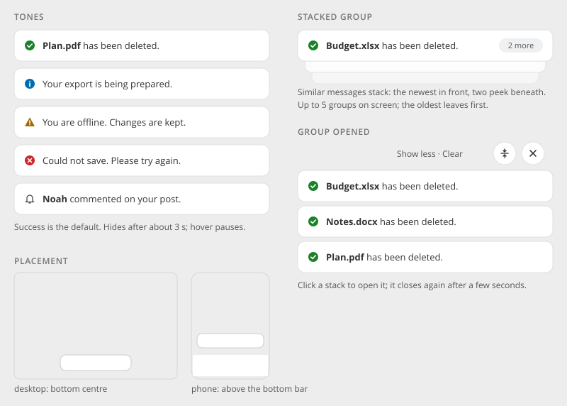

# Toast

> Found in the design: after actions everywhere (deleted, saved, uploaded, copied), the component
> demo page (all tones, grouped messages)
> · Core: `StatusBar.vue` (since 1.20, mounted by `humhub\widgets\StatusBar` on every page),
> fed by `humhub.ui.status` (`module.success()`, `warn()`, `error()`, `info()`)
> · Technology: **Vue** (exists). PHP and legacy JS reach it through the existing status API.

A short message about the **result of an action** ("Plan.pdf has been deleted."). It appears for
a moment and disappears by itself, and it never needs an answer.

Don't use a toast for:

- **Errors at a field:** see [Form Fields](form-fields.md).
- **Decisions:** use a [Dialog](dialog.md).
- **Lasting state:** use a notice in the page.



## Tones

| Tone | Use | Example |
|---|---|---|
| **Success** (default) | An action worked | "Plan.pdf has been deleted." |
| **Info** | Neutral information about something running | "Your export is being prepared." |
| **Warning** | Something needs attention, but nothing failed | "You are offline. Changes are kept." |
| **Danger** | An action failed | "Could not save. Please try again." |
| **Notification** | Something happened that concerns the user | "Noah commented on your post." |

**Text:** one sentence, saying what happened. The object is emphasised ("**Plan.pdf** has been
deleted."). There are no buttons inside the toast.

## Behaviour

- **Auto-hide:** after about 3 seconds (longer for longer texts). Hovering or keyboard focus
  pauses the timer.
- **Grouping:** similar messages (same source and tone, e.g. several deleted files) **stack**. The
  newest is in front with "2 more", and up to two peek beneath. At most 5 groups are on screen, and
  the oldest leaves first.
- **Open a group:** a click on the stack shows all its messages, with **Show less** and **Clear**.
  An open group closes again after a few seconds without interaction.
- **Dismiss:** auto-hide, Escape, or Clear on an open group.
- **Errors with details:** technical details (e.g. a server trace for admins) can be expanded in
  the toast, as today.

## Placement

| Where | Position |
|---|---|
| Desktop | Bottom centre |
| Phone | Above the bottom bar |
| On-screen keyboard open | Above the keyboard |

## Accessibility

- Toasts are announced in a live region: `polite` for success, info and notification;
  `assertive` for danger.
- Pausing on focus gives keyboard users time to read.
- Information that matters later must not only be in a toast (e.g. a failed save also marks the
  form).
- Reduced motion: no slide or stack animation.

## Markup and styles

A toast is Bootstrap's **`.toast`** in a **`.toast-container`**. Grouping will be added on top.
Class names and SCSS follow [Styling with Bootstrap 5](bootstrap.md).

```html
<div class="toast-container position-fixed bottom-0 start-50 translate-middle-x is-visible">
    <div class="toast show toast-success" role="status" aria-live="polite" aria-atomic="true">
        <div class="toast-body">
            <i class="toast-icon ti ti-circle-check" aria-hidden="true"></i>
            <span class="toast-message">Plan.pdf has been deleted.</span>
            <button type="button" class="btn-close toast-close" aria-label="Close"></button>
        </div>
    </div>
</div>
```

| Class | Element |
|---|---|
| `.toast-container.position-fixed` | Bottom centre (Bootstrap's position utilities), clear of the safe area on mobile devices; full width on phones; `.is-visible` while the toast is shown |
| `.toast` + `.toast-<tone>` | A toast: `info`, `success`, `warning`, `danger`; the tone colours border, outline and icon. Danger has `role="alert"`, the rest `role="status"` |
| `.toast-body` | Icon (`.toast-icon`), text (`.toast-message`), details toggle (`.toast-details-toggle`, a `.btn-ghost.btn-icon-only.btn-sm`), close (`.btn-close.toast-close`) |
| `.toast-details` | Technical details (an error trace) below the body |
| `.toast-group` | Planned: a stack of toasts of one source and tone, with "N more" (`.btn.btn-link`) |

- **Files:** `_toast.scss`, behind `$prev-toast`; Bootstrap's `$toast-*` values in
  `variables.scss`.
- **Sass variables:** Bootstrap's `$toast-max-width` (320px), `$toast-padding-x/y`,
  `$toast-font-size`, `$toast-color`, `$toast-background-color` (translucent),
  `$toast-border-color`, `$toast-border-radius`, `$toast-box-shadow`; plus `$toast-tones` (tone →
  colour), `$toast-icon-size`, `$toast-details-max-height`, `$toast-transition-duration`.

## Implementation in core

**Today:** `StatusBar.vue` renders the toast above and shows **one message at a time** with the
auto-close timings of the old jQuery bar, plus the details toggle for error traces. All callers
(`humhub.ui.status`, `module.success()`, and PHP messages via the `view-status` flash of
`humhub\components\View`) reach it through the bridge queue.

**Gaps:**

| Gap | Proposal |
|---|---|
| One message at a time | Queue and **group** messages (by source and tone), with stacks, "N more", and opening a group |
| No "notification" tone | Add it for live notifications that are shown as a toast |
| Position on phones | Above the bottom bar and the keyboard |
| Auto-hide timer | Pause on hover and keyboard focus |

The public API stays the same: `module.success('…')` keeps working and simply benefits from
grouping.

## Open questions

1. **Action in a toast:** the design has none. Do we want "Undo" for some actions (delete, archive)
   later?
2. **Live notifications as toasts:** show new notifications as toasts, or only as the bell's dot?
