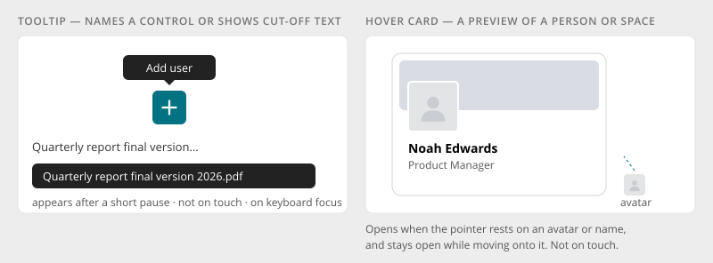

# Tooltip

> Found in the design: every icon button, truncated names (files, tables), counters, chips that
> filter ("Filter by Marketing")
> · Core: Bootstrap 5 tooltips via `humhub.ui.additions` (`.tt`, `data-bs-toggle="tooltip"`,
> `Button::tooltip()`)
> · Technology: **Both** (one shared tooltip for PHP and Vue markup)

A short text label that appears next to a control. It has two jobs:

- **Name a control** that shows only an icon ("Add user", "More actions").
- **Show text that was cut off** ("Quarterly report final version 2026.pdf").

A tooltip never holds information or actions that exist nowhere else. For a richer preview of a
person or space, use the [Hover Card](hover-card.md).

## Behaviour

- **Mouse:** appears after a short pause (about 250ms). Moving to the next control shortly after
  shows its tooltip at once, so scanning a toolbar is quick.
- **Keyboard:** appears on focus, but only when focus came from the keyboard (Tab), not after a
  click.
- **Touch:** no tooltips. A tap triggers the control.
- **Closes** on leaving, on a click, on Escape and on scrolling.
- **Placement:** above the control by default, otherwise where there is room, and always inside
  the window.
- **Cut-off text:** only shows when the text is actually truncated.
- **Text:** a few words, without a full stop. For icon buttons, the same text as the button's
  accessible name.

## Accessibility

- An icon button's tooltip is its accessible name (`aria-label`) and not an extra description.
  Where the tooltip differs from the name, it is linked with `aria-describedby`.
- Escape hides the tooltip without moving focus.
- Tooltips are never the only way to get information (they don't exist on touch).
- Reduced motion: no fade or slide.

## Markup and styles

Bootstrap's **`.tooltip`** and Tooltip JS. The shared behaviour (delay, quick follow-up, keyboard
focus only, no touch) is Bootstrap's options plus a small delegated binding, not a tooltip of its
own. Class names and SCSS follow [Styling with Bootstrap 5](bootstrap.md).

- **Markup:** `data-bs-toggle="tooltip"` with `data-bs-title` (or `title`), as today. Icon
  buttons get it from `Button::iconOnly()` and `IconButton.vue`.
- **Options:** `delay: { show: 500, hide: 0 }` (`$tooltip-delay` as a CSS variable read by the
  JS), `trigger: 'hover focus'` with a `:focus-visible` check, no tooltip on touch.
- **Truncated text:** `data-tooltip="overflow"` creates the tooltip only while the text is cut
  off.
- **File:** `_tooltip.scss`, behind `$prev-tooltip`.
- **Sass variables:** Bootstrap's `$tooltip-font-size` (already set), `$tooltip-max-width`,
  `$tooltip-bg`, `$tooltip-color`, `$tooltip-padding-x/y`, `$tooltip-border-radius`,
  `$tooltip-opacity`.

## Implementation in core

**Today:** Bootstrap 5 tooltips, initialised by `humhub.ui.additions` on `.tt` and
`[data-bs-toggle="tooltip"]` elements. `Button::tooltip()` sets them. Vue components often use the
native `title` attribute instead (e.g. `PageToolbar` actions).

**Gaps:**

| Gap | Proposal |
|---|---|
| Delay, quick follow-up, keyboard-only focus, no touch | One shared tooltip, bound by delegation, that reads `data-tooltip` (or the existing Bootstrap attributes) from PHP and Vue markup alike |
| Vue uses native `title` | Switch to the shared tooltip, so icon buttons look the same everywhere |
| Truncated text | `data-tooltip="overflow"`: show only when the text is cut off |

## Open questions

1. **Keep Bootstrap tooltips** and restyle them, or replace them with one small shared
   implementation? Bootstrap has no quick follow-up and no keyboard-only focus.
