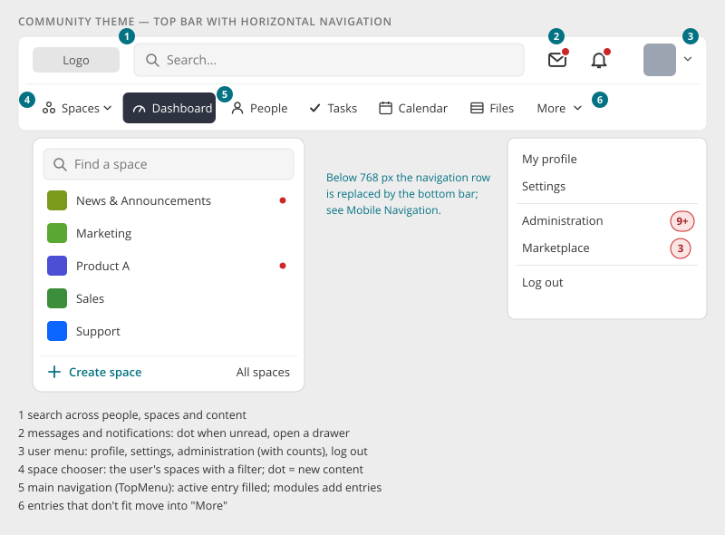

# Top Bar

> Found in the design: every page. The prototype is built on the Enterprise theme, so it shows the
> sidebar variant; the Community theme keeps the horizontal navigation shown here.
> · Core: `humhub\widgets\TopMenu`, `space\widgets\Chooser` (`SpaceChooser.vue`),
> `MetaSearchWidget`, `NotificationArea` (`NotificationMenu.vue`), `TopMenuRightStack`,
> `user\widgets\AccountTopMenu`; layout `protected/humhub/views/layouts/main.php`
> · Technology: **Both** (proposed). PHP renders the bar; the drawers and the space chooser are
> Vue islands.

The frame at the top of every page in the **Community theme**. It holds:

- the **global and personal** parts: search, messages, notifications and the user menu
- the **main navigation**: the space chooser and the main menu

On phones the navigation row is replaced by the [Mobile Navigation](mobile-navigation.md). With
the **Enterprise theme**, the navigation and the spaces move into a left [Sidebar](sidebar.md) instead.

## Anatomy

| # | Part | Notes |
|---|---|---|
| — | **Logo** | Links to the dashboard |
| 1 | **Search** | Takes the free width. Searches people, spaces and content. Escape clears. |
| 2 | **Messages and notifications** | Icon buttons with a **red dot** while something is unread. The count is in the accessible name ("Notifications, 3 unread"). Each opens a **drawer**. |
| 3 | **User menu** | Picture and caret. It opens My profile, Settings, Administration and Marketplace (with count badges), and Log out. |
| 4 | **Space chooser** | A dropdown with the user's spaces: filter field, space rows (image, name, dot for new content), "Create space" and "All spaces" |
| 5 | **Main navigation** | The `TopMenu` entries (Dashboard, People, plus module entries such as Tasks, Calendar, Files). The active entry is filled dark. |
| 6 | **More** | Entries that don't fit the width move into a "More" menu, in their order |

## Behaviour

- **Drawers** (messages, notifications) open below their button:
  - newest first, with unread items highlighted
  - "Mark all as read" only while something is unread
  - "Show all" leads to the full page
  - width about 400px, with the list scrolling inside
- **Live updates:** new messages or notifications update the dot and, while open, the drawer list.
  The dot pulses once on arrival. Reduced motion: no pulse.
- **Space chooser:**
  - it loads the user's spaces on first open
  - the filter searches all visible spaces as you type, and the user's own come first
  - a dot marks spaces with new content
  - it follows the [Context Menu](context-menu.md) placement rules
- **Overflow:** the main navigation never wraps. Entries move into "More" from the end.
- **Counts on menu entries** follow [Badges & Status](badges.md): "Administration 9+" sums up what
  waits there.
- Each drawer button keeps a link to its full page (`/notifications`, `/messages`) as a fallback.

## Mobile

| Width | Top bar |
|---|---|
| > 768px | Both rows as shown |
| ≤ 768px | One row: logo icon, search, messages, notifications, user picture. The navigation row and the space chooser move into the [Mobile Navigation](mobile-navigation.md) (bottom bar plus menu sheet with all entries and spaces). |

Drawers take the screen width minus a small margin.

## Accessibility

- The bar is a `<header>`. The navigation row is a `<nav aria-label="Main">` with
  `aria-current="page"` on the active entry.
- Search is a `role="search"` form with a label.
- Drawer buttons have `aria-expanded` and `aria-controls`, and the unread count in their name.
  Drawers have focus handling, and Escape closes them.
- The space chooser and the user menu follow the [Context Menu](context-menu.md) rules. The space
  filter is a labelled search field.

## Implementation in core

**Today** (Community theme, `views/layouts/main.php`), two bars:

- **First bar** (`#topbar-first`): logo, `NotificationArea` (messages, notifications) in the
  centre, `AccountTopMenu` on the right.
- **Second bar** (`#topbar-second`): `space\widgets\Chooser` (with `SpaceChooser.vue` since
  1.20), `TopMenu`, and on the right `TopMenuRightStack` with the search.

`NotificationMenu.vue` already owns bell, badge and dropdown, with live updates.

**Changes (proposal, derived from the design, which shows the Enterprise variant):**

| Change | Note |
|---|---|
| Search moves to the first row and takes the free width | Today it sits at the right end of the navigation row |
| Messages and notifications move next to the user menu | Today they are centred in the first bar |
| Unread number → dot | `NotificationMenu.vue` shows a dot. The number moves into the accessible name and the drawer header. |
| One drawer style | Notifications and messages share the drawer look ("Mark all as read", "Show all") |
| Navigation row | `TopMenu` entries with icons, the active entry filled, overflow into "More". The `TopMenu` API and events stay. |
| Space chooser | `SpaceChooser.vue` in the new dropdown look (filter, dots, "Create space", "All spaces") |
| Counts in the user menu | `AccountTopMenu` entries get the `badge` of [Badges & Status](badges.md) |

## Open questions

1. **Two rows or one:** keep two rows (tools above, navigation below, as proposed), or merge into
   one row on wide screens?
2. **Number or dot:** the design shows only a dot for notifications. Keep the number in the bar?
3. **Search:** the existing search (results page), or suggestions while typing?
